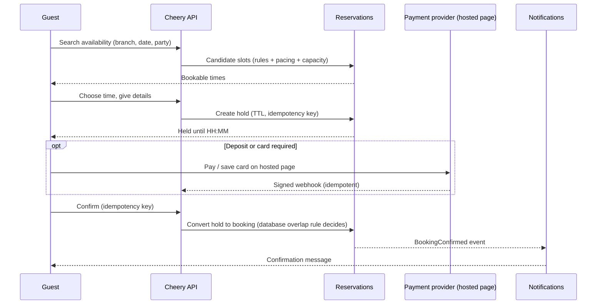
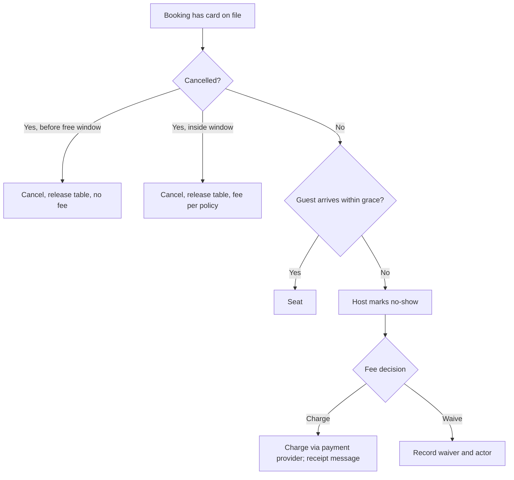
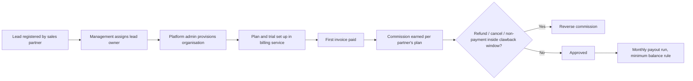

# Document 1 — Product and Requirements Architecture

Product: **Cheery** — multi-tenant restaurant-management SaaS.
Baseline: Stage A analysis, `decision-log.md` (D-01 … D-28), `stage-c-architecture-options.md` (approved).
Status: **Draft for review.** Release 1 scope is *reservations-first* (R-01, D-24).

Tags used: **[C]** confirmed by the product owner · **[R]** recommended, needs approval · **[A]** assumption · **[Q]** open question · **[F]** future consideration.

---

## 1. Product overview

**[C]** Cheery is a commercial SaaS product for restaurants: independent venues, multi-branch groups and multi-brand groups, in Australia first, then India and other countries. It is the company's own intellectual property, not a one-customer solution.

**[C]** Long-term vision: a one-stop restaurant platform. Near term, it integrates with existing POS systems (Square first); later, it adds its own POS and further modules (D-01).

**[C]** Customers are acquired by Cheery's own salespeople, who earn a configurable commission (default 30%) (D-06, D-12 to D-16).

**[C]** Release 1 (first release, first customer the signed Sydney group using Square) concentrates on reservations (D-21, D-22, D-24). There is no hard deadline (D-23).

### 1.1 Product goals (Release 1)
1. **[R]** Let a guest book a table online without ever being offered a time the restaurant cannot honour.
2. **[R]** Give hosts one trustworthy view of bookings, tables and walk-ins, with no double-booking possible.
3. **[R]** Reduce no-shows and manual work (reminders, deposits or card holds, waitlist messages).
4. **[R]** Give managers control of tables, hours, rules and messages per branch, with sensible inheritance from the brand/organisation.
5. **[R]** Give Cheery a sellable, billable, supportable SaaS: tenants, plans, entitlements, onboarding, commission tracking.

### 1.2 Non-goals (Release 1)
Ordering, kitchen display, QR ordering, waiter operations, native POS, loyalty, inventory, staff scheduling, delivery-platform integration, consumer marketplace, native mobile apps, offline operation (D-10, R-06). Each has a defined seam so it can be added without redesign.

---

## 2. Functional inventory (from the prototype, classified)

The prototype is context, not specification (D-02). Every prototype capability is classified:

- **Core-R1** — in Release 1.
- **Config-R1** — in Release 1 as a setting of the reservation product.
- **Later** — planned module, not Release 1.
- **Rethink** — prototype shows a need but the prototype approach should not be followed.
- **Drop/Defer** — customer-specific or unvalidated.

| # | Prototype capability | Class | Module | Note |
|---|---|---|---|---|
| 1 | Restaurant/branch discovery list within an organisation | Core-R1 | Reservations / Org & Venues | Scoped to one organisation's venues; **no cross-tenant discovery** (R-06) |
| 2 | Online booking: party size, date, time slot, area preference | Core-R1 | Reservations | Server-side availability |
| 3 | Seats-left per slot / full slots hidden | Config-R1 | Reservations | Display of remaining capacity is a setting; may reveal capacity — make configurable |
| 4 | Guest details: allergies, children, high chair, seating request, occasion | Core-R1 | Guest / Reservations | Structured, not free text; sensitive-data handling |
| 5 | Deposit for large groups | Config-R1 | Reservations + Payments (hosted) | Via provider-hosted page; refund rules needed |
| 6 | Card held for no-show/late-cancel fee | Config-R1 | Reservations + Payments | Saved-card (setup) not long auth holds (research) |
| 7 | Cancellation, free window, late-cancel fee | Core-R1 | Reservations | Fee policy configurable per brand/branch |
| 8 | Change time ("modify") | Rethink | Reservations | **Must be atomic** (secure new slot before releasing old) |
| 9 | Booking confirmation, reminders (24 h / 2 h), reply-to-cancel | Core-R1 | Notifications | Consent, opt-out and sender-registration rules apply |
| 10 | Multilingual templates per brand | Core-R1 | Notifications | Template + language + country rules |
| 11 | Host seating grid (timeline by table) | Core-R1 | Reservations / Floor | Primary host tool |
| 12 | Host floor view with table states | Core-R1 | Floor & Resources | |
| 13 | Host list view | Core-R1 | Reservations | |
| 14 | Phone booking and walk-in entry | Core-R1 | Reservations | |
| 15 | Move table / extend / seat / no-show / cancel | Core-R1 | Reservations | All subject to server-side conflict rules |
| 16 | Table reset status | Config-R1 | Floor & Resources | |
| 17 | Overrun and late alerts | Core-R1 | Reservations | Based on stored timestamps, not wall-clock derivation |
| 18 | Pacing (guests per 15 min) with logged override | Config-R1 | Reservations | Per branch/service |
| 19 | Waitlist with quote and "table ready" text | Core-R1 | Reservations | Hold expiry must actually be enforced |
| 20 | Guest history for hosts, lookup by name/phone | Core-R1 | Guest | Tenant-scoped; merge/dedupe rules |
| 21 | Group enquiry → offer → booking | Config-R1 | Reservations | Guest-facing accept link needed (prototype lacked it) |
| 22 | Tables, areas, counter seats, joinable combinations | Core-R1 | Floor & Resources | Areas become entities; adjacency |
| 23 | Service periods, closures | Core-R1 | Floor & Resources / Config | Must actually drive availability |
| 24 | Booking rules (durations, buffer, grace, max online) | Core-R1 | Configuration | Inheritance org → brand → branch |
| 25 | Feature switches | Config-R1 | Configuration | Separate from plan entitlements |
| 26 | Messages tab (templates, preview) | Core-R1 | Notifications | |
| 27 | Activity log | Core-R1 | Audit | Structured, actor identity |
| 28 | Staff list, roles, permission matrix | Core-R1 | Identity & Access | Must be **enforced** (prototype never did) |
| 29 | Brands & branches admin, add branch, country/currency/timezone | Core-R1 | Org & Venues, Localization | Country profile is data |
| 30 | Basic operational KPIs (covers, no-shows, utilisation) | Core-R1 | Reporting | Computed, not seeded numbers |
| 31 | Integrations tab | Core-R1 | Integration Hub | Square read-only, messaging, billing, hosted payments |
| 32 | Menu editor, prices, availability | Later | Menu & Catalog | Per brand price / per branch availability |
| 33 | Waiter order entry, bill, payment | Later | Ordering / Payments | |
| 34 | Kitchen display | Later | Kitchen Display | |
| 35 | Guest QR ordering, pay at table, call waiter | Later | QR / Ordering | |
| 36 | JA² Club loyalty, points | Drop/Defer | Loyalty (later) | Customer-specific; revisit as optional module |
| 37 | Weekend 10% surcharge | Drop/Defer | Config / Ordering later | Becomes a tax/charge rule when ordering exists |
| 38 | nopCommerce widget | Config-R1 | Integration Hub | Generic embeddable booking widget; nopCommerce is one embedding target |
| 39 | Reserve with Google | Later | Integration Hub | Not confirmed by research; verify before committing |
| 40 | Offline tablet | Later | Client sync | Out of Release 1 (D-10) |
| 41 | Delivery platforms, catering | Later | Integration Hub | |

**[Q]** Items 3 and 39 need owner confirmation (capacity display policy; Google reservation integration priority).

---

## 3. Platform capabilities not in the prototype (required for a SaaS)

| # | Capability | Class | Notes |
|---|---|---|---|
| P1 | Organisation/tenant provisioning and deprovisioning | Core-R1 | Assisted onboarding via admin and API (R-05) |
| P2 | Authentication with MFA for staff and admins | Core-R1 | Managed identity provider (ADR-03 open) |
| P3 | Memberships and scoped roles (org, brand, branch) | Core-R1 | |
| P4 | Plans, trial, entitlements, per-branch counting | Core-R1 | Entitlement service separate from permissions |
| P5 | Third-party billing integration, invoices, payment failure handling | Core-R1 | Billing vendor via a port (D-08) |
| P6 | Sales partners, lead ownership, commission plans, ledger, clawback, payout runs | Core-R1 (minimal) | D-06, D-12 to D-17 |
| P7 | Country packs (currency, tax, locale, address/phone, holidays, notifications, provider mapping) | Core-R1 mechanism | Australia pack in R1; India/UK paper-tested (D-20) |
| P8 | Data subject requests: export, correction, deletion | Core-R1 | Legal advice required for rules by country |
| P9 | Consent and preference records | Core-R1 | Marketing opt-in per brand |
| P10 | Audit trail, platform admin console, support access with audit | Core-R1 | |
| P11 | Public API and webhooks (outbound events) | Core-R1 (basic) | Needed for widget and integrations |
| P12 | Observability, backups, restore testing | Core-R1 | Operational |
| P13 | Data export for customers on exit | Core-R1 | Contractual expectation |
| P14 | Tenant branding on guest pages (logo, colours, domain) | Config-R1 | |

---

## 4. Users, personas and roles

### 4.1 Tenant-side personas
| Persona | Needs | Key actions | Scope |
|---|---|---|---|
| Guest | Book, change, cancel quickly; be reminded | Search availability, book, pay deposit, cancel, join waitlist | Public, per venue |
| Host | Run the floor during service | Seat, move, extend, walk-in, waitlist, reset | One branch (sometimes several) |
| Branch manager | Configure the venue, watch performance | Tables, hours, rules, messages, reports | One or more branches |
| Brand manager | Consistency across branches | Brand defaults, templates | One brand |
| Organisation owner/admin | Control the account | Staff, branches, subscription, integrations | Whole organisation |
| Waiter, kitchen (later) | Run service | — | Later releases |

### 4.2 Cheery-side personas
| Persona | Needs | Scope |
|---|---|---|
| Platform admin | Provision tenants, manage plans, support | Platform |
| Support agent | Diagnose issues without seeing more data than necessary | Time-boxed, audited tenant access |
| Sales partner | Register leads, see own commission and status | Own leads and statements only; **never guest data** |
| Management (commission/lead owner) | Assign lead ownership, approve commission and payouts | Platform finance |
| Finance | Payout runs and reconciliation | Platform finance |

**[R]** Roles are bundles of permissions granted through a membership at a scope; custom roles are an enterprise-tier feature. Role/permission catalogue is defined in Document 3.

---

## 5. Key business workflows

### 5.1 Online booking with slot hold

**[R]** If confirmation fails because the table was taken, the guest is offered the nearest alternatives; the hold is never silently lost.

### 5.2 Host service flow
Booked → (arrival) Seated → Finished → table "needs reset" → Ready. Walk-in: Seated directly; or joins waitlist, notified when a table fits, then seated. Exceptions: late (grace elapsed → prompt), no-show (seat released; fee decision), cancel, move, extend (blocked on conflict with reason), overrun alert.

### 5.3 Late cancellation / no-show fee

**[Q]** Refund/retention rules for deposits on cancellation (not defined in the prototype) must be decided per brand policy and country consumer law.

### 5.4 Group enquiry
Guest submits enquiry (above the online limit) → manager offers space/time/deposit → guest accepts via a link and pays deposit → booking created with conflict check → expiry of unaccepted offers.

### 5.5 Customer onboarding and commission

---

## 6. Functional requirements (Release 1)

Requirement IDs are stable and will be referenced by tests and Document 10. Priority: **M** must (Release 1), **S** should, **C** could. All are **[R]** until reviewed, except where tagged.

### 6.1 Identity and access (IAM)
- IAM-01 **M** Staff sign in through the identity provider; MFA available and mandatory for admin roles.
- IAM-02 **M** A person can hold memberships in more than one branch, brand or organisation, each with a role.
- IAM-03 **M** Every API call authorises against membership scope; permissions are enforced server-side.
- IAM-04 **M** Staff invitation, role change, suspension and removal, all audited.
- IAM-05 **S** Shared-tablet quick switch (PIN) only on registered devices, bound to an authenticated device session. **[Q]** whether PIN shared-device sign-in is wanted.

### 6.2 Organisation and venues
- ORG-01 **M** Create/suspend/close an organisation, brands and branches, each with address, country, time zone and status.
- ORG-02 **M** A one-restaurant customer works without extra setup concepts.
- ORG-03 **M** Branch lifecycle: setting up → live → closed; billing reflects branch count.
- ORG-04 **S** Deprovisioning: export, then retention period, then deletion per policy.

### 6.3 Configuration and localisation
- CFG-01 **M** Settings resolve through inheritance (platform/country → organisation → brand → branch); overrides explicit and visible.
- CFG-02 **M** Country pack supplies currency, locale, tax mode, address/phone formats, holidays, notification rules.
- CFG-03 **M** No country-specific constants in application code.
- CFG-04 **S** Setting changes are versioned and audited.

### 6.4 Floor and resources
- FLR-01 **M** Areas, tables and counter seats are managed entities with capacity.
- FLR-02 **M** Joinable combinations (including adjacency) are configurable.
- FLR-03 **M** Service periods and closures drive availability.
- FLR-04 **M** Table states: free, booked, seated, needs reset, resetting.
- FLR-05 **M** Removing a table with future bookings is blocked or forces reassignment.

### 6.5 Reservations (incl. waitlist, enquiries)
- RES-01 **M** Availability reflects service periods, closures, rules, pacing and existing bookings.
- RES-02 **M** No two active bookings can overlap on the same resource including turn buffer; enforced in the database.
- RES-03 **M** Slot hold with expiry; confirmation is idempotent.
- RES-04 **M** Default dwell times by party size and seat type, adjustable per booking.
- RES-05 **M** Booking changes (time, party, table) are atomic: the new allocation is secured before the old one is released.
- RES-06 **M** Cancel, no-show, seat, finish, extend, move with reasons and history.
- RES-07 **M** Pacing limits with logged host override.
- RES-08 **M** Waitlist with quote, notification, hold-time expiry and seat action.
- RES-09 **S** Group enquiry flow with guest-facing acceptance and offer expiry.
- RES-10 **M** Deposits and card-on-file per policy through provider-hosted pages; no card data stored or processed by Cheery.
- RES-11 **M** Walk-ins, phone bookings and online bookings share one allocation engine.
- RES-12 **S** Large-party and special-requirement handling (accessibility, high chair) stored as structured tags.

### 6.6 Guest
- GST-01 **M** Guest records per tenant, keyed by verified contact details with merge/dedupe rules.
- GST-02 **M** Allergy, dietary, children and preference notes with restricted visibility.
- GST-03 **M** Consent records (marketing opt-in per brand, per channel) with timestamp and source.
- GST-04 **M** Access/export, correction and deletion requests handled per tenant policy.
- GST-05 **S** Guest history across brands inside one organisation, if the organisation enables it.
- GST-06 **S** No-show history flag visible to hosts per policy.

### 6.7 Notifications
- NTF-01 **M** Transactional messages: confirmation, reminder(s), cancellation, waitlist ready, deposit/fee receipts.
- NTF-02 **M** Templates per brand and language with variables and fallbacks; preview.
- NTF-03 **M** Delivery log, retries, provider failover or clear failure state.
- NTF-04 **M** Opt-out and consent rules honoured per country; sender registration per country.
- NTF-05 **S** Inbound replies (e.g. cancel) handled idempotently.

### 6.8 Subscription and entitlements
- SUB-01 **M** Plans with monthly and annual terms, trial, per-branch quantity, module add-ons.
- SUB-02 **M** Entitlement service answers "may this organisation use feature X / branch count N" consistently across modules, enforced server-side.
- SUB-03 **M** Billing-service sync: subscription events update entitlements; failed payment leads to a defined grace → restricted → suspended state.
- SUB-04 **S** Upgrade/downgrade and branch add/remove with proration handled by the billing service.
- SUB-05 **M** Customer-visible billing history (link or embedded).

### 6.9 Partner and commission
- PRT-01 **M** Partner (salesperson) records; contractor status; payout details held securely.
- PRT-02 **M** Lead registration and manual ownership assignment by authorised management; conflicting claims go to a queue; every decision audited.
- PRT-03 **M** Commission plan per partner: rate (default 30%), revenue basis (subscription, add-ons, setup fees), tax/discount treatment, duration, effective dates; plan versions never rewrite past earnings.
- PRT-04 **M** Commission accrues from paid-invoice events; reversal on refund, chargeback or cancellation within the clawback window (default 90 days, configurable).
- PRT-05 **M** Append-only ledger showing earned, approved, paid, reversed and outstanding balances.
- PRT-06 **M** Monthly payout runs with minimum balance and approval step; export for payment.
- PRT-07 **S** Partner portal: own leads, customers' commercial status, statements. No access to guest or operational data.
- PRT-08 **Q** Tax treatment of contractor payouts per country requires accountant/legal input.

### 6.10 Integration hub
- INT-01 **M** Ports (interfaces) and adapters for billing, messaging, payments, POS, identity; replaceable without core changes.
- INT-02 **M** Square adapter, read-only: sales/spend to guest history, check linkage.
- INT-03 **M** Outbound webhooks with signing, retries, dead-letter; inbound webhooks verified and idempotent.
- INT-04 **M** Per-tenant integration credentials stored securely; rotation and revocation.
- INT-05 **S** Embeddable booking widget and a hosted booking page per brand/branch.
- INT-06 **M** Reconciliation jobs for payments and messages.

### 6.11 Audit and reporting
- AUD-01 **M** Immutable, structured audit events: who, what, when, where, before/after.
- AUD-02 **M** Per-branch and per-booking activity views with permission scoping.
- REP-01 **M** Operational reports: covers, bookings by source/status, no-show and cancellation rates, table utilisation, turn times, lead time.
- REP-02 **S** Organisation-wide roll-up across branches where the viewer's scope allows.
- REP-03 **S** Export (CSV) and scheduled email of key reports.

---

## 7. Non-functional requirements (proposals; final numbers in Document 9)

All **[R]** unless noted. They are targets to confirm, not measured facts.

| Area | Proposal |
|---|---|
| Availability | 99.9% monthly for guest booking and host tools (≈ 43 min/month error budget); maintenance windows outside dining peaks |
| Latency | Availability search p95 < 500 ms; booking confirm p95 < 800 ms; host actions p95 < 300 ms (server side) |
| Correctness | Zero double-bookings by construction (database constraint); zero cross-tenant reads (isolation tests are a release gate) |
| Scale (Year 1) | 10 organisations, ~100 branches [C]; design sized and load-tested for 10× that; growth scenarios in Document 9 |
| Peak load | Dining-hour peaks (evening, weekends); target planned in Document 9 using stated assumptions |
| Recovery | Proposal RPO ≤ 5 minutes (point-in-time recovery), RTO ≤ 4 hours; restores tested on a schedule |
| Security | Controls mapped to OWASP ASVS and ISO/IEC 27001 Annex A themes from day one; certification not required at launch [C, D-18]; legal compliance tracked separately |
| Privacy | Data classification, consent records, retention rules, data residency (AU stack first) |
| Accessibility | WCAG 2.2 AA target for guest pages and staff apps **[Q: confirm standard]** |
| Browser/device | Current evergreen browsers; tablet for hosts; mobile web for guests |
| Localisation | Locale-aware dates, numbers, currency, time zones; UI strings externalised from day one even though Release 1 UI is English **[Q]** |
| Observability | Tracing, metrics, structured logs, alerting on SLOs |
| Maintainability | Module boundaries enforced by automated checks; coverage and review gates (Document 8) |
| Data portability | Customer export in open formats |

---

## 8. Assumptions

1. **[A]** Release 1 sells to groups and single venues in Australia; English UI only at launch (messaging templates multilingual).
2. **[A]** Guest-facing booking runs on each tenant's own domain/page or embedded widget.
3. **[A]** Deposits and fees are processed on the restaurant's own merchant account via a provider-hosted page.
4. **[A]** The signed Sydney group has no contractual requirements beyond reservations in Release 1 (D-24); their contract terms have not been reviewed by me.
5. **[A]** 50% target margin is lifetime-averaged contribution margin per branch (D-26).
6. **[A]** Research figures marked `[S]` or UNVERIFIED are provisional.

## 9. Open questions

| # | Question | Why it matters | Default if unanswered |
|---|---|---|---|
| Q1 | Contract terms with the Sydney group: service levels, penalties, data location, exit terms | NFRs and legal obligations | Assume no special terms |
| Q2 | Do staff really need shared-tablet PIN sign-in? | Authentication design, device security | Not in Release 1; individual sign-in |
| Q3 | Should guests see "seats left" per slot? | Capacity disclosure, UX | Off by default, setting per branch |
| Q4 | Deposit refund and cancellation-fee rules by brand and country | Consumer-law and payment design | Per-brand policy settings; legal review before launch |
| Q5 | Is Reserve with Google a launch requirement? | Integration scope | Later |
| Q6 | Accessibility standard (WCAG 2.2 AA?) | Cost and test scope | WCAG 2.2 AA |
| Q7 | Other POS vendors used by target customers | Adapter roadmap | Square only |
| Q8 | Billing service and identity provider choices | Vendor-specific design | Decide in ADRs 03 and 04 |
| Q9 | Billing-fee percentage and cost per branch | Pricing | Estimate in Document 9 |
| Q10 | Are salespeople ever paid by recurring commission after the first term? | Ledger design | Configurable per partner (covered) |

## 10. Traceability

Each requirement ID above will be linked in Document 4 (tables), Document 5 (API), Document 6 (controls) and Document 10 (phase), and to acceptance tests. A requirement without a test is not done.

---

## 11. Additions from the architecture review (2026-11-08)

New requirements found by `11-architecture-review.md`. All **[R]**; priorities are proposals.

| ID | Pri | Requirement | Review ref |
|---|---|---|---|
| MRC-01 | M | **Merchant onboarding:** each restaurant connects its own payment-provider account (platform-account model) with KYC status visible; deposits/fees stay disabled until the account is approved | E-S1, E-M2 |
| IMP-01 | M | **Data import:** import existing guests, future bookings, tables/areas and settings from CSV/other systems with validation, dry-run, duplicate detection and an audit trail | E-M1 |
| EML-01 | M | **Sender authentication:** guide each tenant through email domain authentication (SPF/DKIM/DMARC) or use a verified shared sending identity; show status | E-M3 |
| LGL-01 | M | **Venue legal content:** per brand/country, versioned booking terms, cancellation/deposit policy text and privacy notice, with the guest's acceptance recorded against the version | E-M5 |
| SUP-01 | S | **Support tooling:** support-access grants, tenant diagnostics, tenant-visible audit view of support actions | E-M6 |
| SUB-06 | M | **Message metering and allowances:** count messages per branch/month, include an allowance per plan, bill overage via the billing service | E-M4 |
| ANL-01 | S | **Booking-page analytics and cookie consent** where required by country | E-M7 |
| STS-01 | S | **Customer status communications** (planned maintenance, incident notices) in-app and via status page | E-M8 |
| EXP-01 | M | **Tenant export package:** defined formats, size limits and delivery for exit/data-return | E-M10 |
| MSG-01 | M | **Two-way messaging:** inbound replies (e.g. cancel) routed to the correct tenant; number strategy decided (shared vs per-tenant) | Twilio findings, Doc 9 §12 |
