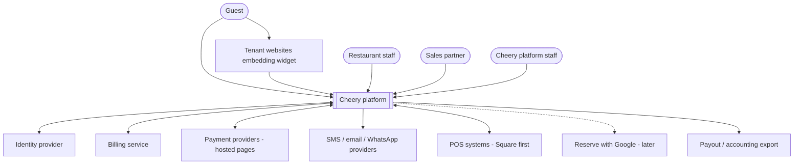
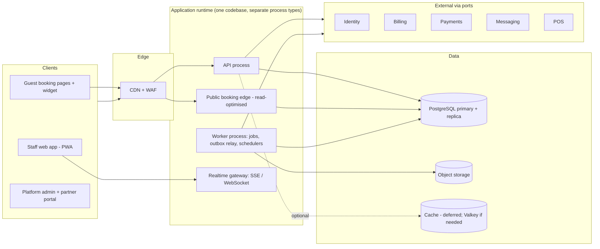
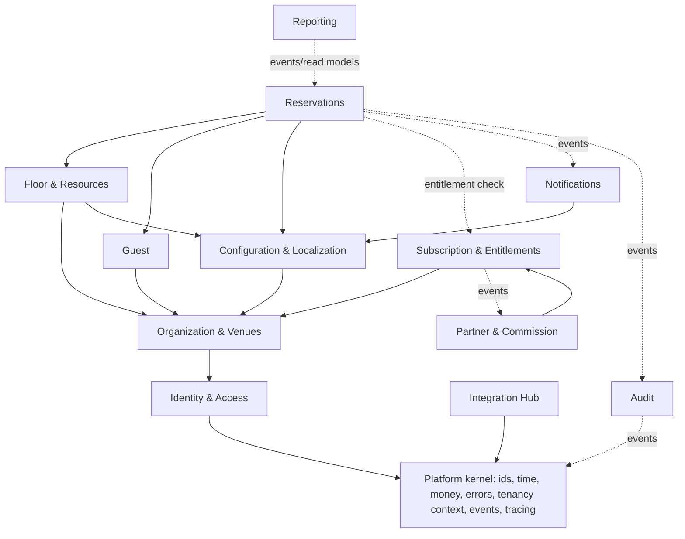
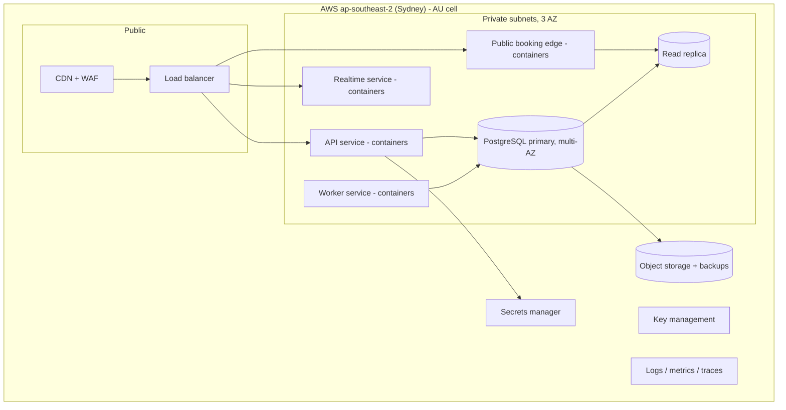

# Document 2 — Solution Architecture

Baseline: `stage-c-architecture-options.md` (approved, D-27), Document 1 (requirement IDs), `decision-log.md`, research files.
Tags: **[C]** confirmed · **[R]** recommended, needs approval · **[A]** assumption · **[F]** future.
Status: **Draft for review.** ADR-01, ADR-02 and ADR-10 are approved; all other ADRs are proposed.

---

## 1. Architecture principles

1. **Correctness before cleverness.** Double-booking and cross-tenant reads are prevented by the database, not only by code. **[R]**
2. **Tenant identity comes from authentication, never from the client.** **[R]**
3. **Modules own their data and expose narrow interfaces.** No module reads another's tables. **[R]**
4. **Ports and adapters at every external boundary.** Billing, payments, messaging, POS, identity are replaceable. **[C: D-01, D-22]**
5. **Configuration is data, not code.** Country, tax, locale, rules and templates are configured, never hard-coded. **[C: D-04]**
6. **Three separate questions:** *may this person* (permission), *did the customer buy it* (entitlement), *is it switched on and how does it behave* (setting). **[R]**
7. **Boring technology, few moving parts.** Add infrastructure only for a measured need. **[R]**
8. **Backward-compatible change.** Deployments and migrations never break running customers. **[R]**
9. **Evidence over assertion.** Security, isolation and concurrency claims are backed by automated tests that gate release. **[R]**
10. **Design the seam, don't build the room.** Future modules get interfaces now, implementations later. **[C: D-02, D-10]**

## 2. Architecture style

Modular monolith, internally event-driven through a transactional outbox, deployed as several process types from one codebase (**ADR-01, ADR-02 approved**; style approved in D-27).

Trade-off accepted: one release train and one database to protect, in exchange for simple transactions, low operating cost and the freedom to move boundaries while the domain is still being learned. A module is extracted into its own service only if it has a measured scaling, security-isolation or team-ownership reason, and the module interface is already the contract.

## 3. System context



## 4. Container view



Process types:
- **API:** authenticated REST for staff, admin, partner and tenant integrations.
- **Public booking edge:** unauthenticated guest availability and booking endpoints, with strict rate limits, bot protection and read-optimised queries. Separate process type so abuse cannot starve staff traffic. **[R]**
- **Worker:** background jobs, outbox relay, schedulers (reminders, hold expiry, waitlist expiry, payout runs), webhook delivery and retries.
- **Realtime gateway:** pushes live host/floor updates; stateless, authenticated, tenant-scoped channels.

## 5. Module boundaries

### 5.1 Structure of every module
```
modules/<name>/
  domain/          entities, value objects, domain services, domain events (no framework imports)
  application/     use cases / command & query handlers, transaction boundaries
  infrastructure/  repositories, adapters (database, external providers)
  api/             controllers/DTOs for HTTP (thin)
  public/          the ONLY surface other modules may import: service interfaces, event types
  tests/
```
Rules **[R]**:
- Business rules live in `domain` and `application`, never in controllers or SQL triggers (database constraints encode invariants, not workflows).
- Another module may import only `public/`.
- Each module owns a database schema and its migrations.
- Cross-module reads use the other module's public query interface or a local read model fed by events.
- Cross-module writes use the public command interface within one transaction only when both are in the same bounded workflow; otherwise use events with idempotent consumers.

### 5.2 Module contracts (Release 1)

Entities, ownership and events are the starting contract; Document 4 turns them into tables.

| Module | Business responsibility | Core entities (owns) | Application services | Events published | Events consumed | Permission examples | Config | Entitlement key | Integrations |
|---|---|---|---|---|---|---|---|---|---|
| **Identity & Access** | Authenticate via provider; authorise by membership and scope | Person, Membership, Role, Permission grant, Device session | Invite, assign role, evaluate access | `MembershipChanged`, `UserSuspended` | `OrganizationClosed` | `staff.manage` | Session length, MFA policy | `core` | Identity provider |
| **Organization & Venues** | Tenant lifecycle and hierarchy | Organization, Brand, Branch, Address, Status | Provision, add branch, suspend, close, export | `OrganizationProvisioned`, `BranchAdded`, `BranchStatusChanged`, `OrganizationClosed` | `SubscriptionStateChanged` | `branch.manage` | Country, time zone, branding | `core` | — |
| **Subscription & Entitlements** | Plans, trial, entitlements, billing sync | Plan, Subscription, Entitlement grant, Billing account ref | Check entitlement, apply plan, handle billing events | `EntitlementsChanged`, `SubscriptionStateChanged`, `InvoicePaid` | `BranchAdded`, billing webhooks | `billing.view` | Grace periods | `core` | Billing service |
| **Partner & Commission** | Salespeople, lead ownership, commission, payouts | Partner, Lead, Commission plan (versioned), Ledger entry, Payout run | Assign lead, accrue, reverse, approve, export payout | `CommissionAccrued`, `CommissionReversed`, `PayoutApproved` | `InvoicePaid`, `InvoiceRefunded`, `SubscriptionCancelled`, `OrganizationProvisioned` | `commission.approve` | Rate, basis, duration, clawback window | platform-only | Payout export |
| **Configuration & Localization** | Scoped settings, effective-setting resolver, country packs | Setting definition, Setting value (scoped, versioned), Country pack, Tax rule, Locale data | Resolve setting, validate, publish change | `SettingChanged` | `BranchAdded` | `settings.manage` | (is the config system) | `core` | — |
| **Guest** | Guest identity, preferences, consent | Guest, Contact, Preference/Allergy note, Consent record, Merge record | Find/create, merge, record consent, export/delete | `GuestCreated`, `ConsentChanged`, `GuestDeleted` | `BookingCompleted`, `NoShowRecorded`, POS spend events | `guest.view`, `guest.notes.view` | Retention rules | `reservations` | POS (read) |
| **Floor & Resources** | Physical capacity and service time | Area, Resource (table/counter seat), Combination, Service period, Closure, Resource state | Define layout, set hours/closures, change state | `LayoutChanged`, `ClosureAdded`, `ResourceStateChanged` | `BranchAdded` | `layout.manage` | Defaults for capacity, turn buffer | `reservations` | — |
| **Reservations** | Availability, holds, bookings, waitlist, enquiries, policies | Hold, Booking, Allocation (resource × time range), Waitlist entry, Enquiry/Offer, Policy decision | Search availability, hold, confirm, modify, cancel, seat, finish, no-show, waitlist, offer | `BookingHeld`, `BookingConfirmed`, `BookingChanged`, `BookingCancelled`, `GuestSeated`, `BookingCompleted`, `NoShowRecorded`, `WaitlistNotified` | `SettingChanged`, `LayoutChanged`, `ClosureAdded`, payment webhooks | `booking.create`, `booking.cancel`, `booking.override_pacing` | Durations, buffer, grace, pacing, max online party, deposit, fee, windows | `reservations` (+ add-ons: `waitlist`, `deposits`, `enquiries`) | Payments (hosted), Notifications |
| **Notifications** | Messages across channels | Template, Template version, Message, Delivery attempt, Opt-out | Render, schedule, send, record delivery, handle inbound | `MessageDelivered`, `MessageFailed` | Booking events, `WaitlistNotified`, receipts | `templates.manage` | Quiet hours, sender IDs, language fallback | `reservations` (volume by plan) | SMS, email, WhatsApp |
| **Integration Hub** | Ports, adapters, credentials, webhooks, reconciliation | Connection, Credential reference, Sync cursor, Webhook endpoint/delivery, Reconciliation run | Connect, rotate, sync, deliver, reconcile | `IntegrationFailed`, outbound webhook events | Domain events (for webhooks) | `integrations.manage` | Per-connection settings | `integrations` (per integration) | All external |
| **Audit** | Immutable activity record | Audit event | Record, query | — | All domain events | `audit.view` | Retention | `core` | — |
| **Reporting (read side)** | Operational reports | Read models, report definitions | Query, export, schedule | — | Booking, floor, guest events | `reports.view` | Time ranges | `reports` | BI export later |

### 5.3 Allowed dependencies


Solid arrows = synchronous calls through `public/` interfaces. Dotted = events or entitlement check. **No arrow may close a cycle.** Reservations never imports Notifications; it publishes events.

**Platform kernel** (shared): ids, UTC/time-zone helpers, money type, error model, tenancy context, event base types, tracing. It contains **no business rules** and must stay small; anything with a business meaning belongs to a module (rule against a "common" dumping ground).

### 5.4 Architecture fitness checks (automated, run on every change) **[R]**
1. Module boundary check: imports only from other modules' `public/` (dependency-boundary tool, e.g. Nx module boundaries / dependency-cruiser; tool chosen in Document 8).
2. No import cycles between modules.
3. `domain/` imports no framework, database or HTTP libraries.
4. Every tenant-owned table has `tenant_id`, an RLS policy and an isolation test (schema lint over migrations).
5. No raw SQL string building from request input; parameterised access only.
6. Every outbound call goes through a port; no direct provider SDK use in modules.
7. No country, currency or tax constants outside country-pack data (pattern lint).
8. Time-handling lint: no `Date.now()`/local time in domain code; time comes from an injected clock.
9. Migration lint: destructive changes (drop/rename) rejected outside a declared expand-contract plan.
10. Public API diff against OpenAPI: breaking changes fail the build.

## 6. Cross-cutting design

### 6.1 Tenant context
Authenticated request → token carries person and membership claims → server resolves the organization and permitted scopes → tenant context set for the transaction (`set_config(..., true)`) → RLS applies. Background jobs carry the tenant in their payload and restore context before running. A request without a resolved tenant touches no tenant data. Detail in Document 3.

### 6.2 Consistency and concurrency
- Overlap prevention: exclusion constraint over (resource, time range) for active allocations, including turn buffer; the application proposes allocations, the database decides.
- Every state-changing endpoint accepts an idempotency key; repeated calls return the original result.
- Optimistic concurrency (version column) on bookings and settings to avoid lost updates.
- Hold expiry is a worker-driven transition, not an in-memory timer.

### 6.3 Events
Transactional outbox: a state change and its event row commit together; a relay publishes to in-process subscribers and the job queue; consumers are idempotent and record processed event ids. Events are versioned and documented (Document 5). External webhooks are derived from the same events.

### 6.4 Time, money, identity of things
- Instants stored in UTC; branch time zone stored; "service day" is explicit so late-night bookings belong to the right day.
- Money: integer minor units + ISO currency; tax lines stored at time of calculation.
- Ids: opaque, non-sequential, globally unique; never expose internal keys that reveal tenant counts. (Format chosen in Document 4.)

### 6.5 Configuration resolution
Setting definitions declare scope levels, type, default and validation. Values are stored per scope; an effective-settings resolver walks branch → brand → organization → country → platform default, caches per branch, and invalidates on `SettingChanged`. The admin UI shows the source of each effective value.

### 6.6 Error model and API conventions
Common problem-details error format with stable error codes; pagination, filtering and sorting conventions; contract-first OpenAPI; versioning policy. Detail in Document 5.

### 6.7 Observability
Trace id propagated through API → job → outbox event → provider call; structured logs without personal data by default; metrics tied to SLOs (availability search latency, booking success, message delivery, job lag, hold expiry lag).

## 7. Deployment architecture



- **[R]** Managed container service (ECS Fargate), no Kubernetes initially; managed PostgreSQL with point-in-time recovery; encryption at rest with managed keys; secrets in a secrets manager; private subnets for data and compute.
- **[R]** Environments: development (local), integration/CI, staging (production-shaped, synthetic data only), production. No production data outside production.
- **[R]** Cell model: the AU cell is the first deployment; the directory maps each organization to a cell so a dedicated database or a second region (e.g. India) is a new cell running the same code, not a fork. No active-active multi-region.
- **[R]** Infrastructure as code (OpenTofu), reviewed and applied from CI; no manual console changes in production.
- Deployment details, CI/CD, backups and DR are in Document 7.

## 8. Technology decisions summary

| Concern | Decision | Status |
|---|---|---|
| Language/framework | TypeScript on Node LTS, NestJS; exact versions pinned in Document 8 | **Approved (ADR-01)** |
| Database | PostgreSQL 18 | Recommended |
| Tenancy | Shared DB + RLS, cell-ready | **Approved (ADR-02)** |
| Hierarchy | Organization = tenant | **Approved (ADR-10)** |
| Identity | Managed provider; WorkOS vs Cognito to be decided by a spike | Open (ADR-03) |
| Billing | Third-party behind port; vendor open | Open (ADR-04) |
| Guest payments | Provider-hosted pages, per-country adapter | Open (ADR-05) |
| Messaging | Provider RFQ; AU sender ID, India DLT | Open (ADR-06) |
| Hosting | AWS Sydney, ECS Fargate, OpenTofu | Recommended (ADR-07) |
| WAF/edge | Cloudflare vs AWS WAF | Open (ADR-08) |
| Offline | Out of Release 1 | Deferred (ADR-09) |

## 9. Architecture decision records

Each ADR: context, options, decision, consequences. Full text is kept in `docs/architecture/adr/` as short individual files in Stage F; the table below is the index and the reasoning that matters for review.

| ADR | Title | Status | Reasoning (short) | Main consequence / revisit trigger |
|---|---|---|---|---|
| 01 | TypeScript/NestJS backend | **Approved** (D-28) | One language across API, web, widget and future offline client; strong ecosystem; type contracts shared with front end | Revisit if team skills favour .NET; runner-up .NET 10 LTS |
| 02 | Shared DB + RLS, cell-ready hybrid tenancy | **Approved** (D-27) | Lowest cost, strong isolation if enforced in DB, path to dedicated databases/regions | RLS adds test and pooling discipline; revisit on first enterprise dedicated-DB request |
| 10 | Organization = tenant; no separate group level | **Approved** (D-27) | One contract, one data wall | Revisit if a customer needs multiple legal entities with separate billing: handle as multiple billing accounts under one organization |
| 03 | Identity provider | Open | Buy not build; WorkOS vs Cognito pending spike (Auth0 expensive at B2B scale) | Spike criteria: org/membership model, MFA, SSO later, data residency, price at 100 and 1,000 branches |
| 04 | Billing service | Open | Must support AUD/INR/GBP, per-branch quantity, tax invoices, dunning; India recurring-payment constraints | Possibly two providers by country |
| 05 | Guest payments | Open | Hosted pages keep card data out of Cheery; Stripe not generally available to Indian businesses | Per-country adapter set |
| 06 | Messaging providers | Open | Sender registration is live in AU and India | RFQ |
| 07 | Hosting | Recommended | AWS Sydney for data residency; Fargate avoids cluster operations | Revisit at >~50 services or special workloads |
| 08 | WAF/edge | Open | Cloudflare vs AWS WAF | Decide with Document 7 |
| 09 | Offline | Deferred | Speculative today (D-10) | Readiness: client ids, idempotency keys, change events |
| 11 | Modular monolith with enforced boundaries | Recommended (approved as style D-27; ADR formalises) | See §2 | Extract only on measured need |
| 12 | Transactional outbox + idempotent consumers | Recommended | Reliable events without a broker | Consider broker at higher volume |
| 13 | DB-enforced overlap prevention | Recommended | Concurrency safety independent of app bugs | Constraint must exclude partitioning by time |
| 14 | Settings as scoped data with resolver | Recommended | Supports inheritance and country packs | Cache invalidation correctness is tested |
| 15 | Public booking edge as separate process | Recommended | Isolate abuse-prone traffic | Same codebase, separate scaling |
| 16 | Monorepo, single codebase | Recommended | Atomic changes, shared types, one pipeline | Tooling chosen in Document 8 |

## 10. Risks specific to this architecture

1. **Boundary erosion** in a monolith. Mitigation: fitness checks (§5.4) failing the build.
2. **RLS misconfiguration / pooling leaks.** Mitigation: non-owner role, transaction-scoped context, isolation tests as release gate, pooler behaviour tested (RDS Proxy pinning).
3. **Shared-database blast radius.** Mitigation: per-tenant rate limits, query timeouts, cell migration path, tested restores.
4. **Premature generality in country packs.** Mitigation: build the mechanism with Australia only, paper-test India and the UK.
5. **Vendor uncertainty in India (payments, billing, messaging).** Mitigation: ports, and no commitment of India dates until ADRs 04–06 are decided.
6. **Event-consumer drift** (duplicate or lost events). Mitigation: idempotency, dead-letter queues, reconciliation jobs.

## 11. What Document 3 and 4 will add

- Document 3: tenant provisioning and deprovisioning, role and permission catalogue, membership model, inheritance rules in detail, isolation test catalogue, dedicated-cell migration procedure.
- Document 4: tables, constraints (including the overlap constraint), indexes, RLS policies, migration strategy, retention and archival.
