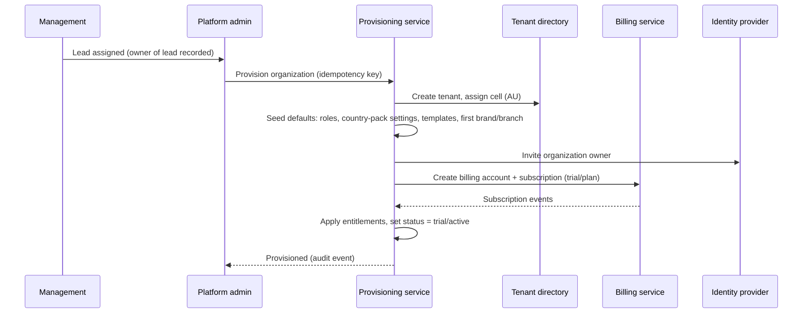

# Document 3 — Multi-Tenant Architecture

Baseline: Document 2, `stage-c-architecture-options.md`, `decision-log.md` (D-01 … D-28), research files.
Approved: hybrid tenancy (shared database + row-level security, cell-ready) and Organization = tenant (D-27).
Tags: **[C]** confirmed · **[R]** recommended, needs approval · **[A]** assumption · **[F]** future · **[Q]** open.
SQL below is **illustrative design**, not final migrations (those are Document 4).

---

## 1. Tenant hierarchy

```
Platform (Cheery)
 ├─ Platform realm: staff, support, finance, management, sales partners   (no tenant data)
 └─ Organization  = TENANT (one contract, one subscription, one data wall)
      ├─ Brand 0..n
      │    └─ Branch 1..n   (one country, one time zone)
      │         └─ Area → Resource (table / counter seat) → Combination
      └─ Memberships (people with a role at a scope)
```

- **[C/R]** A single-restaurant customer is an organization with one brand and one branch; there is no separate "simple mode".
- **[R]** A brand may have branches in several countries; a branch belongs to exactly one brand and country.
- **[R]** Guest records belong to the **organization**; an organization may choose to share guest history across its brands (setting), never across organizations. Marketplace sharing would require a separate consumer identity and per-guest consent (R-06).
- **[R]** The platform realm and the tenant realm are separate data areas. Sales partners and finance staff authenticate in the platform realm and can query only commercial tables.

### 1.1 Tenant directory
A small platform-level directory maps each organization to its cell:

| Field | Purpose |
|---|---|
| `tenant_id` | Globally unique, opaque id |
| `slug`, custom domains | Routing for guest pages and widgets |
| `cell_id` | Which database/region serves this tenant |
| `status` | Lifecycle state (§7) |
| `data_region` | Residency commitment |
| `plan_ref` | Link to billing account (reference only) |

Every request is routed using the directory; the AU cell is the only cell at launch.

---

## 2. Isolation model

### 2.1 Principle
Isolation is enforced in **layers**, and no layer trusts the one above it. **[R]**

1. Identity establishes who the person is and which organization context they selected.
2. The server resolves permitted scopes from membership; the client never supplies a tenant id that is trusted.
3. The data layer applies the tenant boundary itself (row-level security).
4. Every asynchronous path carries the tenant explicitly and re-establishes context.

### 2.2 Request flow

```mermaid
sequenceDiagram
  participant C as Client
  participant GW as API process
  participant IAM as Access module
  participant DB as PostgreSQL (RLS)
  C->>GW: Request + access token
  GW->>GW: Verify token (signature, expiry, audience)
  GW->>IAM: Resolve person, active organization, memberships
  IAM-->>GW: Tenant id + permitted scopes (cached, short TTL)
  GW->>GW: Authorise: permission AND scope AND entitlement
  GW->>DB: BEGIN; set_config('app.tenant_id', tenant, true)
  GW->>DB: Query/command (RLS applies)
  DB-->>GW: Only that tenant's rows
  GW->>DB: COMMIT (context discarded)
```

A request that cannot resolve a tenant gets no tenant data: the policy compares `tenant_id` to a missing setting and matches nothing.

### 2.3 Database layer (illustrative)

```sql
-- every tenant-owned table
ALTER TABLE reservations.booking ENABLE ROW LEVEL SECURITY;
ALTER TABLE reservations.booking FORCE  ROW LEVEL SECURITY;

CREATE POLICY tenant_isolation ON reservations.booking
  USING      (tenant_id = NULLIF(current_setting('app.tenant_id', true), '')::uuid)
  WITH CHECK (tenant_id = NULLIF(current_setting('app.tenant_id', true), '')::uuid);
```

Rules **[R]**:
- The application connects as a **non-owner role without BYPASSRLS**; migrations run as a different owner role. Superuser credentials are never used by the application.
- The tenant setting is applied **per transaction** (`set_config(..., true)`), so a pooled connection cannot carry a previous tenant's context. PgBouncer in transaction mode supports this; **RDS Proxy behaviour with `SET` must be tested before it is used** (research item).
- **Composite foreign keys** include `tenant_id` (e.g. `FOREIGN KEY (tenant_id, guest_id) REFERENCES guest(tenant_id, id)`), so a row can never point at another tenant's row even by mistake.
- Every tenant-owned table has `tenant_id NOT NULL`, an RLS policy, an index that leads or includes `tenant_id`, and an isolation test. A migration lint fails the build otherwise (fitness check 4).
- Cross-tenant platform queries (finance, support) use a separate audited role and a separate code path; they are never a flag on the normal path.
- Branch-level restriction is enforced in the application authorization layer and in query scoping. For highly sensitive tables (e.g. guest allergy notes) a second database setting (`app.branch_ids`) can add RLS defence in depth **[R, optional per table]**; the cost is more policy complexity.

### 2.4 Isolation by layer

| Layer | Control | Verification |
|---|---|---|
| Browser / client | Never trusted for tenant id; no tenant id accepted in bodies for authorisation | API tests with tampered ids |
| API / authorisation | Permission ∧ scope ∧ entitlement on every endpoint; deny by default | Authorisation matrix tests |
| Database | RLS + composite FKs + non-bypass role | Isolation suite incl. "no context ⇒ no rows" |
| Background jobs | Tenant in payload; context restored before work; per-tenant concurrency caps | Job tests with mixed-tenant queues |
| Outbox / events | Tenant on every event; consumers re-establish context | Event replay tests |
| Cache (if used) | Key prefix includes tenant; no global caches of tenant data | Key-format lint + tests |
| Files / object storage | Path prefix per tenant; access via short-lived signed URLs issued after authorisation | Direct URL guessing test |
| Search / reporting | Same RLS-protected tables or read models carrying `tenant_id`; no unscoped views | View lint + tests |
| Integrations / webhooks | Credentials per tenant; outbound payloads built under tenant context; inbound verified and mapped to a tenant before processing | Webhook mismatch tests |
| Logs / traces / metrics | Tenant id as a field; no personal data by default; support tooling filters by tenant | Log review checks |
| Backups / restore | Backups cover all tenants; **single-tenant restore procedure** documented and rehearsed (restore to a scratch database, extract tenant, verify) | DR exercise |
| Admin and support tools | Time-boxed, reasoned, audited access (§4.4) | Access-log review |

### 2.5 Noisy-neighbour controls **[R]**
Per-tenant API rate limits; statement timeouts; per-tenant job concurrency caps and fair scheduling; payload size limits; per-tenant quotas (messages, exports); public booking edge limits by IP and by tenant. Any tenant exceeding limits degrades alone.

---

## 3. Identity, membership and roles

### 3.1 Model
- **Person** — a global identity (login) held by the identity provider; Cheery stores a profile reference, not credentials.
- **Membership** — links a person to an organization with a **role** at a **scope**: whole organization, one or more brands, or a list of branches.
- A person may have memberships in several organizations (e.g. a consultant) and must **select an active organization**; switching issues a new context.
- Memberships are managed inside Cheery (not only in the identity provider) so scope and role changes are audited, instant and queryable.
- Tokens carry person and active organization; **scopes are resolved server-side** (cached briefly) so a 100-branch role does not bloat the token and revocation is immediate. **[R]**

### 3.2 Roles (Release 1 system roles) **[R]**

| Role | Typical scope | Summary |
|---|---|---|
| Organization owner | Organization | Everything incl. billing contact, integrations, staff, deletion request |
| Organization admin | Organization | As owner except ownership transfer and closure |
| Brand manager | Brand(s) | Brand defaults, templates, branch oversight |
| Branch manager | Branch(es) | Layout, hours, rules, bookings, reports, branch staff |
| Host | Branch(es) | Bookings, seating, waitlist, floor state, limited guest data |
| Read-only / analyst | Any | Reports and read access |
| *Waiter, Kitchen* | Branch(es) | **Later** (ordering/KDS modules) |

Custom roles (building a role from permissions) are an **enterprise-tier feature [F]**. Roles are bundles of permissions; permission checks use permission keys, never role names.

### 3.3 Permission catalogue (Release 1 starter set)

| Area | Permission keys |
|---|---|
| Organization | `org.view`, `org.manage`, `brand.manage`, `branch.manage` |
| Staff | `staff.view`, `staff.manage`, `roles.manage` |
| Settings | `settings.view`, `settings.manage`, `templates.manage` |
| Layout & hours | `layout.view`, `layout.manage`, `hours.manage` |
| Bookings | `booking.view`, `booking.create`, `booking.modify`, `booking.cancel`, `booking.seat`, `booking.noshow`, `booking.override_pacing`, `booking.waive_fee` |
| Waitlist & enquiries | `waitlist.manage`, `enquiry.manage` |
| Guests | `guest.view`, `guest.manage`, `guest.notes.view`, `guest.export`, `guest.delete` |
| Money | `payments.view`, `payments.charge_fee`, `payments.refund` |
| Reports & audit | `reports.view`, `reports.export`, `audit.view` |
| Integrations & billing | `integrations.manage`, `billing.view`, `billing.manage` |

Platform realm permissions (separate catalogue): `tenant.provision`, `tenant.suspend`, `plan.manage`, `lead.assign`, `commission.approve`, `payout.run`, `support.access_request`, `partner.view_own`.

### 3.4 Authorisation evaluation
An action is allowed only if **all** pass **[R]**:
1. **Permission:** the person's role grants the key.
2. **Scope:** the target resource's branch/brand/organization is within the membership scope.
3. **Entitlement:** the organization's plan includes the feature (and quantity limits such as branch count).
4. **Resource state / conditions:** e.g. cannot modify a finished booking; fee charge requires a recorded no-show; override pacing is logged with reason.

Denials return a consistent error without revealing whether the resource exists in another tenant. Sensitive reads (guest notes, exports) are written to the audit log.

### 3.5 Platform realm and support access
- Platform staff and **sales partners never receive tenant data access by default.** Partners see only their own leads, customers' commercial status and statements.
- **Support access** to a tenant uses a request → time-boxed grant (e.g. up to a few hours **[A]**) with a stated reason and ticket reference; actions are audited and visible to the tenant's owner. Impersonation is read-only unless explicitly escalated. Whether customers must pre-approve support access is **[Q]** for contract/legal review.
- Platform credentials use mandatory MFA and are separate from tenant identities.

---

## 4. Configuration inheritance

### 4.1 Levels
`Platform default → Country → Organization → Brand → Branch` (an optional service-period level may be added where rules vary by lunch/dinner).

### 4.2 Setting definition
Each setting is declared once in code/data with: key, type, validation, allowed scopes, platform default, whether it is **lockable**, whether it is **sensitive**, which entitlement it depends on, and a description for the UI.

### 4.3 Resolution
```
effective(key, branch):
   start with platform default
   apply country value (branch.country) if any
   apply organization value if any
   apply brand value if any
   apply branch value if any
   -- "locked" rule: if a higher level marks its value as locked, lower overrides are ignored
```
The UI shows the **source** of every effective value ("inherited from Brand: Dashi") and who changed it and when.

### 4.4 Example

| Setting | Platform | Country AU | Organization | Brand Dashi | Branch CBD | Effective at CBD |
|---|---|---|---|---|---|---|
| Free cancellation window (hours) | 24 | — | 24 | — | — | 24 |
| Dwell time 3–4 guests (min) | 90 | — | 90 | — | **105** | 105 (branch override) |
| Max online party size | 8 | — | 8 | 8 | — | 8 |
| No-show fee per guest | — | — | 25 *(locked)* | — | 15 | **25** (organization locked) |

### 4.5 Rules **[R]**
- Overrides are explicit rows; deleting an override returns to inheritance.
- Setting writes are validated, versioned and audited; changes publish `SettingChanged` so caches invalidate.
- Settings are **not** entitlements. A locked/hidden setting due to plan is shown as "not in your plan", driven by the entitlement service.
- Country-pack values (currency, tax mode, locale defaults, phone/address formats) are loaded as country-level defaults and are not editable by tenants, except where the pack allows.

---

## 5. Entitlements vs. permissions vs. settings

| Question | Owned by | Example |
|---|---|---|
| May this person do it? | Identity & Access | Host cannot change tax settings |
| Did the customer buy it? | Subscription & Entitlements | Waitlist is an add-on |
| Is it switched on, and how? | Configuration | Waitlist hold time is 10 minutes |

Modules ask one question per concern through the entitlement and configuration interfaces; none of them calls the billing service directly. Entitlement states drive behaviour as in §6.2. Feature flags are for release rollout and emergency disable only; they are not plans. **[R]**

---

## 6. Provisioning, lifecycle and deprovisioning

### 6.1 Provisioning (assisted onboarding, R-05)


- Provisioning is an **API** with an idempotency key, so self-serve sign-up can reuse it later **[R]**.
- It is a resumable workflow: each step is recorded, so a failure leaves a visible, retryable state, not a half-created tenant.

### 6.2 Tenant lifecycle states **[R]** (behaviour to be confirmed against the customer contract)

| State | Meaning | Staff app | Guest booking | Billing link |
|---|---|---|---|---|
| Provisioning | Being created | No | No | — |
| Trial | Free period | Full | Full | Trial end date |
| Active | Paying | Full | Full | Paid |
| Past due | Payment failed; grace period | Full + banner | Full | Dunning |
| Restricted | Grace ended | Read/limited; no new branches/add-ons | Existing rules honoured **[Q]** | Overdue |
| Suspended | Non-payment or breach | Read-only + export | Disabled with a clear guest message | — |
| Closing | Cancellation requested | Read-only + export | Disabled | Final invoice |
| Closed | Retention window running | None (owner export only) | None | — |
| Deleted | Data erased | — | — | — |

Suspending guest booking affects the restaurant's diners, so the restricted/suspended behaviour is a **business and contract decision [Q]**, not only a technical one.

### 6.3 Deprovisioning **[R]**
1. Owner (or platform on contract end) requests closure; confirmation step; audit event.
2. **Export** made available (bookings, guests, settings, audit extracts) in open formats.
3. **Retention window** (default proposal 30 days **[A]**, contractually configurable) during which the tenant is closed but recoverable.
4. **Deletion job:** removes tenant rows in dependency order, deletes files and integration credentials, revokes memberships, informs providers where applicable, and writes a deletion certificate (counts, timestamps).
5. **Backups** containing the tenant age out on the backup retention schedule; the policy is stated to the customer. Exceptions (e.g. financial records the business must keep) are held in platform tables under legal advice **[Q]**.
6. Guest-level deletion/export requests follow the same machinery at guest scope (GST-04).

---

## 7. Moving a tenant between cells (shared → dedicated or region change)

Triggers: enterprise contract requiring dedicated infrastructure, regulatory/residency need, performance isolation, or opening an India cell.

### 7.1 Design prerequisites (built from the start)
- Globally unique, non-sequential ids → rows move without renumbering.
- Every tenant-owned table carries `tenant_id`; composite foreign keys keep all references inside the tenant.
- No cross-tenant joins or shared tenant-owned reference data (shared reference data lives in the platform area and is replicated to every cell).
- The tenant directory is the single routing source.
- Same schema version and code in every cell.

### 7.2 Procedure **[R]**
1. **Plan:** choose target cell, window, rollback criteria; notify customer.
2. **Prepare target:** provision a cell at the same schema version; create empty tenant shell.
3. **Initial copy:** snapshot copy of the tenant's rows (by `tenant_id`), files and settings.
4. **Catch-up:** replicate ongoing changes (logical replication with row filters on PostgreSQL 15+ or change-data capture; method to be rehearsed in a spike).
5. **Verify:** row counts and checksums per table; business invariants (no overlapping allocations; ledger sums).
6. **Cutover:** brief write freeze for the tenant; final catch-up; switch directory pointer; reopen writes on target.
7. **Observe:** source tenant data kept read-only for a fixed period for rollback.
8. **Retire:** delete tenant rows from source; update the deletion record.
Rollback before step 8 is: freeze, reverse the pointer, replay deltas if any. Target downtime is minutes for the tenant only. **[A]** Exact numbers to be measured in rehearsal.

---

## 8. Tenant isolation test catalogue (release gate)

Each runs in CI against a database with two or more tenants and users of different scopes. **[R]**

| ID | Scenario | Expected |
|---|---|---|
| ISO-01 | Tenant A user requests Tenant B booking by id | Not found (no existence leak) |
| ISO-02 | Tenant A user lists bookings | Only A's rows |
| ISO-03 | Request with tampered `tenant_id` in body/header/path | Ignored or rejected; no cross-tenant read/write |
| ISO-04 | DB session without tenant context runs `SELECT` on every tenant table | Zero rows (iterate all tables from the catalog) |
| ISO-05 | Application role attempts `INSERT` with another tenant's `tenant_id` | Rejected by `WITH CHECK` |
| ISO-06 | Insert row referencing another tenant's guest | Rejected by composite FK |
| ISO-07 | Pooled connection reused after Tenant A request, then Tenant B request | B sees only B; no residual A context |
| ISO-08 | Branch user (Branch 1) requests Branch 2 booking/guest | Denied |
| ISO-09 | Host tries manager-only action by calling the API directly | Denied |
| ISO-10 | Settings of Tenant A change | Tenant B effective settings unchanged |
| ISO-11 | Plan lacks feature; client calls endpoint directly | Denied by entitlement on the server |
| ISO-12 | Background jobs for A and B in one queue | Each runs under its own context; failures isolated |
| ISO-13 | Outbox event replay | Consumers do not apply events across tenants |
| ISO-14 | Signed file URL for A used for B's path | Rejected |
| ISO-15 | Webhook arrives for B's account using A's endpoint/secret | Rejected |
| ISO-16 | Report/export by org admin | Includes only their organization, within their scope |
| ISO-17 | Sales partner calls tenant data endpoints | Denied |
| ISO-18 | Support grant expires | Access ends; actions audited |
| ISO-19 | Noisy tenant floods API | Own limits reached; other tenants unaffected |
| ISO-20 | Concurrent bookings for same table from two tenants' identical table names | No interference (scoped ids) |
| ISO-21 | Restore of Tenant A from backup | Does not alter other tenants |
| ISO-22 | Deleted tenant | No remaining rows, files, credentials; certificate matches counts |

Coverage rule: the suite is generated from the schema catalogue so **a new tenant table without a policy fails automatically**.

---

## 9. Decisions requiring approval

| # | Decision | Recommendation |
|---|---|---|
| 1 | Role set and permission keys (§3) | Approve as the Release 1 starter set |
| 2 | Support access model (time-boxed, reason, tenant-visible) and whether customers must pre-approve | Time-boxed with audit; pre-approval per contract **[Q]** |
| 3 | Lifecycle states and what restricted/suspended mean for guest booking | Needs business and contract input **[Q]** |
| 4 | Retention window after closure | Default 30 days, configurable |
| 5 | Optional branch-level RLS for sensitive tables | Use for guest notes; elsewhere application-level scope |
| 6 | Settings with "locked" (enforced) semantics | Include in Release 1 |
| 7 | Custom roles | Enterprise tier, later |

## 10. Risks

1. **RLS bypass through role mistakes or pooling** → non-bypass role, transaction-scoped context, catalogue-driven tests, RDS Proxy test.
2. **Performance cost of RLS and composite keys** → index with `tenant_id`, measure in Document 9, use `EXPLAIN` checks in CI.
3. **Branch-scope bugs** (RLS covers tenants, not branches) → centralised scope filter in the data-access layer; authorisation matrix tests; optional RLS for sensitive tables.
4. **Support/impersonation misuse** → time-boxed, reason-required, tenant-visible audit.
5. **Cell migration never rehearsed** → rehearse in staging before the first real request.
6. **Over-engineered configuration** → ship a small set of lockable settings first; add scope levels only when needed.

## 11. Next
Document 4 turns these decisions into tables, constraints (including the booking overlap constraint), RLS policies, indexes, migration strategy, retention and archival.

---

## 12. Addition from the architecture review (2026-11-08)

**Tenant directory resilience (E-I3):** the directory is a global trust anchor. Controls: changes only through an audited platform API with maker–checker for cell moves; read-only replicas and a short-TTL local cache in every process so reads survive a directory outage; integrity checks comparing directory entries with cell contents; the tenant's cell id may also be carried as a signed claim in the token so routing does not depend on a live lookup; documented runbook and restore test for the directory.
