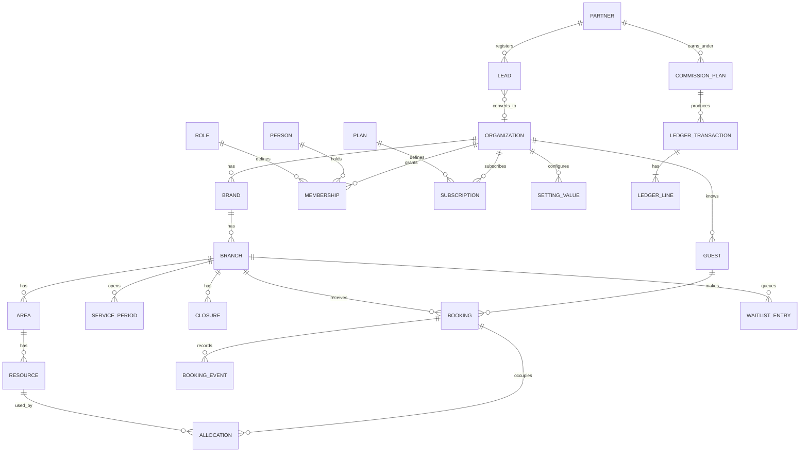

# Document 4 — Database Architecture

Baseline: Documents 1–3, `decision-log.md`, `research/stack-verification.md`.
Database: PostgreSQL (version pinned in Document 8; research found 18.x current and 14 reaching end of life 2026-11-12).
Tags: **[C]** confirmed · **[R]** recommended, needs approval · **[A]** assumption · **[F]** future · **[Q]** open.
SQL is **design-level**: names and types may change when migrations are written (Stage F). Requirement IDs refer to Document 1.

---

## 1. Conventions **[R]**

| Topic | Convention | Reason |
|---|---|---|
| Schemas | One schema per module (`org`, `iam`, `cfg`, `floor`, `res`, `guest`, `ntf`, `sub`, `prt`, `integ`, `audit`, `platform`); modules touch only their own schema | Data ownership (Doc 2 §5.1) |
| Names | `snake_case`, singular table names, `*_id` for references, `*_at` for instants | Consistency |
| Primary keys | `uuid` version 7 (time-ordered), generated by the application (PostgreSQL 18 also provides a native function; verify at pin time) | Good index locality, globally unique so rows can move between cells |
| Public references | Booking/enquiry **references are separate short random codes**, not the primary key | Time-ordered ids reveal creation time; codes are guest-friendly and unguessable |
| Tenant column | `tenant_id uuid NOT NULL` on every tenant-owned table | RLS and cell moves |
| Foreign keys | **Composite** `(tenant_id, x_id)` references inside tenant data | A row can never point at another tenant |
| Time | `timestamptz` (UTC) for instants; `date` for branch-local **service day**; branch time zone stored on branch | Doc 2 §6.4 |
| Money | `amount_minor bigint` + `currency char(3)` | No floats; per-country minor units |
| Status fields | `text` with `CHECK` constraint (not native enums) | Easier to evolve without table locks |
| Flexible data | `jsonb` only for genuinely open-ended or versioned payloads (settings values, country-pack data, provider payloads); core fields stay relational | Queryability and integrity |
| Soft delete | `deleted_at` only where history matters (guests, staff); bookings use status, not deletion | Audit and legal retention |
| Concurrency | `version integer` column on mutable aggregates; updates use `WHERE version = ?` | Avoid lost updates |
| Audit columns | `created_at`, `created_by`, `updated_at`, `updated_by` (actor id or system) | Traceability |
| Classification | Table/column comments carry a data class tag: `public`, `internal`, `personal`, `sensitive`, `financial` | Feeds privacy controls (Doc 6) |
| Card data | **Never stored.** Only provider references and masked last-4 / brand where the provider returns them | PCI scope |

---

## 2. Data ownership

| Schema | Owning module | Contains tenant data? |
|---|---|---|
| `platform` | Platform kernel / Organization | Directory only (`tenant`, `cell`, country packs, setting definitions, plans) |
| `org` | Organization & Venues | Yes |
| `iam` | Identity & Access | Yes (memberships); `person` is platform-level |
| `cfg` | Configuration & Localization | Yes (values); definitions/country packs in `platform` |
| `floor` | Floor & Resources | Yes |
| `res` | Reservations | Yes |
| `guest` | Guest | Yes |
| `ntf` | Notifications | Yes |
| `sub` | Subscription & Entitlements | Per-tenant grants; plans in `platform` |
| `prt` | Partner & Commission | **No tenant data** (commercial only) |
| `integ` | Integration Hub | Yes |
| `audit` | Audit | Yes + platform events |
| `outbox` | Kernel | Yes |

Rule: a module's code may read/write only its schema. Cross-module access is by public service interface or by a local read model populated from events.

---

## 3. Conceptual model



---

## 4. Table design by module

Columns shown are the essentials; every tenant table also has the conventional columns in §1.

### 4.1 `platform` (directory and shared reference data)

| Table | Key columns | Notes |
|---|---|---|
| `cell` | `id`, `region`, `status` | One row at launch (AU) |
| `tenant` | `id`, `slug`, `cell_id`, `status`, `data_region`, `created_at` | The directory (Doc 3 §1.1); no personal data |
| `tenant_domain` | `tenant_id`, `host` unique | Custom booking domains |
| `country_pack` | `country_code`, `version`, `effective_from`, `data jsonb` | Currency, locales, formats, notification rules, provider mapping; versioned, never edited in place |
| `tax_rule` | `country_code`, `code`, `rate_bps`, `inclusive_default`, `valid_from`, `valid_to`, `rules jsonb` | Tax as data |
| `holiday_calendar` | `country_code`, `region`, `date`, `name` | Public holidays |
| `setting_definition` | `key`, `type`, `schema jsonb`, `allowed_scopes text[]`, `default_value jsonb`, `lockable`, `sensitive`, `entitlement_key` | Doc 3 §4.2 |
| `plan`, `plan_entitlement` | `plan.id`, `code`, `interval`; `plan_entitlement(plan_id, key, value jsonb)` | Commercial catalogue |

### 4.2 `org`

| Table | Key columns | Constraints |
|---|---|---|
| `organization` | `id` (= `tenant_id`), `name`, `legal_name`, `status`, `country_code`, `branding jsonb` | `id` equals directory tenant id |
| `brand` | `id`, `tenant_id`, `name`, `branding jsonb`, `status` | Unique `(tenant_id, name)` |
| `branch` | `id`, `tenant_id`, `brand_id`, `name`, `country_code`, `timezone` (IANA), `address` (structured) + `address_extra jsonb`, `phone`, `status`, `go_live_at` | FK `(tenant_id, brand_id)`; `status` CHECK in (`setting_up`,`live`,`closed`) |

### 4.3 `iam`

| Table | Key columns | Notes |
|---|---|---|
| `person` | `id`, `idp_subject` unique, `email`, `display_name`, `status` | **Platform-level** (no `tenant_id`); tenant code reaches it only through a view limited to persons with a membership in the tenant |
| `role` | `id`, `tenant_id` nullable (null = system role), `code`, `name` | Custom roles later |
| `role_permission` | `role_id`, `permission` | |
| `membership` | `id`, `tenant_id`, `person_id`, `role_id`, `scope_type` (`org`/`brand`/`branch`), `status`, `invited_at`, `accepted_at` | Unique active `(tenant_id, person_id, role_id, scope…)` |
| `membership_scope` | `membership_id`, `tenant_id`, `brand_id` or `branch_id` | Rows used when scope is not the whole organization |
| `device_session` | `id`, `tenant_id`, `person_id`, `device_label`, `last_seen_at`, `revoked_at` | Registered devices (if shared-tablet sign-in is approved) |

### 4.4 `cfg`

| Table | Key columns | Notes |
|---|---|---|
| `setting_value` | `id`, `tenant_id`, `scope_type` (`org`/`brand`/`branch`/`service`), `scope_id`, `key`, `value jsonb`, `locked bool`, `version`, `updated_by`, `updated_at` | Unique `(tenant_id, scope_type, scope_id, key)`; value validated against definition |
| `setting_history` | `setting_value_id`, `old jsonb`, `new jsonb`, `changed_by`, `changed_at` | Append-only (CFG-04) |

### 4.5 `floor`

| Table | Key columns | Notes |
|---|---|---|
| `area` | `id`, `tenant_id`, `branch_id`, `name`, `kind` (`dining`,`counter`,`outdoor`,`private`), `sort` | |
| `resource` | `id`, `tenant_id`, `branch_id`, `area_id`, `code`, `kind` (`table`,`counter_seat`), `min_party`, `max_party`, `seats`, `online_bookable`, `position jsonb`, `active` | Unique `(branch_id, code)`; counter seats are individual resources |
| `resource_combination` | `id`, `tenant_id`, `branch_id`, `name`, `min_party`, `max_party` | |
| `resource_combination_member` | `combination_id`, `resource_id`, `tenant_id` | Adjacency modelled by explicit membership, not inferred |
| `service_period` | `id`, `tenant_id`, `branch_id`, `name`, `weekdays smallint[]`, `opens_local time`, `closes_local time`, `crosses_midnight`, `active` | Drives availability (FLR-03) |
| `closure` | `id`, `tenant_id`, `branch_id`, `from_date`, `to_date`, `reason`, `scope` (`full`,`service`) | |
| `resource_state` | `resource_id`, `tenant_id`, `state` (`free`,`seated`,`needs_reset`,`resetting`), `since`, `booking_id` | Current state (one row per resource) |

### 4.6 `guest`

| Table | Key columns | Notes |
|---|---|---|
| `guest` | `id`, `tenant_id`, `display_name`, `language`, `status`, `merged_into_id`, `created_at`, `deleted_at` | Personal |
| `guest_contact` | `id`, `tenant_id`, `guest_id`, `kind` (`phone`,`email`), `value_normalized`, `verified_at`, `primary` | **Unique `(tenant_id, kind, value_normalized)`**; phone normalised to E.164 using the branch country |
| `guest_note` | `id`, `tenant_id`, `guest_id`, `category` (`allergy`,`dietary`,`preference`,`accessibility`,`family`,`staff_note`), `text`/`code`, `restricted bool`, `source`, `created_by` | `allergy`/`dietary` treated as sensitive (restricted view) |
| `consent_record` | `id`, `tenant_id`, `guest_id`, `brand_id`, `purpose`, `channel`, `granted bool`, `source`, `text_version`, `recorded_at` | **Append-only**; current consent = latest per (guest, brand, purpose, channel) (GST-03) |
| `guest_merge` | `id`, `tenant_id`, `from_guest_id`, `into_guest_id`, `decided_by`, `at`, `reversible_until` | Dedupe record |
| `guest_visit_summary` | `tenant_id`, `guest_id`, `brand_id`, `visits`, `no_shows`, `last_visit_on` | Read model fed by events |

### 4.7 `res` (core)

| Table | Key columns | Notes |
|---|---|---|
| `booking` | `id`, `tenant_id`, `branch_id`, `guest_id`, `reference` (unique short code), `party_size`, `service_day date`, `starts_at`, `planned_ends_at`, `status` (`held`,`confirmed`,`seated`,`completed`,`cancelled`,`no_show`,`expired`), `source` (`online`,`phone`,`walk_in`,`google`,`waitlist`,`enquiry`), `channel_ref`, `special_requests`, `policy_snapshot jsonb`, `version` | FK `(tenant_id, guest_id)`, `(tenant_id, branch_id)` |
| `booking_tag` | `booking_id`, `tenant_id`, `tag` | Structured tags (`child`,`high_chair`,`wheelchair`,`occasion:*`) |
| `booking_event` | `id`, `booking_id`, `tenant_id`, `type`, `actor`, `reason`, `data jsonb`, `at` | Append-only status/action history (RES-06) |
| `allocation` | see §5 | The overlap-protected table |
| `hold` | `booking_id`, `tenant_id`, `expires_at`, `idempotency_key` | A hold is a `booking` in `held` status plus this row |
| `waitlist_entry` | `id`, `tenant_id`, `branch_id`, `guest_id`/contact snapshot, `party_size`, `quoted_minutes`, `status` (`waiting`,`notified`,`seated`,`left`,`expired`), `notified_at`, `hold_until`, `source` | `hold_until` enforced by worker |
| `enquiry` | `id`, `tenant_id`, `branch_id`, `guest_id`, `party_size`, `requested_date`, `status` (`new`,`offered`,`accepted`,`declined`,`expired`,`booked`), `offer jsonb`, `offer_expires_at`, `booking_id` | RES-09 |
| `payment_ref` | `id`, `tenant_id`, `booking_id`, `provider`, `provider_object_id`, `purpose` (`deposit`,`card_on_file`,`fee`,`refund`), `amount_minor`, `currency`, `status`, `last4`, `brand` | **No card numbers**; provider holds the card |
| `idempotency_key` | `tenant_id`, `key`, `scope`, `request_hash`, `response jsonb`, `expires_at` | Primary key `(tenant_id, scope, key)`; cleaned after TTL |

`policy_snapshot` stores the cancellation window, fee rule and deposit terms **as agreed at booking time**, so later setting changes cannot alter what a guest was promised.

### 4.8 `ntf`

| Table | Key columns | Notes |
|---|---|---|
| `template` | `id`, `tenant_id`, `brand_id`, `event_type`, `channel`, `status` | |
| `template_version` | `template_id`, `tenant_id`, `language`, `body`, `version`, `published_at` | Versioned; sending references a version |
| `message` | `id`, `tenant_id`, `guest_id`, `event_ref`, `channel`, `template_version_id`, `status`, `provider`, `provider_message_id`, `scheduled_for`, `sent_at` | Stores contact **reference**, not raw number; rendered body kept only for a short period [A] |
| `delivery_attempt` | `message_id`, `tenant_id`, `attempt`, `result`, `error_code`, `at` | |
| `opt_out` | `tenant_id`, `contact_hash`/`guest_id`, `channel`, `scope`, `at`, `source` | Honoured before sending |

### 4.9 `sub`

| Table | Key columns | Notes |
|---|---|---|
| `subscription` | `id`, `tenant_id`, `plan_id`, `billing_provider`, `billing_ref`, `status`, `quantity_branches`, `trial_ends_at`, `current_period_end`, `grace_until` | Mirror of billing service state |
| `entitlement_grant` | `tenant_id`, `key`, `value jsonb`, `source` (`plan`,`addon`,`override`), `valid_from`, `valid_to` | Entitlement service reads this; overrides audited |
| `billing_event_inbox` | `provider`, `event_id` (unique with provider), `payload jsonb`, `received_at`, `processed_at` | Idempotent webhook processing |
| `invoice_ref` | `tenant_id`, `provider_invoice_id`, `amount_minor`, `currency`, `status`, `paid_at` | Reference mirror for commission and history |

### 4.10 `prt` (commercial only; **no guest or booking data**)

| Table | Key columns | Notes |
|---|---|---|
| `partner` | `id`, `person_id`, `status`, `country_code`, `contractor bool`, `payout_details_ref` | Payout details in secrets/vault reference, not plain columns |
| `lead` | `id`, `partner_id`, `prospect_name`, `status`, `tenant_id` nullable (after conversion), `registered_at` | |
| `lead_assignment` | `id`, `lead_id`, `owner_partner_id`, `decided_by`, `reason`, `decided_at` | Append-only history of management decisions (PRT-02, D-15) |
| `commission_plan` | `id`, `partner_id`, `version`, `rate_bps`, `basis text[]`, `tax_treatment`, `duration_months`, `clawback_days`, `effective_from`, `effective_to` | **Immutable versions**; new row for any change (PRT-03) |
| `ledger_account` | `id`, `kind` (`partner_payable`,`commission_expense`,`clearing`), `partner_id`, `currency` | |
| `ledger_transaction` | `id`, `kind` (`accrual`,`reversal`,`payout`,`adjustment`), `source_event_id` unique-per-kind, `plan_id`, `occurred_at`, `approved_by` | Idempotent by source event |
| `ledger_line` | `transaction_id`, `account_id`, `amount_minor` (signed), `currency` | Per transaction lines **sum to zero** (checked by deferred constraint trigger and tests) |
| `payout_run` | `id`, `period`, `status`, `approved_by`, `exported_at` | |
| `payout_item` | `run_id`, `partner_id`, `amount_minor`, `currency`, `status` | Minimum-balance rule applied at run creation |

Balances are **derived** from lines (and cached in a read model), never edited. Corrections are new reversing transactions.

### 4.11 `integ`

| Table | Key columns | Notes |
|---|---|---|
| `connection` | `id`, `tenant_id`, `kind` (`pos`,`messaging`,`payments`,`webhook`), `provider`, `status`, `config jsonb`, `secret_ref` | Secrets live in the secrets manager; table holds a reference |
| `sync_cursor` | `connection_id`, `tenant_id`, `stream`, `cursor`, `updated_at` | |
| `inbound_event` | `provider`, `event_id`, `tenant_id`, `received_at`, `processed_at`, `status` | **Unique `(provider, event_id)`** deduplicates webhooks |
| `webhook_endpoint` | `id`, `tenant_id`, `url`, `secret_ref`, `event_types[]`, `active` | Outbound |
| `webhook_delivery` | `id`, `tenant_id`, `endpoint_id`, `event_id`, `attempt`, `status`, `response_code`, `next_attempt_at` | Dead-letter after retry budget |
| `pos_sale_summary` | `tenant_id`, `branch_id`, `guest_id`/`booking_id` (nullable), `external_id`, `amount_minor`, `currency`, `closed_at` | Read-only mirror from Square for guest history |
| `reconciliation_run` | `id`, `tenant_id` nullable, `job` (`payments`,`billing`,`messaging`,`pos`,`webhooks`,`commission`), `started_at`, `finished_at`, `checked_count`, `discrepancy_count`, `details jsonb`, `actor` | Run record for every reconciliation job (Doc 5 §6.4) |
| `usage_counter` | `tenant_id`, `branch_id`, `metric` (`sms_sent`,`email_sent`,…), `period` (month), `quantity` | Message metering for allowances/overage (Doc 9 §6.4) |

### 4.11a `rep` (reporting read models)

Reporting owns read models fed by events, never the transactional tables: e.g. `rep.booking_fact` (one row per booking with branch, service day, party size, source, outcome, lead time, dwell), `rep.daily_branch_summary` (covers, no-shows, cancellations, utilisation), `rep.guest_branch_summary`. Every table carries `tenant_id`, RLS and the same isolation tests; models can be rebuilt from events and the source tables. Definitions are finalised with Document 1 REP-01…03.

### 4.12 `audit` and `outbox`

| Table | Key columns | Notes |
|---|---|---|
| `audit.event` | `id`, `tenant_id` nullable, `actor_type`, `actor_id`, `action`, `entity_type`, `entity_id`, `before jsonb`, `after jsonb`, `request_id`, `ip`, `at` | **Append-only**: application role has `INSERT`/`SELECT` only. Partitioned by month (safe: no overlap constraint here) |
| `outbox.event` | `id`, `tenant_id`, `type`, `version`, `payload jsonb`, `created_at`, `published_at` | Written in the same transaction as the change; partitioned by day/week for cheap purge |
| `outbox.consumer_inbox` | `consumer`, `event_id`, `processed_at` | Primary key `(consumer, event_id)` gives idempotent consumption |

Job-queue tables are created and owned by the chosen queue library under their own schema, and carry `tenant_id` in the job payload (isolation test ISO-12).

---

## 5. The double-booking guard (RES-02, RES-03, RES-05)

```sql
CREATE EXTENSION IF NOT EXISTS btree_gist;

CREATE TABLE res.allocation (
  id          uuid PRIMARY KEY,
  tenant_id   uuid NOT NULL,
  branch_id   uuid NOT NULL,
  booking_id  uuid NOT NULL,
  resource_id uuid NOT NULL,
  -- planned occupancy: [start, planned end + turn buffer)
  occupied    tstzrange NOT NULL,
  kind        text NOT NULL CHECK (kind IN ('hold','booking','block')),
  active      boolean NOT NULL DEFAULT true,
  expires_at  timestamptz,                         -- holds only
  FOREIGN KEY (tenant_id, booking_id) REFERENCES res.booking (tenant_id, id),
  CONSTRAINT no_overlap
    EXCLUDE USING gist (resource_id WITH =, occupied WITH &&)
    WHERE (active)
    DEFERRABLE INITIALLY IMMEDIATE
);
CREATE INDEX allocation_branch_time ON res.allocation USING gist (branch_id, occupied) WHERE active;
```

Design notes **[R]**:
- A **party on several tables or counter seats = several rows** sharing one `booking_id`, inserted in one transaction. Either every resource is free or the whole insert fails.
- The application chooses candidates (best fit, area preference, combinations, pacing); **the constraint is the final authority** under concurrency. On a conflict error the application re-runs allocation or offers alternatives.
- `DEFERRABLE` lets a move or swap between two bookings happen inside one transaction without a transient violation.
- The range includes the **turn buffer** at creation; buffer setting changes do not alter existing rows.
- Holds are real rows (`kind='hold'`, `expires_at`). PostgreSQL cannot use `now()` in an index predicate, so correctness must not depend on the sweeper: **before inserting, the allocation path deactivates expired holds on the target resources in the same transaction.** The worker also sweeps for tidiness and to emit `BookingExpired`.
- The constraint governs **planned** occupancy. A party that overruns is a real-world fact the database cannot refuse; it is recorded as actual seating/finish times, produces an alert, and the host moves or re-times the *next* booking. Extending the planned end of the current booking into a neighbour is rejected by the constraint (matches the prototype's "blocked with reason" behaviour).
- `allocation` is **not partitioned by time**: an exclusion constraint on a partitioned table must include all partition keys with equality. Table size is bounded by archiving completed rows (§9).
- `kind='block'` rows allow manager blocks (private event, maintenance) with the same guarantee.
- Closures and service periods are checked in the application when creating allocations; large "closure" blocks may also be materialised as `block` rows if needed for the host grid.

A concurrency test (many simultaneous attempts for the same resource and time) is a release gate.

---

## 6. Row-level security and roles

- Roles: `app_rw` (application, non-owner, no `BYPASSRLS`), `app_ro` (replica reads), `migrator` (owner, DDL), `platform_ops` (audited cross-tenant platform tasks via separate code path), `analytics_ro` (future).
- Policy template and rules are in Document 3 §2.3. Every tenant table: RLS enabled + forced, policy on `tenant_id`, no policy-less tables.
- `person` and platform tables have **no tenant policy** but are never directly readable by tenant-facing queries; tenant views expose only memberships' persons.
- `audit.event`: `INSERT`/`SELECT` only, with the same tenant policy; no `UPDATE`/`DELETE` grants.
- A migration lint verifies the catalog: every table in a tenant-owning schema has `tenant_id`, RLS enabled and forced, a policy, and a leading-`tenant_id` index.

---

## 7. Indexing and query design

| Query | Index (all lead or include `tenant_id` unless noted) |
|---|---|
| Host day view (bookings for a branch and service day) | `booking (tenant_id, branch_id, service_day, starts_at)` partial on active statuses; second index for history |
| Availability for a branch/day | Resources by branch (small); allocations via `allocation_branch_time` gist; computed in the application from a few hundred rows |
| Guest lookup by phone/email | Unique `guest_contact (tenant_id, kind, value_normalized)` |
| Guest history | `booking (tenant_id, guest_id, starts_at DESC)` |
| Waitlist for a branch | `waitlist_entry (tenant_id, branch_id, status, created_at)` partial on active |
| Pending reminders | `message (status, scheduled_for)` partial on `status='scheduled'` (worker scan; tenant in payload) |
| Hold expiry sweep | `allocation (expires_at)` partial on `kind='hold' AND active` |
| Webhook dedupe | Unique `(provider, event_id)` |
| Audit lookup | `audit.event (tenant_id, entity_type, entity_id, at DESC)` and `(tenant_id, at DESC)` |
| Commission balances | `ledger_line (account_id)`; balances cached in read model |
| Effective settings | `setting_value` unique key above; resolved result cached per branch |

Practices **[R]**: indexes justified by a named query; `EXPLAIN` checks for key queries in CI against representative data volumes; statement and lock timeouts set on the application role; no unbounded list endpoints (pagination is cursor-based).

---

## 8. Migration strategy

**Tooling [R]:** SQL-first migrations reviewed as code, run by a dedicated `migrator` role from CI; a TypeScript data-access approach that does not hide RLS and exclusion constraints (query-builder style preferred over a heavyweight ORM; exact library chosen in Document 8). Schema and migrations live in the module that owns them.

**Zero-downtime rules (expand → migrate → contract):**
1. *Expand:* add nullable columns/new tables/new indexes (`CREATE INDEX CONCURRENTLY`); add constraints as `NOT VALID`, then `VALIDATE` separately; never take long exclusive locks.
2. *Deploy* code that writes both old and new shapes and reads the new when present.
3. *Backfill* in small batches via the worker, resumable and rate-limited.
4. *Switch* reads; monitor.
5. *Contract* in a later release: drop old columns/tables only after a full release cycle and an explicit approval.
- Set `lock_timeout`/`statement_timeout` in migrations; one risky change per release; migrations are idempotent and tested on a restored copy of production-shaped data.
- **Rollback:** prefer forward-fix; expand-phase changes are inherently safe to leave in place; every migration records its undo or compensating plan.
- **Destructive operations** (drop, rename, type change, bulk update/delete) require reviewer approval and a rehearsal on a production-shaped copy.
- Reference data (country packs, setting definitions, plans) is versioned data shipped through migrations and is additive.
- Every migration is also run in a **multi-cell compatibility** check: the same sequence must work on a fresh dedicated cell.

---

## 9. Retention, archival and deletion

Defaults are **proposals [A]**; periods for financial and tax records and for personal data must be set with legal/accounting advice by country **[Q]**.

| Data | Proposed default | Mechanism |
|---|---|---|
| Active bookings, guests, config | While tenant active | — |
| Completed/cancelled bookings and allocations | Keep rows; move `allocation` rows older than ~13 months to `res.allocation_archive` (no exclusion constraint needed) | Worker job |
| Guest personal data | Per tenant policy; deletion/anonymisation on request (GST-04); inactive-guest anonymisation after a configurable period | Worker job + merge records |
| Consent records | Keep while the guest or the evidence of consent matters | Append-only |
| Message content | Short (e.g. 30–90 days); delivery metadata longer | Partition drop / purge |
| Audit events | Longer (e.g. ≥ 1–2 years; tenant-configurable above a floor) | Monthly partitions detached to cold storage |
| Outbox | Days to weeks after publish | Partition drop |
| Idempotency keys | Hours to days | TTL purge |
| Financial references (`invoice_ref`, `payment_ref`) and ledger | Per accounting/tax law **[Q]** | Never hard-deleted while required |
| Closed tenant | Retention window then deletion with certificate (Doc 3 §6.3) | Deletion job |

Archival never breaks the overlap guarantee: only inactive rows leave the constrained table.

---

## 10. Backup and recovery

- **Continuous WAL archiving with point-in-time recovery**, daily snapshots, multi-AZ for the primary. Proposal: RPO ≤ 5 minutes, RTO ≤ 4 hours (Document 9 to confirm).
- Backups encrypted, stored in Australia; a second Australian location for copies **if available (verify)**; backups are not reachable with application credentials.
- **Restore tests** on a schedule (proposal monthly for a full restore; quarterly for a single-tenant extract), with results recorded.
- **Single-tenant restore:** restore a snapshot to a scratch instance, extract rows by `tenant_id` with checks, apply through a reviewed procedure; never overwrite other tenants.
- Deleted-tenant data in backups ages out per the stated backup retention (Doc 3 §6.3).

---

## 11. Performance and capacity notes (to be quantified in Document 9)

- Row counts at the Year-1 target (about 100 branches) are small; a single primary with a read replica is ample. The design is sized for 10× and tested at that scale with generated data.
- Likely hot spots: availability search on the public edge (read-optimised, replica, short-lived cache), reminder scans, audit growth, and message volume.
- Avoid: unindexed JSON filtering, cross-schema joins in request paths, per-row triggers for business rules, table-wide locks in migrations.

---

## 12. Traceability

| Requirement | Main tables |
|---|---|
| RES-01…05, RES-11 | `res.booking`, `res.allocation`, `floor.*`, `cfg.setting_value` |
| RES-08 | `res.waitlist_entry` |
| RES-09 | `res.enquiry` |
| RES-10 | `res.payment_ref`, `integ.connection` |
| GST-01…06 | `guest.*` |
| NTF-01…05 | `ntf.*` |
| SUB-01…05 | `sub.*`, `platform.plan*` |
| PRT-01…07 | `prt.*` |
| INT-01…06 | `integ.*`, `outbox.*` |
| AUD-01…02 | `audit.event` |
| CFG-01…04 | `platform.setting_definition`, `cfg.*`, `platform.country_pack` |
| ORG-01…04, IAM-01…05 | `org.*`, `iam.*`, `platform.tenant` |

## 13. Decisions requiring approval

| # | Decision | Recommendation |
|---|---|---|
| 1 | UUIDv7 primary keys with separate public reference codes | Approve |
| 2 | Composite tenant foreign keys everywhere | Approve |
| 3 | Overlap guard via exclusion constraint on `allocation`, holds as rows, expired holds cleared in the allocating transaction | Approve |
| 4 | Text + CHECK for statuses (no native enums) | Approve |
| 5 | Commission ledger as append-only double-entry with immutable plan versions | Approve |
| 6 | SQL-first migrations with expand→contract and no heavyweight ORM | Approve; library choice in Document 8 |
| 7 | Retention defaults (§9) | Provisional until legal/accounting advice |
| 8 | Allergy/dietary notes as restricted, sensitive guest data | Approve |

## 14. Risks

1. **Constraint misuse under refactoring** (e.g. someone partitions `allocation`) → documented rule, schema lint, concurrency test.
2. **RLS plus composite keys add friction** → generated migration templates and lint make the safe path the easy one.
3. **Guest dedupe errors** (wrong merges) → merge record with reversal window, no automatic merges on weak matches.
4. **Time/zone errors at midnight and DST** → explicit service day, clock injection, DST test dates per country.
5. **Ledger inconsistency** → sum-to-zero check, idempotent source events, reconciliation against billing.
6. **Retention obligations unknown by country** → keep defaults provisional; legal review before launch.

## 15. Next
Document 5 defines the API and integration contracts: conventions, versioning, error model, idempotency, events and webhooks, and the port interfaces for billing, messaging, payments, POS and identity.
