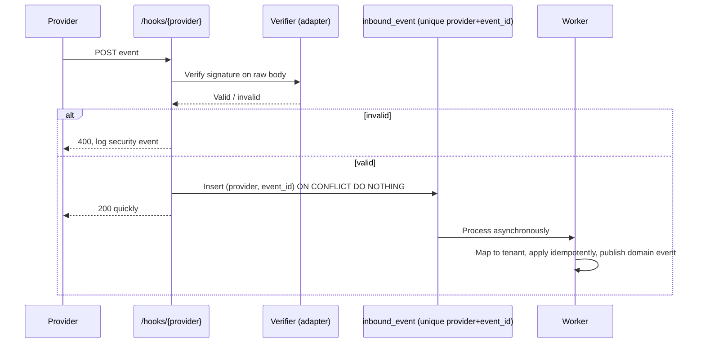

# Document 5 — API and Integration Architecture

Baseline: Documents 1–4, `decision-log.md`, `research/stack-verification.md`, `research/compliance-scan.md`.
Tags: **[C]** confirmed · **[R]** recommended, needs approval · **[A]** assumption · **[F]** future · **[Q]** open.
Numbers (limits, retry counts, TTLs) are **proposals to tune with load tests**, not measured values.

---

## 1. API surfaces

| Surface | Audience | Base path | Auth | Notes |
|---|---|---|---|---|
| **Public booking API** | Guests via Cheery pages/widgets, tenant sites | `/public/v1` | None (rate-limited, bot-protected); booking management by signed link token | Served by the public booking edge process; read-optimised |
| **Staff API** | Restaurant staff apps | `/v1` | Identity-provider token + membership | Tenant resolved from token, never from the URL |
| **Tenant integration API** | Customer's own systems (later tier) | `/v1` (same API, API-key or OAuth client) | Scoped API credentials per organization | Entitlement-gated |
| **Platform API** | Cheery admin, finance, management | `/platform/v1` | Separate platform realm, MFA | Provisioning, plans, support access, leads, payouts |
| **Partner API** | Sales partners | `/partner/v1` | Platform realm, partner role | Own leads/statements only; no tenant data |
| **Webhooks (outbound)** | Customer systems | — | HMAC signature | Derived from domain events |
| **Provider webhooks (inbound)** | Billing, payments, messaging, POS | `/hooks/{provider}` | Provider signature | Verified, deduplicated, mapped to a tenant |
| **Realtime** | Staff apps | `/realtime` | Token | Tenant/branch-scoped channels (SSE/WebSocket) |

**[R]** One OpenAPI document per surface, **contract-first**: the contract is reviewed before code, server stubs/validators and the TypeScript client are generated from it, and a breaking-change check runs in CI (fitness check 10).

---

## 2. REST conventions **[R]**

### 2.1 Resources and paths
- Plural nouns, kebab-case paths, ids opaque: `/v1/branches/{branchId}/bookings/{bookingId}`.
- **No tenant id in paths or headers for authorisation.** A tenant id in a request is rejected or ignored (isolation test ISO-03).
- Actions that are not CRUD are explicit sub-resources: `POST /bookings/{id}/seat`, `/cancel`, `/no-show`, `/extend`, `/move`.
- Collections are scoped by branch where the domain demands it; cross-branch queries use filters (`branchId=…`) limited to the caller's scope.

### 2.2 Request and response
- JSON (UTF-8). Instants as ISO-8601 UTC (`2026-11-06T09:30:00Z`); **service days as local dates** (`2026-11-06`) with the branch time zone returned in the branch resource.
- Money as `{ "amountMinor": 2500, "currency": "AUD" }`.
- Responses use **explicit response DTOs with allow-lists**; entities are never serialised directly (prevents leaking fields; OWASP API3).
- Unknown request properties are rejected; strings have length limits; enumerations are closed.
- Partial updates use `PATCH` with JSON Merge Patch for simple resources; complex state changes use action endpoints.

### 2.3 Pagination, filtering, sorting
- **Cursor pagination:** `?limit=50&cursor=…`; response includes `nextCursor`. Maximum `limit` enforced (proposal 200).
- Filtering by documented query parameters (e.g. `status`, `from`, `to`, `branchId`); no free-form query language in Release 1.
- Sorting via `sort=field` / `sort=-field` on indexed fields only.

### 2.4 Concurrency and idempotency
- **Idempotency:** all `POST` endpoints that change state accept an `Idempotency-Key` header (required on booking confirmation, payment-affecting calls, provisioning). Keys are stored per tenant and scope with a request hash; a repeat returns the original response; the same key with a different body returns `409 idempotency_key_reuse`. TTL proposal 24 h (longer for provisioning).
- **Optimistic concurrency:** resources expose `ETag`/`version`; updates send `If-Match`; mismatch returns `412 precondition_failed`.

### 2.5 Errors
Standard problem-details body (RFC 9457) with a stable `code`, plus a `traceId`:

```json
{
  "type": "https://api.cheery.example/errors/slot_unavailable",
  "title": "Selected time is no longer available",
  "status": 409,
  "code": "slot_unavailable",
  "detail": "The table was taken while you were booking.",
  "traceId": "…",
  "alternatives": [{ "startsAt": "2026-11-06T09:45:00Z", "partySize": 4 }]
}
```
Errors never reveal whether an id exists in another tenant (not found and not permitted look alike where appropriate), never include stack traces, and never include personal data.

| HTTP | Typical `code` values |
|---|---|
| 400 | `validation_failed` (with field list), `malformed_request` |
| 401 | `unauthenticated`, `token_expired` |
| 403 | `forbidden`, `entitlement_required`, `tenant_suspended` |
| 404 | `not_found` |
| 409 | `slot_unavailable`, `hold_expired`, `idempotency_key_reuse`, `state_conflict` |
| 412 | `precondition_failed` |
| 422 | `policy_violation` (e.g. outside booking window, party too large for online) |
| 429 | `rate_limited` (+ `Retry-After`) |
| 502/503/504 | `provider_unavailable`, `temporarily_unavailable` |

### 2.6 Rate limiting and quotas **[R]**
Layered: edge/WAF (IP, bot score), per-IP and per-contact limits on the public edge, per-tenant limits on the staff API, per-credential limits on the integration API. `429` + `Retry-After`. Proposals to tune: public availability search 30/min/IP; hold creation 5/10 min per contact and per IP; staff API generous per-user limits with a tenant-wide ceiling.

### 2.7 Versioning and deprecation **[R]**
- Major version in the path (`/v1`). Additive changes (new optional fields, new endpoints, new enum values documented as extensible) are non-breaking; clients must ignore unknown fields.
- Breaking changes require `/v2` and a deprecation period with `Deprecation` and `Sunset` headers and a changelog (proposal ≥ 12 months for customer-facing APIs **[A]**). The first-party staff app is released in step with the API; the server supports the previous app version for one release (N-1).
- Event schemas and webhook payloads are versioned separately (§5).

---

## 3. Key Release 1 endpoints (starter catalogue)

### 3.1 Public booking API
| Method & path | Purpose | Req |
|---|---|---|
| `GET /public/v1/venues/{slug}` | Venue info, hours, booking options, policies shown to guests | RES-01 |
| `GET /public/v1/venues/{slug}/availability?date&partySize&area` | Bookable times (no table identities exposed) | RES-01 |
| `POST /public/v1/venues/{slug}/holds` | Create a hold; returns `holdId`, `expiresAt` | RES-03 |
| `POST /public/v1/holds/{holdId}/confirm` | Confirm with guest details (idempotent); may return a hosted payment URL when a deposit/card is required | RES-03, RES-10 |
| `GET /public/v1/bookings/{reference}?t=…` | View a booking via signed link token | RES-06 |
| `POST /public/v1/bookings/{reference}/cancel?t=…` | Guest cancellation (policy applied) | RES-06 |
| `POST /public/v1/bookings/{reference}/change` | Atomic change (new slot secured before old released) | RES-05 |
| `POST /public/v1/venues/{slug}/waitlist` | Join waitlist | RES-08 |
| `POST /public/v1/venues/{slug}/enquiries` | Group enquiry | RES-09 |
| `POST /public/v1/offers/{offerId}/accept?t=…` | Accept an enquiry offer | RES-09 |

Public-edge protections **[R]**: bot challenge before hold creation, per-contact and per-IP quotas, short holds, no enumeration of references (unguessable codes + signed tokens), no guest personal data in responses beyond what the link-holder already supplied. Whether phone verification (e.g. one-time code) is required for deposits is **[Q]** (cost and conversion trade-off).

### 3.2 Staff API
| Area | Examples |
|---|---|
| Bookings | `GET /v1/branches/{id}/bookings?serviceDay=…`, `POST /bookings` (phone/walk-in), `POST /bookings/{id}/seat\|move\|extend\|cancel\|no-show\|finish`, `POST /bookings/{id}/charge-fee`, `POST /bookings/{id}/waive-fee` |
| Waitlist | `GET/POST /v1/branches/{id}/waitlist`, `POST /waitlist/{id}/notify\|seat\|remove` |
| Floor | `GET /v1/branches/{id}/floor`, `PUT /resources/{id}/state` |
| Layout & hours | CRUD for areas, resources, combinations, service periods, closures |
| Guests | `GET /v1/guests?phone=…`, `GET/PATCH /guests/{id}`, `POST /guests/{id}/merge`, `POST /guests/{id}/export`, `DELETE /guests/{id}` (request) |
| Settings | `GET /v1/settings/effective?scope=branch:{id}`, `PUT /settings/{key}` with scope and lock flag |
| Templates | CRUD + preview |
| Staff & roles | invitations, memberships, role assignment |
| Reports | `GET /v1/reports/{name}?from&to&branchId` |
| Audit | `GET /v1/audit?entity=…` |
| Integrations | connect/disconnect, test, sync status |
| Realtime | `GET /realtime/branches/{id}` event stream |

### 3.3 Platform and partner APIs
Platform: tenant provisioning (idempotent), suspend/close, plan changes, support-access grants, lead assignment, commission plan versions, payout runs. Partner: register lead, view own leads, commission statements. Both are in the platform realm; neither can reach tenant tables.

---

## 4. Provider ports and adapters

Every external system is behind a **port** (interface owned by Cheery). Adapters are chosen per country/tenant by configuration. Modules depend on ports, never on SDKs (fitness check 6).

```ts
// Illustrative TypeScript interfaces (final shapes in code review)
interface BillingPort {
  createCustomer(org: OrgRef): Promise<BillingCustomerRef>;
  createSubscription(input: SubscriptionInput): Promise<SubscriptionRef>;
  changeQuantity(sub: SubscriptionRef, branches: number, effective: 'now' | 'period_end'): Promise<void>;
  cancel(sub: SubscriptionRef, when: 'now' | 'period_end'): Promise<void>;
  customerPortalUrl(customer: BillingCustomerRef): Promise<string>;
  parseWebhook(rawBody: Buffer, headers: Headers): Promise<BillingEvent>; // verifies signature
}

interface GuestPaymentPort {
  createHostedCheckout(input: {amount: Money; purpose: 'deposit'|'card_on_file'; returnUrl: string; reference: string}): Promise<{url: string; providerObjectId: string}>;
  chargeSavedMethod(input: {providerObjectId: string; amount: Money; idempotencyKey: string}): Promise<ChargeResult>;
  refund(input: {providerObjectId: string; amount: Money; idempotencyKey: string}): Promise<RefundResult>;
  parseWebhook(rawBody: Buffer, headers: Headers): Promise<PaymentEvent>;
}

interface MessagingPort {
  send(msg: {channel: 'sms'|'email'|'whatsapp'; to: ContactRef; templateVersionId: string; variables: Record<string,string>; idempotencyKey: string; senderId?: string}): Promise<{providerMessageId: string}>;
  parseDeliveryReceipt(rawBody: Buffer, headers: Headers): Promise<DeliveryEvent>;
  parseInbound(rawBody: Buffer, headers: Headers): Promise<InboundMessage>;
}

interface PosPort { // read-only in Release 1 (R-03)
  listLocations(): Promise<PosLocation[]>;
  fetchSales(input: {locationId: string; since: Cursor}): Promise<{sales: PosSale[]; next: Cursor}>;
  parseWebhook(rawBody: Buffer, headers: Headers): Promise<PosEvent>;
  // later: pushOrder(), updateTableStatus()
}

interface IdentityPort {
  inviteUser(email: string, orgRef: OrgRef): Promise<void>;
  revokeSessions(personId: string): Promise<void>;
  verifyToken(token: string): Promise<VerifiedClaims>;
}
```

### 4.1 Adapter selection
Resolved from the **country pack + tenant connection**: e.g. Australia → Stripe adapter (hosted checkout) and chosen SMS provider with a registered sender ID; India → provider(s) to be decided by ADRs 04–06 (research: Stripe invite-only for Indian businesses; DLT registration required for SMS). A country can be launched only when its adapters and registrations exist; this is a **launch checklist item**, not a code change.

### 4.2 Credentials
Per-tenant credentials (OAuth tokens, API keys) are stored in the secrets manager; the database stores only `secret_ref`. Rotation and revocation are first-class operations; access is logged. Platform-level provider credentials (billing, messaging) are separate from tenant credentials.

### 4.3 Planned adapters
| Port | Release 1 | Later |
|---|---|---|
| Billing | One vendor (ADR-04) | Second vendor for India if needed |
| Guest payments | Stripe hosted pages (AU, subject to ADR-05) | Local providers by country |
| Messaging | One SMS provider + one email provider | WhatsApp, second SMS for India |
| POS | Square (read-only) | Others per demand; order push; native POS becomes an internal implementation of the same port |
| Identity | Chosen provider (ADR-03) | Per-tenant SSO |
| Reserve with Google | — | Verify availability and requirements before committing (research did not confirm) |

---

## 5. Events and webhooks

### 5.1 Internal domain events
Published through the transactional outbox (Doc 2 §6.3). Envelope:

```json
{
  "id": "evt_01…",
  "type": "booking.confirmed",
  "version": 1,
  "tenantId": "…",
  "occurredAt": "2026-11-06T09:30:00Z",
  "actor": { "type": "guest|staff|system", "id": "…" },
  "traceId": "…",
  "data": { "bookingId": "…", "branchId": "…", "serviceDay": "2026-11-12", "partySize": 4, "startsAt": "…" }
}
```
Events carry **ids and the minimum data** needed; consumers fetch more through public interfaces. Personal and sensitive fields (e.g. allergy notes) are not placed in general events.

| Event | Producer | Main consumers |
|---|---|---|
| `organization.provisioned`, `branch.added`, `branch.status_changed`, `organization.closed` | Org | Subscription, Config, Audit, Commission |
| `membership.changed` | IAM | Audit, cache invalidation |
| `setting.changed` | Config | Reservations (cache), Audit |
| `layout.changed`, `closure.added` | Floor | Reservations |
| `booking.held`, `booking.confirmed`, `booking.changed`, `booking.cancelled`, `booking.expired` | Reservations | Notifications, Audit, Reporting, Guest |
| `guest.seated`, `booking.completed`, `booking.no_show` | Reservations | Guest summary, Reporting, Payments (fee flow) |
| `waitlist.notified`, `waitlist.expired` | Reservations | Notifications |
| `guest.created`, `consent.changed`, `guest.deleted` | Guest | Notifications (opt-out), Audit |
| `subscription.state_changed`, `entitlements.changed`, `invoice.paid`, `invoice.refunded` | Subscription | Commission, Org/Reservations (restrictions), Audit |
| `commission.accrued`, `commission.reversed`, `payout.approved` | Commission | Audit, finance export |
| `message.delivered`, `message.failed` | Notifications | Reservations (fallback), Audit |
| `integration.failed` | Integration Hub | Alerting |

Consumers are idempotent (`outbox.consumer_inbox`). Event schemas are versioned; adding fields is non-breaking; removal/semantic change requires a new version with dual publishing during migration.

### 5.2 Outbound webhooks (tenant integrations) **[R]**
- Tenants register endpoints and event types (entitlement-gated).
- **Signing:** `Cheery-Signature: t=<unix>,v1=<HMAC-SHA256(secret, t + "." + body)>`; receivers reject old timestamps (replay protection, proposal 5 min tolerance). Per-endpoint secrets, rotatable with overlap.
- **Delivery:** at-least-once; `Cheery-Event-Id` for receiver-side dedupe; timeouts (proposal 10 s); retry with exponential backoff and jitter (proposal 8 attempts over ~24 h); then dead-letter; manual **replay** from the admin UI; endpoint auto-disabled after sustained failure with a notification.
- **SSRF protection:** HTTPS only; destination resolved and checked against private/loopback/link-local/metadata ranges; no redirects; egress through a controlled path; size limits on responses.
- Payloads follow the same envelope; sensitive fields excluded by default.

### 5.3 Inbound provider webhooks

Rules **[R]**: verify on the **raw body** before parsing; respond fast and process asynchronously; dedupe by `(provider, event_id)`; map the event to a tenant through stored provider references (never trust tenant hints in the payload); out-of-order events handled by applying state transitions only when valid; unknown events recorded and ignored.

---

## 6. Failure handling, resilience and reconciliation

### 6.1 Calls to providers **[R]**
- Explicit **timeouts** on every call; **retry** only idempotent operations, with exponential backoff and jitter and a retry budget; **circuit breaker** per provider adapter with a clear open/closed state visible to operators.
- Every state-changing provider call carries an **idempotency key** derived from our own request, so a retry cannot double-charge or double-send.
- Provider calls from request paths are minimised; slow or non-critical work is done by workers.

### 6.2 Behaviour when a dependency is down

| Dependency | Impact | Designed behaviour |
|---|---|---|
| Messaging provider | Confirmations/reminders delayed | Queue and retry; fail over to another provider/channel if configured; booking is still valid; host UI shows delivery status; alert on backlog |
| Guest payment provider | Deposit/card steps unavailable | Do not confirm bookings that *require* payment; offer alternatives (call/walk-in/try later); bookings without payment continue |
| Billing service | Cannot read/change subscription state | Use cached entitlements; **never lock out customers because the billing service is unreachable**; queue changes; reconcile later |
| Identity provider | New logins fail | Existing sessions valid until expiry; staff continue; guest booking is unaffected (no login) |
| POS (Square) | No spend enrichment | Skip enrichment; resume from cursor; no effect on bookings |
| Own database primary | Outage | Failover (multi-AZ); public edge may serve cached venue info and queue read-only message; see Document 7 |

### 6.3 Duplicates and ordering
At-least-once everywhere, handled by idempotent receivers: unique constraints on `(provider, event_id)`, idempotency keys on commands, consumer inbox for events, and state-machine guards (a "paid" event for an already-refunded invoice is recorded, not applied).

### 6.4 Reconciliation jobs **[R]**
| Job | Compares | Frequency (proposal) | On mismatch |
|---|---|---|---|
| Payments | `payment_ref` vs provider objects | Hourly + daily full | Alert; correct status; flag booking |
| Billing | `subscription`/`invoice_ref` vs billing service | Daily | Alert; auto-repair safe fields; finance review otherwise |
| Messaging | `message` status vs delivery receipts | Hourly | Retry/resolve unknowns |
| POS sync | Cursor vs provider counts | Daily | Resync window |
| Webhooks | `webhook_delivery` failures | Continuous | Dead-letter queue review |
| Commission | Ledger accruals vs `invoice_ref` | Daily | Alert finance; never silently adjust |

Every job writes a run record (`integ.reconciliation_run`) with counts, discrepancies and actor.

### 6.5 Backpressure and fairness
Per-tenant job concurrency caps and fair scheduling prevent one tenant's burst (e.g. bulk reminders) from delaying others (ISO-19). Queues have depth alerts.

---

## 7. Security of APIs (OWASP API Security Top 10, 2023 edition)

| Risk | Control in this design | Verified by |
|---|---|---|
| API1 Broken object-level authorisation | Tenant from token; RLS; scope checks on every object; opaque ids | ISO-01…08 |
| API2 Broken authentication | Managed identity provider, MFA for admin, short-lived tokens, signed link tokens for guests | Auth tests, pen test |
| API3 Broken object property-level authorisation | Response/request DTO allow-lists; restricted fields (allergy notes) need separate permission | Contract tests, property tests |
| API4 Unrestricted resource consumption | Rate limits, payload/page limits, timeouts, per-tenant quotas | Load/abuse tests |
| API5 Broken function-level authorisation | Permission keys per endpoint; deny by default; platform vs tenant realms | Authorisation matrix test |
| API6 Unrestricted access to sensitive business flows | Bot protection and quotas on holds/bookings; deposit-flow limits; reference enumeration protection | Abuse test scenarios |
| API7 Server-side request forgery | Webhook URL validation, egress control, no redirects | SSRF tests |
| API8 Security misconfiguration | Hardened defaults, CORS allow-list per surface, security headers, no verbose errors, config scanned in CI | Config checks |
| API9 Improper inventory management | OpenAPI registry per surface, version/deprecation policy, no undocumented endpoints (routes diffed against spec) | Spec–route diff in CI |
| API10 Unsafe consumption of APIs | Verify provider signatures, validate provider responses against schemas, treat provider data as untrusted | Adapter tests with malformed payloads |

CORS: staff and platform origins on an allow-list; public API allows tenant widget origins registered per venue. Cookies (if used for the web app) are `HttpOnly`, `Secure`, `SameSite`; state-changing browser requests are protected against CSRF; tokens for API clients use headers. Full control mapping continues in Document 6.

---

## 8. Testing and documentation

- **Contract tests:** every endpoint validated against OpenAPI in CI; provider adapters tested with recorded fixtures plus a sandbox suite; consumer-driven contract tests for the staff web app against the staff API; webhook signature tests with good/bad/replayed payloads.
- **Mock servers** generated from the contracts for front-end development.
- **Developer portal / reference docs** generated from OpenAPI for the tenant integration API; changelog and deprecation notices.
- **Observability:** per-endpoint latency/error metrics tagged by surface, tenant tier and outcome; trace propagation into jobs and provider calls.

---

## 9. Decisions requiring approval

| # | Decision | Recommendation |
|---|---|---|
| 1 | Contract-first OpenAPI per surface with breaking-change gate | Approve |
| 2 | Problem-details errors with stable codes | Approve |
| 3 | Idempotency keys on all state-changing POSTs; `If-Match` concurrency | Approve |
| 4 | Guest booking management by signed link token, not guest login | Approve |
| 5 | Phone verification (one-time code) for deposit bookings | **[Q]** decide with cost/conversion data; default off, enabled on risk signals |
| 6 | Webhook signing scheme and retry policy | Approve proposals; tune in testing |
| 7 | Deprecation period for customer-facing API (≥ 12 months) | Approve as proposal |
| 8 | Billing never blocks customers when the billing service is unreachable | Approve |
| 9 | Do not confirm payment-required bookings when the payment provider is down | Approve; confirm commercial acceptability with the Sydney group |
| 10 | Reserve with Google integration scope | Defer; verify requirements first |

## 10. Risks

1. **Public edge abuse** (fake holds exhausting capacity) → short holds, quotas, bot protection, monitoring of hold-to-confirm ratio.
2. **Webhook handling errors** (forged or replayed events) → raw-body verification, dedupe, tenant mapping from stored references.
3. **Provider drift** (API changes, outages) → ports, fixtures plus sandbox tests, reconciliation jobs, circuit breakers.
4. **Contract sprawl** → one registry, route–spec diff, deprecation policy.
5. **India provider constraints** → no commitment of India dates until ADRs 04–06 are settled; adapters selected by country pack.

## 11. Next
Document 6 (Security and Compliance): threat model, security architecture, risk register, standards mapping, privacy controls and the verification checklist.

---

## 12. Additions from the architecture review (2026-11-08)

1. **Merchant onboarding port (E-S1):** extend `GuestPaymentPort` with `createMerchantAccountLink(tenant, branch)`, `getAccountStatus()` and a webhook for status changes (`merchant.account_updated`); staff API `POST /v1/integrations/payments/connect`, `GET /v1/integrations/payments/status`; deposits/fees are rejected with `entitlement_required`/`payments_not_ready` until approved.
2. **Abuse and card-testing protection on public flows (E-S2):** velocity limits per card/contact/IP on deposit flows, minimal retry counts, provider fraud tools enabled, per-venue hold budget, monitoring of hold-to-confirm and failed-payment ratios with automatic tightening.
3. **Guest manage-link tokens (E-S3):** single purpose, expiry, rotation after sensitive actions, `Referrer-Policy: no-referrer`, token reveals only the booking it belongs to.
4. **Inbound messages (MSG-01):** a Messaging webhook maps the inbound number/short code to a tenant and booking context before any action; unknown senders are ignored and logged.
5. **Import API (IMP-01):** asynchronous import jobs (`POST /v1/imports`, `GET /v1/imports/{id}`) with dry-run mode, row-level error report and idempotent re-run.
