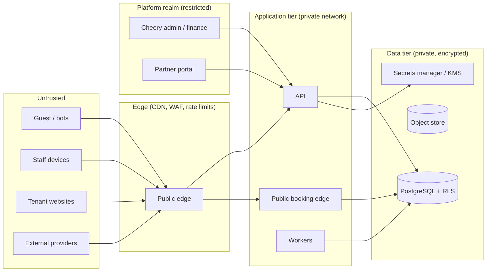

# Document 6 — Security and Compliance

Baseline: Documents 1–5, `decision-log.md`, `research/compliance-scan.md`, `research/stack-verification.md`.
Tags: **[C]** confirmed · **[R]** recommended, needs approval · **[A]** assumption · **[F]** future · **[Q]** open · **UNVERIFIED** = could not be confirmed from an authoritative source in research.

## 0. How to read this document (three different things)

| Concept | Meaning | Status for Cheery |
|---|---|---|
| **Implementing security controls** | Building protections into the product and operations | Done from day one; this document defines them |
| **Certification** (SOC 2 report, ISO/IEC 27001 certificate) | An independent audit of a management system or controls | **Not required at launch** (D-18); controls are mapped now so certification is achievable later |
| **Legal compliance** (privacy law, tax, consumer, payment rules) | Obligations under each country's law | **Not established by following a standard.** Needs advice from qualified local counsel/accountants; items are flagged **[Legal]** |

Nothing here claims that Cheery is certified or legally compliant.

Regulatory facts below come from `research/compliance-scan.md`, where many regulator pages could not be read and several items are marked UNVERIFIED. Treat them as a checklist to confirm with counsel.

---

## 1. Security objectives and scope

1. Tenants' data is never visible to other tenants (confidentiality, integrity) — **the existential risk**.
2. Reservations and the commission ledger are correct and tamper-evident.
3. Guests' personal data, including health-adjacent data (allergies), is protected and used only for its purpose.
4. Payment card data never touches Cheery systems.
5. The service resists abuse and remains available at dining peaks.
6. Cheery can detect, contain, investigate and report incidents.

Scope: the product, its cloud environment, its pipeline and development process, Cheery staff and partner access, and integrations with providers.

---

## 2. Data classification and personal data inventory

### 2.1 Classes **[R]**
| Class | Examples | Handling |
|---|---|---|
| Public | Venue name, opening hours, public menu | No restriction |
| Internal | Configuration, non-personal metrics | Authenticated access |
| Personal | Guest name, phone, email, booking history, staff identity, partner identity | Tenant-scoped, access-logged exports, retention limits |
| Sensitive | Allergy and dietary notes, accessibility needs, children flags, no-show history | Restricted permission (`guest.notes.view`), excluded from events/logs/exports by default **[Legal: may be treated as health information in some countries]** |
| Financial | Payment references, invoices, commission ledger, payout details | Restricted, immutable where possible, secrets in a secrets manager |
| Secret | Credentials, signing keys, API tokens | Secrets manager only; never in code, logs or the database |

### 2.2 Personal data inventory (starter) **[R]**
| Data | Subject | Purpose | System of record | Class | Proposed retention | Processors / transfers |
|---|---|---|---|---|---|---|
| Name, phone, email | Guest | Booking, reminders | `guest.*` | Personal | Tenant policy; anonymise inactive after configurable period | SMS/email providers |
| Allergy/dietary/family notes | Guest | Safe service | `guest.guest_note` | Sensitive | As above; deletion on request | None by default |
| Consent records | Guest | Evidence of marketing consent | `guest.consent_record` | Personal | Keep while evidence needed | — |
| Booking history | Guest | Service, reporting | `res.*` | Personal | Per tenant retention; archive | — |
| Message log | Guest | Delivery evidence | `ntf.*` | Personal | Short for content, longer for metadata | Messaging provider |
| Staff identity, memberships | Staff | Access control | `iam.*`, identity provider | Personal | Life of employment + audit | Identity provider |
| Partner identity, payout details | Partner | Commission payout | `prt.*`, secrets | Personal/Financial | Per tax/accounting law **[Legal]** | Payout channel |
| Audit events | Staff/Guest/System | Accountability | `audit.event` | Internal/Personal | ≥ 1–2 years, tenant-configurable above a floor | — |
| Payment references | Guest | Deposits/fees | `res.payment_ref` | Financial | Per accounting law **[Legal]** | Payment provider |

Roles **[Legal]**: for guest data entered by a restaurant, Cheery is likely a **processor/service provider** acting for the restaurant (the controller); for staff accounts, partners and Cheery's own customer contacts, Cheery is likely a controller. The terms differ by country (Australia, India, UK) and must be confirmed by counsel; they determine contract content (data processing terms, sub-processor lists, breach roles).

---

## 3. Threat model

### 3.1 Trust boundaries

### 3.2 Assets and actors
- **Assets:** tenant guest data (esp. sensitive notes), bookings and availability, tenant configuration, credentials and tokens, commission ledger and payout details, audit log, provider integrations, source code and pipeline, backups.
- **Actors:** anonymous guest/bot; malicious guest; compromised staff account; malicious or careless tenant admin; Cheery insider (support, finance, engineer); sales partner; third-party provider or compromised dependency; external attacker; competitor.

### 3.3 Threats (STRIDE-oriented)
| ID | Category | Scenario | Key controls (see §5) |
|---|---|---|---|
| T-01 | Information disclosure | Tenant A reads Tenant B data via tampered id, missing filter or pooled-connection leak | C-01…C-05 |
| T-02 | Elevation of privilege | Branch user acts on another branch or uses manager-only action by calling API directly | C-06, C-07 |
| T-03 | Spoofing | Staff account takeover (phishing, credential stuffing) | C-10…C-13 |
| T-04 | Tampering | Forged or replayed provider webhook alters payment/billing/commission state | C-24, C-25 |
| T-05 | Denial of service | Bot floods holds to exhaust capacity or overloads public edge at dinner peak | C-18, C-19 |
| T-06 | Repudiation | Staff denies waiving a fee or changing a booking; partner disputes lead ownership | C-27, C-28 |
| T-07 | Tampering | Insider or partner manipulates commission accruals or payouts | C-29, C-30 |
| T-08 | Information disclosure | Guest sensitive notes leak through logs, events, exports or support tooling | C-08, C-31, C-32 |
| T-09 | Information disclosure | Cheery support or engineer browses customer data without need | C-14, C-15 |
| T-10 | Tampering/EoP | Injection (SQL, template, command) or XSS via names, notes, templates | C-20, C-21 |
| T-11 | SSRF | Tenant-supplied webhook/integration URL reaches internal services or cloud metadata | C-26 |
| T-12 | Supply chain | Malicious or vulnerable dependency, compromised CI, or insecure AI-generated code reaches production | C-35…C-38 |
| T-13 | Information disclosure | Misconfigured storage/database/network exposes data; leaked secret | C-16, C-17, C-39 |
| T-14 | Information disclosure | Booking reference enumeration or guessing of manage-link tokens | C-09, C-18 |
| T-15 | Financial | Card data entered into or stored by Cheery systems | C-22, C-23 |
| T-16 | Availability/Integrity | Ransomware, accidental deletion or bad migration | C-40, C-41 |
| T-17 | Repudiation/Integrity | Guest disputes charged fee or promised terms | C-27 (policy snapshot) |
| T-18 | Privacy | Guest data retained or shared beyond purpose; erasure request not honoured | C-31…C-34 |

---

## 4. Security architecture

### 4.1 Authentication and sessions
- **Identity provider** (ADR-03) holds credentials; Cheery stores no passwords. Password policy follows current national digital-identity guidance (length over complexity, breached-password screening, no forced periodic rotation) as supported by the provider. **[R]**
- **MFA:** mandatory for all platform-realm users, organization owners/admins and anyone who can export guest data or change payment settings; offered/required for managers and hosts according to risk. **[Q]** whether shared-tablet PIN sign-in is allowed (see Doc 1 Q2): if approved it is limited to registered devices, to a role with minimal permissions, with short idle timeouts, and never for admin actions.
- **Tokens:** short-lived access tokens (proposal ~15 minutes **[A]**), rotating refresh tokens bound to a session; server-side revocation (membership changes and device removal take effect immediately because scopes are resolved server-side, Doc 3 §3.1); re-authentication for sensitive actions (export, role change, fee charge above a threshold).
- **Guests** have no accounts; booking management uses unguessable signed link tokens with expiry and single-purpose scope.
- **Account recovery** handled by the provider; support cannot bypass MFA without a documented, audited identity-verification procedure **[R]**.

### 4.2 Authorisation
- Tenant and branch isolation per Document 3; permission ∧ scope ∧ entitlement ∧ resource-state (Doc 3 §3.4).
- Role-based by default, attribute conditions where needed (e.g., restricted notes, fee thresholds). **Least privilege:** the starter roles grant only the permissions in Doc 3 §3.3; custom roles are an enterprise feature.
- **Separation of duties** inside Cheery: commission plan changes, lead assignment, commission approval and payout execution require different people (maker–checker). **[R]**

### 4.3 Data protection
- **In transit:** TLS 1.2 minimum, 1.3 preferred, HSTS on all domains; internal service traffic encrypted; certificates automated.
- **At rest:** database, backups, object storage and queues encrypted with managed keys (KMS), key access restricted and logged; payout bank details and integration tokens in the secrets manager (not database columns).
- **Field-level encryption** is *not* applied to bookings/guest notes in Release 1 (it would hinder search and add key-management risk); protection relies on RLS, restricted permissions, encryption at rest and exclusion from logs. Revisit if a customer or regulator requires it. **[R]**
- **Secrets:** secrets manager only; short-lived credentials for workloads (role-based, no static cloud keys); secrets never in code, images, logs or CI output; rotation procedures for each secret class; secret scanning in CI.
- **Tokenised payments:** hosted pages/fields from the payment provider; Cheery stores only provider references and masked display data (Doc 4 §1).

### 4.4 Application security
- **Input validation:** schema validation at the API boundary (generated from OpenAPI), allow-listed enumerations and length limits; output encoding by default in the front end (framework auto-escaping, no raw HTML injection); rich text, if ever allowed, via a sanitiser with an allow-list.
- **Injection:** parameterised queries only; no dynamic SQL from request input; template rendering for messages uses a logic-less engine with an allow-list of variables (prevents template injection).
- **CSRF:** browser sessions use `SameSite` cookies or header-based tokens; state-changing requests require an anti-CSRF token or non-cookie auth.
- **CORS & headers:** per-surface allow-lists; CSP, `X-Content-Type-Options`, frame restrictions (the booking widget uses an explicit `frame-ancestors` allow-list per tenant), referrer policy.
- **File uploads (logos, imports):** type and size limits, content sniffing, re-encode images, store in a non-executable bucket with random names, scan if documents are accepted, serve from a separate domain. CSV imports validated and size-capped.
- **Errors/logging:** no stack traces or personal data in responses; logs structured, personal data minimised, never secrets or full tokens (Doc 5 §2.5).
- **Business-logic abuse** (holds, deposits, enquiries): quotas, bot challenge, monitoring (Doc 5 §3.1).

### 4.5 Infrastructure security
- Private subnets for compute and data; security groups default-deny; no public database or object-store access; managed database with automatic patching windows; images built from minimal, scanned base images; no shell access to production containers by default.
- **WAF and DDoS:** CDN/WAF in front of public surfaces with managed rules, rate-based rules and bot management (ADR-08: Cloudflare vs AWS WAF to be decided); provider-level volumetric DDoS protection; origin accepts traffic only from the edge.
- **Production access:** SSO + MFA, just-in-time elevation, no standing database credentials for humans, all sessions logged; break-glass procedure audited. Developers do not use production data in non-production environments (synthetic data only).
- **Infrastructure as code** with review; drift detection; baseline hardening rules checked in CI.

### 4.6 Monitoring, detection and response
- Central logs, metrics and traces with retention suitable for investigation; tamper-resistant audit store (Doc 4 §4.12).
- **Detections (starter):** repeated failed logins / impossible travel; RLS "no tenant context" errors; cross-tenant access denials; unusual export volume; spikes in hold creation or message sends; webhook signature failures; privileged access and support-grant use; secret access anomalies; unusual database role usage; changes to security-relevant settings.
- **Incident response:** a written plan with roles, severity levels, communication templates, evidence preservation, tenant notification and regulator-notification steps; contact list; at least annual exercise (tabletop) and after every real incident a blameless review. **[R]**
- **Vulnerability management:** dependency (SCA), static analysis (SAST), secret and IaC scanning, container image scanning on every change; authenticated DAST against staging; software bill of materials; patch targets by severity (proposal: critical ≤ 7 days, high ≤ 30 days **[A]**); public vulnerability-disclosure policy (`security.txt`) and triage process.
- **Penetration testing:** independent test before the first production customer, then at least annually and after major changes (new payment flow, new integration class, auth changes); findings tracked to closure.

### 4.7 Secure development lifecycle (including AI-assisted development)
- Threat modelling for new modules and high-risk changes; security review gate for auth, payments, tenant isolation, data export and integrations.
- Mandatory code review by a human; automated checks (Doc 2 §5.4 fitness checks, SAST, SCA, secret scan, isolation tests); protected main branch; signed builds; environment promotion with approvals.
- **AI-assisted development controls [R]:** all generated code goes through the same reviews and tests; dependency additions require approval against an allow-list and lockfile pinning (guards against invented or malicious packages); no secrets, customer data or production data placed in prompts; generated migrations get extra scrutiny (destructive operations, RLS).
- **Target assurance level:** OWASP ASVS (v5.0.0 per research) Level 2 for the application; selected Level 3 requirements for authentication, session handling and the payment/commission flows. **[R]**

---

## 5. Security control matrix

Owner roles are placeholders until the team structure is confirmed **[A]**: **ENG** engineering, **PLT** platform/DevOps, **SEC** security lead (may be a shared role initially), **PRD** product, **FIN** finance, **LEG** external legal/privacy advisor, **OPS** support/operations.

| ID | Risk (§3.3) | Control | Implementation location | Verification | Owner |
|---|---|---|---|---|---|
| C-01 | T-01 | Row-level security on all tenant tables, forced, non-bypass app role | DB migrations; `app_rw` role | Catalog lint; ISO-04, ISO-05 | ENG/PLT |
| C-02 | T-01 | Composite tenant foreign keys | DB schema | ISO-06; schema lint | ENG |
| C-03 | T-01 | Tenant from token, set per transaction | Data-access layer | ISO-03, ISO-07 | ENG |
| C-04 | T-01 | Tenant context in jobs/events/cache/files | Worker, outbox, storage layer | ISO-12…14 | ENG |
| C-05 | T-01 | Isolation suite as release gate; generated from catalog | CI | Suite pass required | ENG/SEC |
| C-06 | T-02 | Permission ∧ scope ∧ entitlement ∧ state evaluation, deny by default | API authorisation layer | Authorisation matrix tests; ISO-08, 09, 11 | ENG |
| C-07 | T-02 | Separate platform/tenant realms | IAM, routing | ISO-17 | ENG/SEC |
| C-08 | T-08 | Restricted permission for sensitive notes; exclude from events/logs/exports | Guest module, DTOs, log config | Property tests; log review | ENG |
| C-09 | T-14 | Unguessable references; signed, expiring link tokens; no enumeration | Public edge | Abuse tests; pen test | ENG |
| C-10 | T-03 | Managed identity provider; no local passwords | IAM integration | Config review | PLT/SEC |
| C-11 | T-03 | MFA for privileged roles and platform realm | Identity provider policy | Access review | SEC |
| C-12 | T-03 | Short-lived tokens, rotation, server-side revocation | IAM, API | Session tests | ENG |
| C-13 | T-03 | Credential-stuffing / anomaly detection and lockout | Provider + edge | Alert tests | SEC |
| C-14 | T-09 | Time-boxed, reasoned, tenant-visible support access | Platform realm | Grant/expiry tests (ISO-18) | SEC/OPS |
| C-15 | T-09 | No standing production data access; JIT elevation; session logging | Cloud IAM, bastion/SSM | Quarterly access review | PLT/SEC |
| C-16 | T-13 | Private networking; default-deny security groups; no public data stores | IaC | IaC scan; external scan | PLT |
| C-17 | T-13 | Secrets manager; no secrets in code/logs; secret scanning | CI, runtime | Scan results; rotation drills | PLT |
| C-18 | T-05/T-14 | Per-IP/contact/tenant rate limits; bot challenge; hold quotas | Edge, public edge, API | Load/abuse tests | ENG/PLT |
| C-19 | T-05 | WAF + DDoS protection; origin locked to edge | Edge config | Resilience test | PLT |
| C-20 | T-10 | Schema validation, parameterised queries, no dynamic SQL | API, data access | SAST, tests, pen test | ENG |
| C-21 | T-10 | Output encoding, CSP, safe template engine | Front end, notifications | DAST, template-injection tests | ENG |
| C-22 | T-15 | Provider-hosted payment pages/fields; no card data fields in our UI or API | Payments adapter, front end | Code search/lint; network capture; PCI self-assessment | ENG/SEC |
| C-23 | T-15 | Script integrity controls on pages that host payment frames (per PCI v4.0.1 criteria) | Front end, CSP | Quarterly script inventory | ENG/SEC |
| C-24 | T-04 | Verify signatures on raw body; replay window; per-provider secrets | Inbound webhook adapters | Bad/replayed payload tests | ENG |
| C-25 | T-04 | Idempotent processing; unique `(provider, event_id)` | `integ.inbound_event` | Duplicate-event tests | ENG |
| C-26 | T-11 | Webhook/integration URL validation; egress control; no redirects | Outbound webhook sender | SSRF tests | ENG/PLT |
| C-27 | T-06/T-17 | Structured audit events; policy snapshot on booking | Audit module, `res.booking` | Audit coverage tests | ENG |
| C-28 | T-06 | Append-only audit store; no update/delete grants | DB grants | Privilege tests | PLT |
| C-29 | T-07 | Maker–checker for plan changes, lead assignment, approvals, payouts | Commission module | Workflow tests; quarterly review | FIN/ENG |
| C-30 | T-07 | Append-only double-entry ledger; reconciliation to billing | `prt.*`, jobs | Sum-to-zero tests; reconciliation | FIN/ENG |
| C-31 | T-08/T-18 | Data classification, minimisation, PII-free logs | Logging, DTOs | Log scans; DPIA-style review | ENG/LEG |
| C-32 | T-08 | Export controls: permission, MFA step-up, audit, expiry of download links | Guest/Reporting | Export tests | ENG |
| C-33 | T-18 | Consent records; opt-out honoured before sending | Guest, Notifications | Consent tests | ENG/LEG |
| C-34 | T-18 | Retention, anonymisation and erasure jobs; deletion certificate | Workers | Deletion tests (ISO-22) | ENG/LEG |
| C-35 | T-12 | Dependency pinning, lockfiles, allow-list for new packages | Repo, CI | SCA reports | ENG |
| C-36 | T-12 | SAST, secret, IaC and container scanning on every change | CI | Gate results | SEC/ENG |
| C-37 | T-12 | Protected branches, required human review, signed builds, SBOM | Source control, CI | Audit of settings | PLT |
| C-38 | T-12 | AI-assisted development rules (§4.7) | Engineering standards | Review checks | ENG/SEC |
| C-39 | T-13 | Hardened configuration baselines; CORS/headers per surface | IaC, app config | Config scans; DAST | PLT/ENG |
| C-40 | T-16 | PITR backups, immutable copies, tested restores | Database, storage | Restore test records | PLT |
| C-41 | T-16 | Expand→contract migrations, rehearsal on restored data | Migration pipeline | Rehearsal evidence | ENG/PLT |
| C-42 | All | Incident response plan, exercises, breach-notification workflow | Process | Tabletop records | SEC/LEG |
| C-43 | All | Annual independent penetration test + remediation tracking | Process | Report and closure evidence | SEC |
| C-44 | All | Supplier due diligence and sub-processor register | Process | Register reviews | SEC/LEG |

---

## 6. Risk register (qualitative)

Likelihood (L) and impact (I): Low / Medium / High; residual rating assumes the listed controls are implemented and verified. Owners per §5 placeholders.

| ID | Risk | L | I | Controls | Residual | Notes |
|---|---|---|---|---|---|---|
| R-01 | Cross-tenant data exposure | Med | High | C-01…C-07 | Low–Med | Highest priority; release gate |
| R-02 | Double-booking / reservation integrity failure | Med | High | DB overlap constraint (Doc 4 §5), concurrency test | Low | Business-critical |
| R-03 | Staff account takeover | High | Med–High | C-10…C-13 | Medium | MFA coverage and phishing awareness |
| R-04 | Sensitive guest notes disclosed | Med | High | C-08, C-31, C-32 | Medium | Legal classification pending |
| R-05 | Card data enters Cheery systems | Low | High | C-22, C-23 | Low | Hosted pages; script controls |
| R-06 | Forged/replayed webhooks | Med | Med–High | C-24, C-25 | Low | |
| R-07 | Public booking abuse (holds, bots) | High | Med | C-18, C-19 | Medium | Monitor hold-to-confirm ratio |
| R-08 | Commission fraud or error | Med | Med–High | C-29, C-30 | Low–Med | Financial control |
| R-09 | Insider misuse (support/engineer) | Low–Med | High | C-14, C-15 | Low–Med | |
| R-10 | Supply-chain compromise / insecure generated code | Med | High | C-35…C-38 | Medium | |
| R-11 | Misconfiguration / leaked secret | Med | High | C-16, C-17, C-39 | Low–Med | |
| R-12 | Ransomware / destructive migration / outage | Low–Med | High | C-40, C-41 | Low–Med | |
| R-13 | Privacy non-compliance (AU/IN/UK) | Med | High | C-31…C-34, C-44, **[Legal]** | Unknown until counsel review | Legal gap |
| R-14 | Messaging/consent law breach (spam, DLT, sender ID) | Med | Med–High | C-33; provider registrations | Medium | Country-specific launch checklist |
| R-15 | Breach not detected/notified in time | Low–Med | High | C-42, §4.6 | Medium | Roles with tenants must be contracted |
| R-16 | Vendor/provider breach or outage | Med | Med | C-44; Doc 5 §6 | Medium | |
| R-17 | Data residency / cross-border transfer issue | Med | Med–High | Cell model; provider selection; **[Legal]** | Unknown until counsel review | |
| R-18 | Retention obligations unmet or exceeded | Med | Med | Doc 4 §9; **[Legal]** | Unknown | |
| R-19 | Tenant branch-scope bug (inside a tenant) | Med | Med | C-06; tests | Low–Med | RLS covers tenants, not branches |
| R-20 | Security debt from schedule pressure | Med | Med | Gates in CI; no hard deadline (D-23) | Low | No deadline helps |

---

## 7. Compliance mapping

Mapping is at **theme level**: it shows where each framework's expectations are addressed. Clause-by-clause mapping happens when certification is pursued. Edition notes come from research.

### 7.1 Security frameworks
| Framework (edition per research) | Role for Cheery | Where addressed |
|---|---|---|
| ISO/IEC 27001:2022 (+Amd 1:2024), ISO/IEC 27002 (edition UNVERIFIED) | Basis for controls; certification optional later (D-18) | §4–§6, Document 7 (operations); organisational controls (policies, roles, supplier management, incident response) need a lightweight management system **[R]** |
| SOC 2 Trust Services Criteria (2017 criteria; 2022 points of focus) | Likely enterprise-customer request | Security, Availability, Confidentiality fit now; Privacy criteria when pursued; evidence kept from day one (change records, access reviews, restore tests) |
| NIST Cybersecurity Framework | Planning vocabulary (Identify, Protect, Detect, Respond, Recover; Govern in newer versions) | Matrix §5, monitoring §4.6, Doc 7 |
| OWASP Top 10 (2025 edition per research) | Web risk awareness | §4.4, tests |
| OWASP ASVS 5.0.0 | Verification standard | Target Level 2 (+ selective Level 3); checklist §9 |
| OWASP API Security Top 10 (2023) | API risks | Doc 5 §7 |

### 7.2 Payments
| Topic | Position |
|---|---|
| **PCI DSS v4.0.1** (only active version per research; future-dated requirements took effect 31 March 2025) | Strategy is **scope reduction**: provider-hosted payment pages/fields so Cheery does not store, process or transmit card data. A provider-hosted redirect or iframe is expected to align with **SAQ A** (Jan 2025 revision); the iframe case adds a script-integrity criterion. **The acquirer/payment provider decides the final eligibility** — confirm in writing before launch. |
| Webhook security | C-24, C-25 |
| Billing for Cheery's own subscriptions | Uses the billing vendor's hosted payment capture; same principle |
| India recurring payments | Research: RBI e-mandate rules (April 2026) include a 24-hour pre-debit notice and limits; only issuers/networks may store card data. Design must follow the chosen provider's compliant flow **[Legal]/[Provider]** |

### 7.3 Australia (first market) **[Legal]**
| Obligation (research summary, partly UNVERIFIED) | Design response |
|---|---|
| Privacy Act 1988 / Australian Privacy Principles; small-business threshold $3m turnover; Cheery itself likely covered once above it; exceptions include businesses trading in personal information | Treat APP-aligned handling as the baseline for all tenants; legal confirmation of who is covered and in what role |
| Statutory privacy tort in force since 10 June 2025 | Tighter access control and logging for sensitive data (C-08, C-32) |
| Automated decision-making transparency duty from 10 December 2026 | Release 1 has no automated decisions about individuals beyond rule-based booking limits; record any future scoring (e.g., no-show risk) and its disclosure needs |
| Children's Online Privacy Code (not in force; consultation closed; registration deadline 10 Dec 2026; applicability to booking apps UNVERIFIED) | Avoid collecting children's personal data (store only a count/flag, not identities); monitor |
| Notifiable Data Breaches scheme (assessment within 30 days of suspicion; regulator and individuals notified for eligible breaches) | §8 breach process; contracts state who notifies |
| Spam Act: consent, sender identification, unsubscribe actioned within 5 business days | C-33; transactional vs marketing separation; opt-out honoured before send; Australian SMS sender-ID registration (research: applies since 1 July 2026 [S]) |
| GST and tax-invoice rules (details UNVERIFIED) | Country pack tax data; Cheery's invoices from the billing vendor; restaurant-side tax arrives with ordering modules |
| Consumer law on cancellation/deposit terms | Policy settings plus `policy_snapshot`; counsel to review default wording **[Legal]** |

### 7.4 India (second market) **[Legal]**
| Obligation (research summary, largely UNVERIFIED) | Design response |
|---|---|
| Digital Personal Data Protection Act 2023; DPDP Rules notified 14 November 2025 (one source says 13th) with an 18-month phase-in; per-rule dates, cross-border, breach timings, processor duties UNVERIFIED | Do not commit an India launch date before counsel reads the gazetted rules; build consent records, purpose limitation, erasure and breach workflow now (they are needed anyway) |
| Consent manager concept, children's data restrictions | Consent model flexible by country pack; no children identities collected |
| TRAI DLT: registered sender headers and templates for SMS | Country-pack launch checklist item; templates registered per brand |
| RBI recurring-payment framework; GST/e-invoicing thresholds (INR 5 crore e-invoicing per research) | Provider and billing selection (ADR-04, ADR-05); tax data in country pack |
| Data localisation/transfer position | UNVERIFIED; cell model allows an India-resident cell if required |

### 7.5 United Kingdom (validation case) **[Legal]**
UK GDPR and the Data (Use and Access) Act 2025 (fully in force per research), 72-hour breach notification to the regulator, PECR soft opt-in for existing customers, VAT-inclusive pricing. Used to validate that consent, erasure, breach and country-pack designs generalise.

### 7.6 Cross-border and residency **[Legal]**
- Primary data and backups stay in Australia (AU cell). Sub-processors (identity, messaging, billing, support tools) may process data elsewhere; the register (C-44) lists each, its location, data categories and safeguards.
- India and UK would use their own cells if law or customer contracts require residency; routing is by the tenant directory (Doc 3).
- Tenant contracts and data-processing terms must state processor role, sub-processors, breach duties and deletion/return on exit.

---

## 8. Privacy controls and processes

| Process | Design |
|---|---|
| **Consent & preferences** | Append-only `consent_record` per guest, brand, purpose, channel; transactional messages separate from marketing; unsubscribe link/keyword in every marketing message |
| **Access / export** | Guest export assembled from guest, bookings, messages, consents; staff-triggered with permission, step-up auth and audit; delivered via expiring link |
| **Correction** | Edit with history; merges reversible within a window |
| **Deletion / anonymisation** | Request → verification → job removes or irreversibly anonymises personal fields; retains non-personal aggregates and records the law requires (**[Legal]** decides what) |
| **Retention** | Doc 4 §9, provisional |
| **Minimisation** | Booking asks for the least data; no children's identities; sensitive notes optional and restricted |
| **Transparency** | Per-venue privacy notice link on booking pages; consent wording versioned (`text_version`) |
| **Impact assessments** | Privacy impact assessment before each new data use (e.g. loyalty, marketplace, scoring) |
| **Breach response** | Detect → triage → contain → assess → notify → learn |

### 8.1 Breach handling workflow **[R]**
1. **Detect/report** (alerts, staff, tenant, researcher) → open incident, assign severity.
2. **Contain** (revoke credentials/sessions, isolate component, preserve evidence).
3. **Assess** scope: which tenants, which data classes, which jurisdictions; whether harm is likely; start the clock (Australia: assessment within 30 days of suspicion; UK: 72 hours for the regulator; India: UNVERIFIED).
4. **Notify tenants** (as controllers) without undue delay with enough detail for them to meet their own duties (proposal: initial notice within 24–72 hours of confirmation **[A]**, contractually fixed); notify regulators/individuals directly where Cheery is itself the controller or where agreed.
5. **Remediate and review** (root cause, fixes, control updates, post-incident report).
The division of notification duties between Cheery and each tenant must be set in contract **[Legal]**.

---

## 9. Security verification checklist

Used as release evidence; each item has an owner and a link to a test or record.

**Before the first production customer**
- [ ] Isolation suite (ISO-01…22) passes in CI; catalogue-driven test fails on a table without RLS.
- [ ] Concurrency test: simultaneous bookings for one resource produce exactly one success.
- [ ] Authorisation matrix test covers every endpoint and role.
- [ ] No card-data fields exist in UI/API; network capture of deposit flow shows only provider-hosted entry; provider/acquirer confirms eligibility for the expected SAQ.
- [ ] Webhook tests: bad signature, replay, duplicate, out-of-order, wrong-tenant.
- [ ] Rate limits and bot protection tested on the public edge.
- [ ] MFA enforced for platform realm and organization owners/admins.
- [ ] Secrets scan clean; no static cloud keys; rotation drill done once.
- [ ] Backups restore tested (full and single-tenant) with recorded RPO/RTO.
- [ ] Logs reviewed for personal-data leakage; sensitive notes absent from events/logs/exports.
- [ ] Independent penetration test completed; critical/high findings fixed.
- [ ] Incident response plan written; tabletop exercise held.
- [ ] Sub-processor register and data-processing terms drafted; counsel review of privacy notice, consent wording and cancellation/deposit terms **[Legal]**.
- [ ] Australian SMS sender-ID registration and email authentication (SPF/DKIM/DMARC) in place.
- [ ] ASVS Level 2 checklist reviewed with exceptions recorded.

**Ongoing**
- [ ] Quarterly access review (cloud, database, platform realm, support grants).
- [ ] Monthly dependency/patch review; SLAs tracked.
- [ ] Quarterly script inventory for payment-frame pages.
- [ ] Annual penetration test; annual incident exercise; annual risk-register review.
- [ ] Restore test on schedule; reconciliation job health.
- [ ] Review when adding a country: legal checklist, sender registration, payment/billing adapter, country pack.

---

## 10. Decisions requiring approval

| # | Decision | Recommendation |
|---|---|---|
| 1 | Data classes and treating allergy/dietary notes as Sensitive | Approve; counsel confirms legal category |
| 2 | MFA scope (platform, owners/admins mandatory; others by risk) | Approve; decide PIN/shared-tablet policy |
| 3 | ASVS Level 2 target with selective Level 3 | Approve |
| 4 | Payments scope reduction (hosted pages) and written SAQ confirmation before launch | Approve |
| 5 | No field-level encryption of guest data in Release 1 | Approve; revisit on customer demand |
| 6 | Maker–checker for commission and payouts | Approve |
| 7 | Support access model (time-boxed, tenant-visible) | Approve with Doc 3 decision |
| 8 | AI-assisted development controls | Approve |
| 9 | Independent penetration test before first customer | Approve; budget needed |
| 10 | Engage Australian privacy/commercial counsel now; Indian and UK counsel before those launches | Approve |

## 11. Items needing professional advice (consolidated)
1. Cheery's role (processor/controller) and contract terms in each country.
2. Whether allergy/dietary data is health information in each country and the resulting duties.
3. Small-business and other exemptions; Cheery's own coverage.
4. Notification duties split between Cheery and tenants; India timings.
5. Cancellation fee/deposit wording and refunds under consumer law.
6. Retention periods for tax, financial and personal data.
7. Cross-border transfer safeguards and India localisation position.
8. Tax treatment of contractor commission payouts per country (D-16).
9. Messaging consent rules per country (Spam Act, DLT, PECR).
10. PCI scope confirmation from the acquirer/payment provider.

## 12. Next
Document 7 (Infrastructure and DevOps): environments, CI/CD, infrastructure as code, deployment strategies, monitoring, backup and disaster recovery, feature flags and release control.

---

## 13. Additions from the architecture review (2026-11-08)

- **Tenants' integration credentials (E-S5):** store OAuth/API tokens only in the secrets manager; refresh server-side; revoke at the provider on disconnect; alert on unusual use (volume, new locations); never expose tokens in logs or responses.
- **Platform realm hardening (E-S6):** separate hostnames and stricter edge rules for the platform and partner portals; optional IP/device restrictions for platform admins; revisit a separate deployment unit on enterprise demand.
- **Owner roles in §5 are placeholders (E-D5):** replace with real names/roles once the team's composition is known.
- **Legal pack:** drafts in `docs/legal/` (not reviewed by a lawyer).
