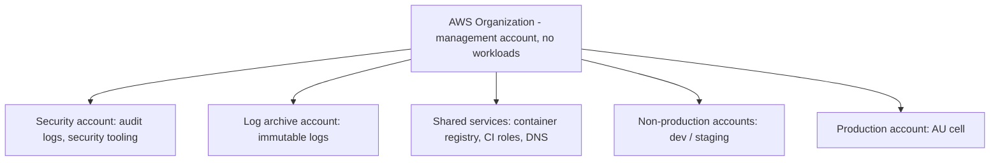

# Document 7 — Infrastructure and DevOps

Baseline: Documents 1–6, `decision-log.md`, `research/stack-verification.md`.
Tags: **[C]** confirmed · **[R]** recommended, needs approval · **[A]** assumption · **[F]** future · **[Q]** open · **UNVERIFIED** = not confirmed from an authoritative source.
Numbers (targets, windows, sizes) are **proposals**; capacity and cost figures are produced in Document 9.

Confirmed inputs: AWS Sydney region for the Australian launch (D-19); modular monolith in several process types (D-27); TypeScript backend (D-28); no hard deadline (D-23); year-1 scale about 10 organizations / 100 branches (D-07).

---

## 1. Principles **[R]**

1. **Everything as code:** infrastructure, pipelines, policies and dashboards live in version control and are reviewed.
2. **Same artifact everywhere:** one built container image is promoted through environments; only configuration differs.
3. **Small, frequent, reversible releases** beat big, rare ones.
4. **No manual production changes.** Break-glass exists, is audited and is followed by a code change.
5. **Deployments never take customers down during service hours** and never break running tenants (backward-compatible migrations, Doc 4 §8).
6. **Measure before scaling:** start small, observe, add capacity or components only on evidence.
7. **Security gates are part of the pipeline,** not a later phase (Doc 6).

---

## 2. Cloud foundation (AWS, Sydney)

### 2.1 Account structure **[R]**

- Separate accounts for production and non-production limit blast radius and make access control simple. Production access is by SSO with MFA and just-in-time elevation (Doc 6 C-15).
- Organization-level guardrails (service control policies): deny disabling logging, deny public data stores, restrict regions to approved ones.
- Region: **ap-southeast-2 (Sydney)** for the AU cell. A second Australian region for backup copies **if available (verify)**; no active-active (Doc 2 §7).

### 2.2 Network **[R]**
- One VPC per environment, three availability zones, public subnets only for load balancers/NAT; **private subnets for compute and data**; no public IPs on workloads or databases.
- Default-deny security groups; database accepts connections only from the application tier; admin access to the database through audited session tooling, not open ports.
- Egress to the internet through controlled NAT with logging; outbound webhook sender uses a dedicated egress path with URL validation (Doc 5 §5.2).
- Private connectivity (VPC endpoints) to object storage, secrets and registry where available.

### 2.3 Compute **[R]**
- **Amazon ECS on Fargate** for all process types (API, public booking edge, worker, realtime gateway). No Kubernetes initially (ADR-07): no cluster to patch, scaling by task count, simpler operations for a small team. Revisit at a measured need (many services, special workloads).
- One service per process type, each with its own scaling policy, task role (least privilege) and health checks.
- Images from minimal base images; built once in CI, scanned, signed, stored in a private registry; deployments reference **image digests**, not mutable tags.

### 2.4 Database **[R]**
- **Managed PostgreSQL** (Amazon RDS for PostgreSQL), multi-AZ primary plus read replica, point-in-time recovery, automated minor-version patching in a defined window, encryption with a customer-managed key.
- Aurora PostgreSQL is an alternative (faster failover, storage scaling) at higher cost; decision recorded in an ADR after a sizing spike. **Required extensions** (e.g. `btree_gist`) and the target major version (research: PostgreSQL 18 current; availability on the managed service **UNVERIFIED**) must be confirmed on the chosen service before commitment.
- **Connection pooling:** pooler in transaction mode with per-transaction tenant context (Doc 3 §2.3). Research notes RDS Proxy may pin connections when `SET` is used; a **pooler compatibility test is a Phase 0 spike** (decision: RDS Proxy vs PgBouncer on Fargate vs application-level pool).
- Separate roles (`app_rw`, `app_ro`, `migrator`, `platform_ops`) with credentials in the secrets manager, rotated automatically where supported.

### 2.5 Other services **[R]**
| Need | Choice |
|---|---|
| Object storage (exports, logos, backups, logs) | S3 with encryption, versioning, block-public-access, lifecycle rules, separate buckets by purpose |
| Secrets | Secrets manager; workload identities (task roles) instead of static keys |
| Keys | KMS customer-managed keys per data class |
| Job queue & outbox | In PostgreSQL (Doc 2); no separate broker initially |
| Cache / realtime fan-out | None at launch; Valkey (managed) added only when measurements justify; realtime via the gateway process |
| DNS & certificates | Managed DNS; automated certificates; custom tenant domains through the edge provider |
| Edge / WAF / DDoS | CDN + WAF in front of public surfaces; Cloudflare vs AWS WAF per ADR-08 (research: Cloudflare Pro/Business plans include WAF; verify at decision time) |
| Email / SMS | External providers via ports (Doc 5), not infrastructure |
| Observability | See §7 |

---

## 3. Environments **[R]**

| Environment | Purpose | Data | Deployment |
|---|---|---|---|
| **Local** | Developer machine | Synthetic seed data | Containers via one command (§4) |
| **CI / ephemeral** | Automated tests per change; optional per-PR preview | Generated test data | Created and destroyed by the pipeline |
| **Development (shared)** | Integration of merged work | Synthetic | Continuous deploy from main |
| **Staging** | Production-shaped rehearsal: same topology, smaller size; migration rehearsal, load and security tests, provider sandboxes | Synthetic or anonymised-by-construction data; **never production copies containing personal data** | Automatic after CI; manual approval to promote |
| **Production (AU cell)** | Customers | Real | Approved promotion from staging |

Rules: environment config is typed and validated at startup (missing or invalid settings fail fast); no environment-specific code branches; staging uses provider sandboxes (billing, payments, messaging, Square sandbox); a restore of production backups is done only inside production-grade accounts (Doc 4 §10). A future **India cell** or **dedicated tenant cell** reuses the same modules and pipeline with a different configuration.

---

## 4. Local development standards **[R]**

- One command to start the whole stack (database, queue, provider fakes, seed data) using containers; documented in the repository; versions pinned to match production (PostgreSQL major, Node LTS).
- Dev containers (or equivalent) so setup is reproducible for new developers and for AI-assisted sessions.
- Provider **fakes/simulators** for billing, payments, messaging and POS so features can be built and tested offline; contract tests keep fakes honest (Doc 5 §8).
- Pre-commit hooks for formatting, lint, secret scan; the same checks run again in CI (hooks can be bypassed; CI cannot).
- Seed data covers two tenants with different shapes (one multi-branch group, one single venue) so isolation and inheritance are always exercised.
- No production data or secrets on laptops. Developer access to staging via SSO.

---

## 5. Source control and release flow

### 5.1 Branching **[R]**
**Trunk-based development**: short-lived branches (target under a day or two), pull requests into `main`, protected `main` (required reviews, required checks, no force push, linear history), feature flags for unfinished work. No long-lived release branches; hotfixes are the same flow with a fast path.

### 5.2 CI/CD pipeline

Gate details **[R]**:
- **Pull request:** all checks above before merge; required human review (Document 8 defines standards); AI-generated changes get no exemption.
- **Release gates (staging):** isolation suite, concurrency test, authorisation matrix, migration rehearsal on production-shaped volume, smoke and E2E on critical journeys (book, change, cancel, seat, waitlist), accessibility checks, dependency/vulnerability threshold.
- **Pipeline security:** cloud access from CI through short-lived federated credentials (no stored cloud keys); least-privilege deploy roles; build runners isolated; third-party actions pinned to commit hashes; signed images verified at deploy; provenance/SBOM stored.
- **Infrastructure pipeline:** OpenTofu plan on pull request, review, then apply from a controlled pipeline; state stored remotely, encrypted and locked; drift detection scheduled.

### 5.3 Tooling decisions deferred to Document 8
Monorepo tooling, test frameworks, lint/format rules and exact CI service (GitHub Actions assumed **[A]**) are specified with the engineering standards.

---

## 6. Deployment strategy and release control

### 6.1 Strategy **[R]**
- **Rolling or blue-green deploys** on ECS with health checks and automatic rollback on failed checks (native ECS blue/green support: **verify at implementation**; alternatively use the deployment-controller options available).
- **Migrations before code** under expand→contract: the new schema is compatible with the old and new code; code is deployed; contraction happens in a later release (Doc 4 §8). The previous application version must run against the new schema (rollback safety).
- **Progressive exposure:** new behaviour behind feature flags; enable for internal tenants → design-partner tenant (with their agreement) → percentage/cohort → all.
- **Public booking edge** deploys with extra care: canary slice of traffic, watch booking-success and error rates, then proceed.
- **Zero downtime:** at least two tasks per service across zones; connection draining; schema changes lock-safe; long jobs are resumable so a deploy never loses work (jobs are retried from durable state).

### 6.2 Windows and approvals **[R]**
- **Dining-peak awareness:** no production deploys during local evening service (proposal 5 pm–10 pm on dining days, per branch time zone for the cell's main market) except emergency fixes. Weekday daytime is the default window.
- Approvals: automated for low-risk changes that pass gates; manual approval for changes touching authentication, tenant isolation, payments, migrations with data movement, and infrastructure networking.
- Every production release has a record: version, changes, migrations, approver, time, result.

### 6.3 Rollback **[R]**
1. Application rollback: redeploy the previous image digest (fast, automatic on health failure).
2. Data/schema: forward-fix preferred; expand-phase changes remain safe to leave; destructive changes happen only after a full release cycle with approval.
3. Feature rollback: disable the flag (seconds, no deploy).
4. Disaster rollback: point-in-time recovery (§9) — last resort, with tenant communication.

### 6.4 Feature flags, entitlements and emergency switches **[R]**
| Mechanism | Purpose | Owner |
|---|---|---|
| **Entitlements** (Doc 3 §5) | What a customer has bought | Product / billing |
| **Settings** | How a feature behaves for a tenant/brand/branch | Tenant admins |
| **Feature flags** (OpenFeature with a flag service, ADR needed) | Release rollout, experiments, kill switches; **not** plans | Engineering |
| **Operational kill switches** | Disable a risky capability globally or per tenant in seconds (e.g. outbound messaging, an integration, online booking for one branch) | On-call / support with audit |

Flag lifecycle: owner and expiry date set at creation; removed after full rollout (stale-flag report in CI); flags evaluated server-side; flag changes audited; flags never gate security or tenant-isolation logic.

---

## 7. Observability and operations

### 7.1 Telemetry **[R]**
- **OpenTelemetry** instrumentation for traces, metrics and logs; trace id from edge → API → job → outbox event → provider call (Doc 2 §6.7). Backend choice (managed vendor vs. self-hosted open-source stack) is an ADR; the instrumentation is vendor-neutral. Error tracking via Sentry-style tooling (research: keep).
- Structured logs without personal data by default; tenant id, request id, actor id as fields; log retention and access controlled; audit events are a separate store (Doc 4).
- Synthetic probes of the public booking journey (availability → hold → confirm in a probe tenant) every minute from outside the network.

### 7.2 SLIs, SLOs and error budgets **[R]** (targets proposed in Document 1; finalised in Document 9)

| Journey | SLI (what is measured) | Proposed SLO |
|---|---|---|
| Guest availability search | Successful responses under 500 ms (p95) | 99.9% of requests succeed; p95 latency target met in 99% of 5-min windows |
| Booking confirmation | Successful confirmations / valid attempts (excluding genuine conflicts) | 99.9% |
| Host actions (seat, move, cancel) | Success under 300 ms (p95) | 99.9% |
| Notification delivery | Confirmations handed to provider within 1 minute | 99% (delivery to handset depends on carriers) |
| Reminder timeliness | Reminders sent within 5 minutes of schedule | 99% |
| Hold expiry lag | Expired holds released within 1 minute | 99.9% |
| Webhook delivery | First attempt within 1 minute | 99% |
| Data durability | Recovery point | RPO ≤ 5 minutes |

**Error-budget policy [R]:** 99.9% monthly allows about 43 minutes of failure. If a budget is exhausted, feature releases pause until reliability work restores it; exceptions need an explicit decision. Alerts fire on **burn rate** (fast and slow windows), not on single spikes.

### 7.3 Alerting and on-call **[R]**
- Page only for customer-impacting conditions tied to SLOs or security events; everything else goes to a ticket queue.
- Alert examples: availability/latency burn, booking failure spike, hold-to-confirm anomaly, job backlog age, outbox lag, message failure rate, webhook signature failures, RLS "no context" errors, database connection saturation, replication lag, disk/IOPS headroom, backup failure, certificate expiry, unusual privileged access.
- Operating model for a small team **[A]**: a rotation with defined hours and severity levels; Australian evening/weekend service is the critical period. Severity definitions, response targets and escalation are written in a runbook before the first customer goes live. **[C, D-31]** Customer support is **business hours at launch**; 24×7 may be added later if the product succeeds. Because restaurants trade in the evenings and at weekends, severe incidents (Sev-1: booking unavailable, data exposure) still page the engineers, with a **best-effort out-of-hours response during the pilot [R]**; customer-facing terms must **not** promise 24×7 or evening support until staffed. Automated detection, rollback and kill switches (§6) are the primary out-of-hours protection.
- **Runbooks** for common incidents (database failover, queue backlog, provider outage, bad deploy, suspected breach, tenant restore); linked from alerts; exercised in game days.
- **Status page** for customers; incident communication templates.

### 7.4 Capacity and cost management **[R]**
- Autoscaling by CPU/request metrics with sensible minimums per zone; database sized by measurement from load tests (Document 9).
- Cost allocation tags (environment, module, cell); monthly cost review; budget alerts; non-production environments scheduled to scale down out of hours.
- Cost-per-branch estimate (needed for pricing, D-25) is produced in Document 9 from measured resource use plus messaging and provider costs.

---

## 8. Configuration and secrets management **[R]**

- Three kinds of configuration: **build-time** (none that varies by environment), **deploy-time** (typed environment config, injected by the platform), **runtime** (settings and flags in the application, Doc 3 §4).
- Secrets only in the secrets manager; injected as runtime references; rotation schedule per class (database credentials automatic; provider API keys manual with calendar and drill; signing keys with overlap windows).
- Tenant-specific integration credentials are encrypted and referenced (Doc 4 `integ.connection.secret_ref`), never in environment variables.
- Configuration changes follow the same review and promotion path as code.

---

## 9. Backup, recovery and disaster recovery

### 9.1 Objectives (proposals; Document 9 confirms) **[R]**
| Scenario | RPO | RTO |
|---|---|---|
| Component failure (task, node) | 0 | Seconds–minutes (automatic) |
| Availability-zone loss | 0 (synchronous standby) | Minutes (automatic failover) |
| Data corruption / bad change | ≤ 5 minutes (point-in-time) | ≤ 4 hours |
| Accidental deletion of a tenant's data | ≤ 5 minutes | ≤ 4 hours (single-tenant restore procedure) |
| Region loss (AU) | Minutes–hours depending on copy lag **[A]** | Proposal ≤ 24 hours, rebuilt from infrastructure code and backup copies in a second Australian location **if available (verify)** |
Active-active multi-region is **not** planned (Doc 2). A warm-standby region is a future option if customer contracts demand a shorter region-loss RTO.

### 9.2 Backups **[R]**
- Continuous log archiving with point-in-time recovery; daily snapshots; retention set by policy (e.g. 35 days online **[A]**); encrypted; copies in a second account (protects against account compromise and ransomware) with immutability/lock.
- Object storage versioning and lifecycle; export files expire.
- Backup access is separate from application credentials; restore actions require approval and are audited.
- Deleted-tenant data in backups follows the stated retention (Doc 3 §6.3).

### 9.3 Recovery testing **[R]**
| Test | Frequency (proposal) | Evidence |
|---|---|---|
| Full database restore to a scratch instance, with integrity and invariant checks (no overlapping allocations, ledger sums) | Monthly | Record of time taken and results |
| Single-tenant extract and restore | Quarterly | Procedure log |
| AZ failover exercise | Twice a year | Measured failover time |
| Region-loss rebuild exercise (infrastructure from code, restore, DNS cutover) | Annually | Measured RTO |
| Game day (incident simulation) | Twice a year | Findings tracked to closure |

---

## 10. Multi-cell and expansion operations **[R]**

- Cells are instantiated from the same infrastructure modules; each cell has its own database, workers and secrets; the tenant directory (global, tiny) routes requests.
- Adding the **India cell** (or a dedicated customer cell) is an infrastructure change plus a launch checklist (legal, provider adapters, sender registrations); it is not a code change (D-04).
- Release management across cells: deploy to the smallest/least-risky cell first; cells upgrade independently within a defined skew limit (schema version compatibility); one pipeline definition parameterised by cell.
- The tenant move procedure (Doc 3 §7) is rehearsed in staging before it is needed.

---

## 11. Delivery roadmap for the platform (feeds Document 10) **[R]**

1. **Foundation:** accounts, network, IaC skeleton, registry, CI with gates, dev/staging environments, secrets, baseline observability.
2. **Production readiness:** production account, edge/WAF, backups with restore tests, alerting and runbooks, pen-test environment, status page.
3. **Operational maturity:** load-test rig, game days, cost dashboards, second-region backup copy, SOC 2/ISO evidence collection if needed.
Details, effort ranges and prerequisites are in Document 10.

---

## 12. Decisions requiring approval

| # | Decision | Recommendation |
|---|---|---|
| 1 | Multi-account AWS structure with SSO and guardrails | Approve |
| 2 | ECS Fargate, no Kubernetes initially | Approve (ADR-07) |
| 3 | RDS PostgreSQL vs Aurora | Decide after Phase 0 sizing spike; confirm extensions/version support |
| 4 | Connection pooler approach (RDS Proxy vs PgBouncer vs app pool) | Decide after Phase 0 compatibility spike |
| 5 | Trunk-based development with protected main and required checks | Approve |
| 6 | No production deploys during local dining peaks | Approve; confirm hours with the Sydney group |
| 7 | Progressive delivery with feature flags separate from entitlements | Approve; flag service ADR |
| 8 | SLO targets and error-budget policy | Approve as proposal; finalise in Document 9 |
| 9 | RPO/RTO proposals, incl. region-loss RTO ≤ 24 h | Approve as proposal; confirm against customer contract |
| 10 | Support model | **Decided (D-31): business hours at launch**; add best-effort Sev-1 escalation during pilot; revisit for 24×7 when revenue justifies |
| 11 | Observability backend (managed vs open-source stack) | ADR after cost comparison |
| 12 | OpenTofu for infrastructure as code | Approve |

## 13. Risks

1. **Operational load on a small team** (on-call, patching, restores) → managed services, automation, runbooks, narrow scope; staff the rotation before launch.
2. **Pooler/RLS incompatibility discovered late** → Phase 0 spike.
3. **Managed-service version/extension gaps** (PostgreSQL major, `btree_gist`) → confirm before committing.
4. **Pipeline compromise** → federated short-lived credentials, pinned actions, signed images, protected branches.
5. **Cost surprises** (messaging, observability, NAT egress) → cost tags, budgets, monthly review, Document 9 estimates.
6. **Untested recovery** → scheduled restore tests with recorded results.
7. **Deploy during service** → peak-hour freeze, progressive rollout, automatic rollback.

## 14. Next
Document 8 (Engineering Standards): coding standards, project structure, testing standards, review rules, documentation requirements and the Definition of Done.
