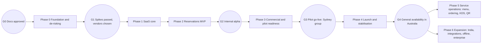

# Document 10 — Product Roadmap and Implementation Plan

Baseline: Documents 1–9, `decision-log.md`.
Tags: **[C]** confirmed · **[R]** recommended · **[A]** assumption · **[Q]** open.

> **Estimate honesty.** Effort ranges are **order-of-magnitude, low-confidence (±50%)**, expressed in *person-weeks (pw)* of engineering effort and assume AI-assisted development by a small senior team. They exclude the owner's decision time, external vendor lead times, legal work and customer discovery, which are listed separately as **dependencies**. They will be re-estimated bottom-up when the backlog exists (Stage F). **No implementation has started and none will start until the owner approves the documentation.**

---

## 1. Planning assumptions

| # | Assumption | Status |
|---|---|---|
| 1 | Team of **10** **[C, D-29]**; composition not yet given. Working assumption: ~6–7 engineers, 1 designer (UX/accessibility), 1 QA/test engineer, DevOps/security capability (shared or one person), 1 product owner | **[A]** — composition to be confirmed |
| 2 | No hard launch deadline for the Sydney group (D-23) | **[C]** |
| 3 | Release 1 = reservations-first (D-24); other modules later | **[C]** |
| 4 | Billing, identity, messaging providers selected in Phase 0 | **[R]** |
| 5 | Sydney group provides real volumes, workflows and a test branch | **[Q]** |
| 6 | Legal advisers engaged before Phase 3 (privacy, terms, commission payouts) | **[R]** |

If the team is smaller, calendar time scales up roughly inversely; Phase 0 spikes remain mandatory regardless.

---

## 2. Roadmap overview

### 2.1 Deviations from the proposed sequence (and why)
| Proposed in the brief | This plan | Reason |
|---|---|---|
| Phase 0 = documentation only | Phase 0 also includes **de-risking spikes** (reservation engine + load, RLS with pooling, identity/billing/messaging vendors) | The two existential risks (double-booking, tenant isolation) and vendor unknowns should be retired before building on them |
| Phase 3 = service operations (menu, orders, KDS, QR, payments) before commercial launch | Moved **after** Australian launch (Phase 5) | Confirmed scope: first release is reservations (D-24) |
| Phase 4 = notifications, reports, security assessment | **Notifications and deposits move into the MVP (Phase 2); security testing runs throughout; a formal assessment precedes pilot (Phase 3)** | Confirmations/reminders/no-show protection make a booking system usable; security cannot be last |
| Subscription foundation in Phase 1 | Entitlements in Phase 1; **live billing in Phase 3** | Entitlements touch every module; live billing is needed only before paying customers |
| Phase 5 includes Indian localisation | Kept, plus **a paper-test of India during Phases 0–1** | Country-pack design must not depend on Australia-only assumptions; India launch depends on unresolved provider/legal items |

---

## 3. Phase 0 — Foundation and de-risking

**Scope:** Approve architecture; set up the engineering foundation; retire the highest risks; decide vendors; engage advisers; discover real customer data.

**Deliverables**
- Owner decisions recorded (index document, Stage E items).
- Repository, CI pipeline with gates, infrastructure-as-code skeleton, dev and staging environments, secrets and baseline observability (Doc 7 §11 step 1).
- **Spike S-1 Reservation engine:** exclusion-constraint model, holds, allocation algorithm, concurrency + load test at the hot-spot scenario (Doc 9 §2.2).
- **Spike S-2 Tenant isolation:** RLS with composite keys, transaction-scoped context, pooler options (including RDS Proxy behaviour), isolation suite skeleton (ISO-01…22).
- **Spike S-3 Vendors:** identity (WorkOS vs Cognito), billing (Stripe Billing vs Chargebee, incl. India constraints), messaging RFQ (AU sender ID, India DLT), WAF/edge, observability backend, flag service, query-builder library.
- Spike S-4: managed PostgreSQL service/extension/version check; cost estimate via cloud calculator.
- Country-pack paper test: Australia, India, UK.
- UX design baseline for guest booking and host tools (using the prototype as context only), including accessibility approach.
- Load-test rig and data generators.
- Sydney group discovery: volumes, peak times, workflows, Square usage, contract obligations.
- Counsel engaged (AU privacy/commercial); pen-test vendor shortlisted.

**Dependencies:** owner approval of documentation (G0); access to the Sydney group; vendor sandbox accounts.
**Technical risks:** pooler/RLS incompatibility; allocation algorithm quality; managed-database extension gaps.
**Business risks:** vendor lead times (sender-ID registration, merchant onboarding); discovery reveals scope beyond reservations.
**Acceptance criteria:** concurrency test shows zero double-bookings under load; isolation spike proves no cross-tenant read through pooled connections; vendor ADRs approved; CI pipeline runs all gates on a sample module; estimates re-baselined with measured data.
**Testing requirements:** spike code is throwaway or promoted only through normal gates; measurements recorded.
**Effort:** 8–14 pw engineering (+ design 3–5 pw).
**Go-live prerequisites:** none (no customer exposure).

## 4. Phase 1 — SaaS core

**Scope:** The tenant platform without restaurant features: identity, organizations/brands/branches, roles/permissions, configuration with inheritance, entitlements, audit, platform admin, provisioning, lead registry.

**Deliverables**
- Identity integration, memberships, scoped roles, permission checks, MFA policy, invitation flows (IAM-01…04).
- Organization & Venues: provisioning API and admin UI, lifecycle states, branch management (ORG-01…03).
- Configuration & Localization: setting definitions, scoped values, locked settings, effective-settings resolver, **Australia country pack**, structure for India/UK (CFG-01…04).
- Subscription & Entitlements: plans, entitlement service, grants; billing connection stubbed behind the port (SUB-01, SUB-02).
- Audit module and event outbox (AUD-01, AUD-02).
- Platform admin console (provisioning, plans, support-access requests).
- Partner & Commission: partner and lead records, ownership assignment workflow (PRT-01, PRT-02).
- Tenant isolation test suite wired into CI as a release gate.
- Staff web app shell and design system with accessibility checks.

**Dependencies:** Phase 0 vendor decisions; design baseline.
**Technical risks:** configuration model complexity; RLS performance overhead; entitlement/permission confusion.
**Business risks:** over-building before customer feedback.
**Acceptance criteria:** all ISO tests pass; two seeded tenants (group and single venue) provisioned end-to-end; permission/scope/entitlement matrix tests pass; configuration inheritance examples from Doc 3 §4.4 reproduce; audit shows who/what/when for every admin action; MFA enforced for owner/admin roles.
**Testing requirements:** isolation, authorisation matrix, contract tests, migration rehearsal, accessibility checks on shell, security scans clean.
**Effort:** 25–40 pw.
**Go-live prerequisites:** none (internal).

## 5. Phase 2 — Reservations MVP

**Scope:** The restaurant product: floor setup, reservation engine, guests, host app, public booking, waitlist, notifications, deposits/card on file, enquiries, basic reporting.

**Deliverables**
- Floor & Resources: areas, tables, counter seats, combinations, service periods, closures (FLR-01…05).
- Reservations: availability, holds, confirmation (idempotent), atomic change, cancel, no-show, seat/finish/extend/move, pacing, dwell times, walk-ins, phone bookings (RES-01…07, RES-11, RES-12).
- Waitlist with expiry (RES-08); group enquiries and offers (RES-09).
- Guest module: records, notes (restricted), consent, merge/dedupe, history (GST-01…04).
- Notifications: templates per brand/language, scheduler, provider adapters (one SMS, one email), delivery log, opt-out, inbound reply (NTF-01…05).
- Deposits/card on file via provider-hosted pages and webhook handling (RES-10), including restaurant **merchant onboarding** flow (see Stage E).
- Public booking edge, hosted booking page and embeddable widget (INT-05).
- Host app (seating grid, floor view, list, waitlist, alerts) with realtime updates.
- Manager screens: layout, hours, rules, messages, activity.
- Operational reports v1 (REP-01).
- Integration Hub core: ports, webhook framework, reconciliation jobs (INT-01, 03, 04, 06).

**Dependencies:** Phase 1 complete; messaging provider and sender-ID registration; payment provider account; Sydney group workflow feedback.
**Technical risks:** allocation quality for real layouts (combinations, counters); realtime consistency; time-zone/DST errors; message deliverability.
**Business risks:** features diverge from how hosts actually work; deposit/fee wording needs legal review.
**Acceptance criteria:** all Must requirements RES/FLR/GST/NTF pass acceptance scenarios; concurrency and hot-spot tests pass; host can run a simulated full service (bookings, walk-ins, waitlist, moves) with no conflicts; end-to-end tests of critical journeys pass on desktop, tablet and mobile; performance targets in Doc 9 §3 met on S1 dataset; messages delivered in the test country with registered sender; WCAG 2.2 AA checks pass on key journeys.
**Testing requirements:** full pyramid (Doc 8 §10), DST/midnight tests, property tests on allocation, webhook fault tests, load tests, accessibility audit, usability sessions with real hosts.
**Effort:** 45–75 pw.
**Go-live prerequisites:** internal alpha only (G2): staging with real staff using synthetic data.

## 6. Phase 3 — Commercial and pilot readiness

**Scope:** Everything needed to charge, support, secure and operate the product for a first real customer.

**Deliverables**
- Live billing integration: subscriptions, per-branch quantity, trial, invoices, dunning, entitlement sync, customer billing history (SUB-01…05).
- **Messaging usage metering and allowance/overage billing** (new requirement from Doc 9 §6.4).
- Partner & Commission: accrual, clawback, ledger, approvals, payout runs and export, statements (PRT-03…06).
- Square read-only integration and guest-history enrichment (INT-02).
- Tenant data import tooling and onboarding checklist (see Stage E).
- Reporting enhancements, exports, scheduled reports (REP-02, REP-03).
- Security: independent penetration test and remediation; threat-model review; incident-response plan and exercise; sub-processor register; privacy notice and terms reviewed by counsel (Doc 6 §9).
- Operations: production environment, edge/WAF, backups and restore tests, monitoring and alerting, runbooks, status page, support process and tooling, on-call rotation.
- Disaster-recovery exercise and load tests at S1/S2 profile; cost per branch measured.
- Data-subject request tooling (export/delete) (GST-04).
- Pricing validated with customers; plan catalogue configured.

**Dependencies:** Phase 2 stable; billing vendor contract; counsel advice; pen-test slot; Square developer access; Sydney group pilot agreement.
**Technical risks:** billing/entitlement edge cases (proration, failed payments); ledger correctness; Square data mapping; production hardening.
**Business risks:** pricing misjudged (messaging cost); legal findings requiring product changes; pilot customer expectations.
**Acceptance criteria:** pen-test criticals/highs fixed; restore test meets RPO/RTO proposals; billing-to-entitlement round trip proven (trial → paid → failed payment → recovery → cancellation); commission ledger reconciles to invoices in test; isolation suite and checklist (Doc 6 §9) complete; runbooks exercised; pilot customer onboarded in staging with imported data; SLO dashboards live.
**Testing requirements:** failure injection (provider outage, duplicate/replayed webhooks), financial reconciliation tests, security test, DR drill, load/soak tests, UAT with pilot staff.
**Effort:** 30–50 pw.
**Go-live prerequisites (pilot, G3):** all acceptance criteria above; written confirmation from payment provider/acquirer of PCI scope; sender registration done; data-processing terms signed; support hours agreed; rollback and kill-switch rehearsed; pilot success criteria agreed.

## 7. Phase 4 — Launch and stabilisation

**Scope:** Pilot with the Sydney group, hypercare, then general availability for new Australian customers.

**Deliverables:** pilot at the Sydney group's **single branch** (D-32), then wider onboarding; onboarding playbook; support knowledge base; defect/usability fixes; performance tuning; second-wave customers (target 10 organizations / 100 branches in year 1 [C]); first quarterly restore test and game day; first cost-per-branch review; roadmap reprioritisation from feedback.

**Dependencies:** G3; sales partners trained (commission rules signed off); support capacity.
**Technical risks:** real-world data variety; peak-night incidents; integration edge cases.
**Business risks:** early churn from missing features; support overload; commission disputes.
**Acceptance criteria:** pilot runs ≥ N service weeks (N agreed, e.g. 4) without Sev-1 incidents or double-bookings; SLOs met; host satisfaction target met; no unresolved high-severity security findings; billing and commissions reconcile for the first cycles.
**Testing requirements:** production monitoring, synthetic probes, regression suites, chaos/game day, post-incident reviews.
**Effort:** 15–25 pw plus ongoing support and operations capacity.
**Go-live prerequisites (GA, G4):** pilot exit criteria met; onboarding and support processes scalable; legal documents final; pricing published.

## 8. Phase 5 — Service operations (Release 2)

**Scope (candidate, to be re-confirmed with customer demand):** Menu & Catalog (brand pricing, branch availability, modifiers), Ordering (waiter and guest QR), Kitchen Display, table-level payments, bill/tax, QR management, POS-port push (orders) where required; extending the same boundaries (Doc 2).
**Deliverables:** modules above; tax engine via country packs; payment at table; kitchen/waiter realtime; Square order push if validated; updated capacity tests (Doc 9 §7).
**Dependencies:** GA stable; decisions on native POS vs integration depth; PCI scope re-assessment.
**Risks:** much larger PCI/financial surface; hardware (printers, terminals); pressure to build native POS prematurely.
**Acceptance criteria:** defined per module with the same standard of scenarios, load tests and security review.
**Effort:** 80–140 pw (very low confidence).
**Go-live prerequisites:** PCI scope confirmation, financial reconciliation tests, kitchen/waiter UAT.

## 9. Phase 6 — Expansion

| Track | Scope | Dependencies / notes | Effort (very low confidence) |
|---|---|---|---|
| **India** | India country pack (INR, GST, locale, phone/address), providers for payments/billing/messaging, DLT registration, DPDP compliance work, possible India cell | Provider ADRs 04–06 resolved; counsel advice; gazetted DPDP rules; data-residency decision | 30–60 pw + vendor/legal lead time |
| **UK / other countries** | Country packs and adapters | Per-country legal checklist | 15–30 pw per country after India |
| **More POS integrations** | New adapters (e.g. Lightspeed/others per demand) | Customer demand | 8–15 pw each |
| **Offline host tablet** | Local store, sync protocol, conflict handling, status UI | Spike outcome; only host-safe operations (Doc 3/Stage C) | 30–50 pw |
| **Enterprise** | SSO per tenant, custom roles, dedicated cells, SLAs, advanced audit/export | Enterprise customer demand | 25–45 pw |
| **Advanced analytics** | Warehouse, cross-branch BI, export | Data volume and customer demand | 20–40 pw |
| **Loyalty / marketing** | Optional modules | Product validation | TBD |
| **Marketplace** | Separate consumer identity, consent-based sharing, listing | R-06 (future goal); legal/privacy design first | TBD |
| **Reserve with Google** | Verify programme requirements first | Not confirmed by research | TBD |

---

## 10. Effort summary and calendar view

| Phase | Engineering effort (pw) | Notes |
|---|---|---|
| 0 Foundation & de-risking | 8–14 | + design 3–5 pw |
| 1 SaaS core | 25–40 | |
| 2 Reservations MVP | 45–75 | |
| 3 Commercial & pilot readiness | 30–50 | |
| 4 Launch & stabilisation | 15–25 | + ongoing ops |
| **Release 1 total (Phases 0–4)** | **≈ 123–204** | |
| 5 Service operations | 80–140 | |
| 6 Expansion | per track | |

Illustrative calendar for a team of 10 (assumed ~6–7 engineers): 123–204 pw ÷ 7 ≈ 18–29 weeks of pure parallel work; adding a ~1.3× factor for coordination, dependencies between modules and the sequential Phase 0 spikes (more people do not scale linearly) gives **≈ 23–38 calendar weeks (≈ 5.5–9 months)** for Release 1, plus lead times for vendors, legal and the pilot period. Design, QA and DevOps run alongside and are not counted. This is a planning range, **not a commitment.** Re-estimate at the end of Phase 0 when spikes provide measured data.

The larger team shortens Phases 1–3 mostly by running modules in parallel (e.g. IAM/Organization, Floor/Reservations, Notifications/Integrations, Billing/Commission); the critical path remains Phase 0 spikes → reservation engine → pilot readiness.

### Critical path items to start early
1. Owner approvals and vendor decisions (Phase 0).
2. Messaging sender-ID registration (AU) and later India DLT — lead time unknown.
3. Payment provider account and restaurant merchant-onboarding approach.
4. Counsel engagement (privacy, terms, commission payouts).
5. Pen-test vendor booking.
6. Sydney group access (volumes, test branch, workflows).
7. Billing vendor contract and sandbox.

---

## 11. Quality gates by phase (summary)

| Gate | Evidence required |
|---|---|
| G0 – Docs approved | Owner sign-off on documents and Stage E critical items |
| G1 – Spikes passed | Concurrency and isolation spikes pass; vendors decided; estimates re-baselined |
| G2 – Internal alpha | Phase 2 acceptance; performance targets met at S1; accessibility audit |
| G3 – Pilot go-live | Phase 3 acceptance and go-live prerequisites |
| G4 – General availability | Pilot exit criteria; operational readiness; published pricing |

## 12. What is deliberately postponed (restated)
Microservices; multi-region active-active; separate analytics warehouse; dedicated search engine; native mobile apps; self-serve sign-up; native POS; menu/ordering/KDS/QR; offline client; marketplace; loyalty; inventory; staff scheduling.

## 13. Decisions requiring approval

| # | Decision | Recommendation |
|---|---|---|
| 1 | Revised phase sequence (§2.1) | Approve |
| 2 | Phase 0 spikes as a mandatory gate (G1) | Approve |
| 3 | Notifications and deposits inside the MVP | Approve |
| 4 | Usage-based messaging billing in Release 1 scope | Approve in principle (see Doc 9) |
| 5 | Team size and composition (needed to turn effort into dates) | **Needed from the owner** |
| 6 | Pilot success criteria and pilot length | Agree with the Sydney group |
| 7 | Phase 5 content to be reconfirmed after GA, not committed now | Approve |

## 14. Risks to the plan
1. Estimates are wide → re-baseline after Phase 0 and each phase.
2. Vendor and legal lead times extend the critical path → start in Phase 0.
3. Scope creep from customer-specific requests → classify each request (core / configurable / integration / later / decline) before accepting.
4. Key-person risk in a small team → documentation standards, module ownership with deputies.
5. Pressure to start Phase 5 before Release 1 is stable → stage gates.
6. **The pilot customer has one branch (D-32):** multi-branch hierarchy, inheritance, group roles and org-wide reporting cannot be proven by the pilot → find a multi-branch design partner or run structured multi-branch simulations with two or more real staff teams before GA; do not sell group features as proven until then.
7. **No contract/terms and no legal budget yet (D-30, D-34):** real guest data would be processed without terms of service, a data-processing agreement or counsel review → decide before G3; minimum viable legal set is listed in Doc 11 update.
8. **Business-hours support (D-31) vs evening service:** incidents on weekend evenings will not have staffed support → honest customer terms, automated alerting, rollback/kill-switch drills, peak-hour deploy freeze.

## 15. Next
Stage E architecture review (`11-architecture-review.md`) and the decisions index (`00-index-and-decisions.md`).

---

## 16. Update 2026-11-08 — new early critical-path items

1. **Company set-up (D-38):** no legal entity or product name yet. Needed before: signing customer terms, opening vendor accounts (cloud, Twilio, billing, identity, payments), ABN/GST registration, a business bank account, insurance, trade-mark and domain clearance for the chosen name. Start immediately; a rename later is costly.
2. **Messaging provider confirmation (D-39):** Twilio as the intended provider; confirm Australian sender-ID registration steps, India DLT handling, number strategy for two-way replies and carrier fees via a short vendor check in Phase 0 (spike S-3).
3. **Pilot branches (D-35):** identify which branches/customers.
