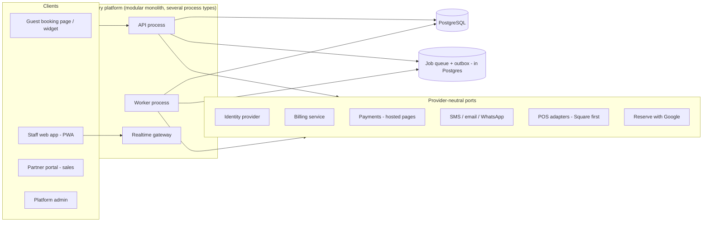
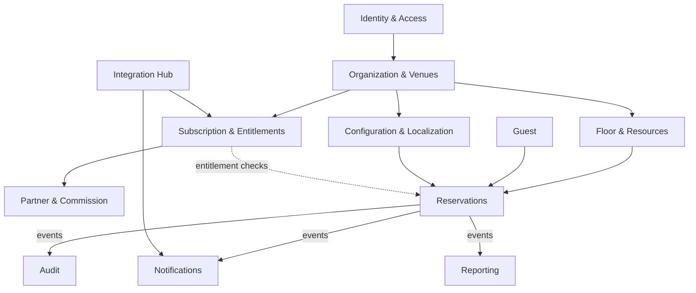

# Cheery — Stage C: Architecture Options and Recommendation

Status: **Recommendation for approval.** Nothing here is built. Evidence: Stage A analysis, `decision-log.md` (D-01…D-20, R-01…R-06), and the three research files in `research/` (about half of the stack facts are tagged `[S]` = search summary only; re-verify before spending money).

Labels used throughout: **Confirmed** (owner said so), **Recommended** (mine, needs approval), **Assumption**, **Needs approval**, **Future**.

---

## 1. Architecture style

| Option | Fit now | Verdict |
|---|---|---|
| Modular monolith | One deployable, strict module boundaries, one database, cheapest to run and change; ideal while the domain model is still moving | **Recommended** |
| Microservices | Independent deploy/scale per service; but distributed transactions around reservations, high ops load, team of unknown size | Not justified now |
| SOA / shared services | Same costs as microservices without the isolation benefits | No |
| Event-driven (internal) | Decouples modules (booking → notification, billing → commission) | **Adopt inside the monolith** via a transactional outbox |
| Hybrid | One codebase, several runtime processes (API, worker, realtime gateway, public booking edge) | **Recommended as the runtime shape** |

**Recommendation:** modular monolith, event-driven between modules through an outbox, deployed as a few process types from one codebase. Boundaries are enforced by automated architecture tests, not convention. A module may be extracted into a service later only when it has a measured scaling, security or team-ownership reason.

**Trade-off:** one shared release train and one database to protect. Mitigated by module-owned schemas, no cross-module table access, and backward-compatible migrations.



## 2. Multi-tenancy

| Model | Isolation | Cost / ops | Verdict |
|---|---|---|---|
| Shared DB, shared schema (`tenant_id` + row-level security) | Logical; strong only if enforced in the database | Lowest | **Default** |
| Schema per tenant | Better blast radius; migrations ×N | Medium-high | No |
| Database per tenant | Strongest; migrations ×N, pooling pain | High | Only for contract/regulatory cases |
| Hybrid | Shared by default, dedicated "cells" on demand | Medium | **Recommended** |

**Recommendation (hybrid):**
- All tenants start in a shared database. Every tenant-owned table carries `tenant_id`; PostgreSQL row-level security (RLS) is a **second wall**, not the only one. The application role is non-owner and non-`BYPASSRLS`.
- Tenant identity comes from the authenticated token, never from a client-supplied id. The tenant context is set per transaction (`set_config(..., true)`), and a request with no context returns no rows. PgBouncer transaction mode supports this; **RDS Proxy behaviour must be tested** (research item).
- A **tenant directory** maps tenant → cell (database + region). Code and schema are identical in every cell, so moving a tenant to a dedicated database or another region is a data migration, not a code change. This also gives the future AU / IN data-residency split.
- Isolation is enforced and tested at: API/authorisation, database (RLS), background jobs (tenant in job payload, context restored before work), cache keys, file paths, search/reporting views, webhooks and integration credentials (per tenant).
- **Do not partition reservations by time:** an exclusion constraint on a partitioned table must include all partition columns, which would break the overlap guard. Partition by tenant or not at all.

**Needs approval:** isolation test suite as a release gate (see §7).

## 3. Domain hierarchy (validated)

Proposed in the brief: Platform → Tenant → Group → Brand → Branch → Resources. Recommended refinement:

```
Platform
 └─ Organization (the tenant / customer account)        ← billing, entitlements, data residency
     ├─ Brand (0..n)                                    ← name, branding, menu/price defaults, templates
     │   └─ Branch / Venue (1..n)                       ← address, country, timezone, hours, rules
     │       └─ Area → Resource (table, counter seat)   ← combinations, capacity
     └─ Group: merged into Organization
```

- "Restaurant Group / Business" and "Tenant" are the **same boundary** in practice: one contract, one subscription, one data wall. Two levels would invite ambiguity. Keep **Organization** as the tenant; allow a single-restaurant customer to have one brand and one branch without any special mode.
- A branch belongs to exactly one brand and one country; a brand can span countries.
- **Membership model:** a person (identity) has memberships to an organization with a role scoped to the org, a brand, or specific branches. This is what supports "branch users cannot see other branches" and a 100-branch group.
- **Platform-level actors** (Cheery staff, sales partners) sit outside tenants and get explicit, narrow, audited access.

## 4. Module map

Consolidation of the 20 proposed domains (merge where data and rules move together):

| Module | Absorbs | Business responsibility |
|---|---|---|
| Identity & Access | IAM | login (via provider), memberships, roles, policy checks |
| Organization & Venues | tenant, brand, branch | hierarchy, provisioning/deprovisioning, status |
| Subscription & Entitlements | billing | plans, entitlements, trial, branch counts, billing-service sync |
| Partner & Commission | (new) | salespeople, lead ownership, commission plans, ledger, clawback, payouts |
| Configuration & Localization | restaurant config, localization | scoped settings with inheritance; country packs as data |
| Guest | guest & customer | guest records, consent, preferences, allergy notes, merge rules |
| Floor & Resources | table & seating, floor ops | areas, tables, combinations, service hours, table state |
| Reservations | booking, waitlist, enquiries | availability, allocation, holds, bookings, waitlist, group enquiries, policies |
| Notifications | communication | templates per brand/language, scheduling, delivery log, opt-out |
| Integration Hub | integration mgmt | ports, adapters, credentials, webhooks in/out, reconciliation |
| Audit | audit & activity | immutable, structured events |
| Reporting (read side) | analytics | operational reports from read models |

**Later, behind the same boundaries:** Menu & Catalog, Ordering, Kitchen Display, Payments (guest-side), QR, POS (native), Loyalty, Inventory, Staff Scheduling, Marketing.

Each module will get a one-page contract in Document 2 (responsibility, entities, owned tables, services, API surface, dependencies, events in/out, permissions, config, entitlement key, integrations). Rule: **a module owns its tables; others use its service interface or events, never its tables.**



## 5. Hard design problems and the recommended answer

| Problem | Recommendation |
|---|---|
| **Double-booking** | Allocation is a server transaction. Each resource-booking row has a time range; a PostgreSQL exclusion constraint (`btree_gist`, `tstzrange` including turn buffer, filtered to active statuses) makes overlaps impossible even under concurrency. Application logic proposes; the constraint decides. |
| **Slot holds** | Short-lived holds (seconds–minutes, TTL) created when a guest proceeds to checkout or deposit, so the table shown is the table kept. Confirmation is idempotent (client key). |
| **Config inheritance** | Settings stored as scoped rows (platform/country → organization → brand → branch) with a versioned, cached "effective settings" resolver. Overrides are explicit; the UI shows where a value comes from. |
| **Permission vs. entitlement vs. config** | Three separate checks: *permission* (can this person?), *entitlement* (did the customer's plan include it?), *setting* (is it switched on / how does it behave?). Modules call one entitlement service; feature flags are for rollout only, not plans. |
| **Time** | Store instants in UTC plus the branch time zone; model the "service day" explicitly (a 1 AM booking belongs to the previous service day). No fixed hours or offsets in code. |
| **Money & tax** | Integer minor units + ISO currency; tax as data (jurisdiction, rate, inclusive/exclusive, rounding rule) in the country pack; invoices store the tax lines computed at the time. |
| **Country packs** | A country pack is data + adapters: currency, locales, tax rules, address/phone formats, holidays, notification rules, payment/messaging provider mapping, consent defaults. Adding a country = new pack + any missing adapter; no core code change. Paper-tested on AU, IN, UK. |
| **Events** | Transactional outbox: a state change and its event commit together; consumers are idempotent. Webhooks in/out use signed payloads, retries with backoff, dead-letter, reconciliation jobs. |
| **Commission** | Append-only double-entry ledger. Commission plans are versioned per salesperson (rate, basis, duration). Earned on billing "paid" events; reversed on refund/chargeback/cancellation inside the clawback window. Lead assignment is a permissioned, audited action by management. Payout runs are approved batches. |
| **Audit** | Structured events (actor, tenant, entity, action, before/after, request id), append-only, separate from application logs. |
| **Offline (later)** | Not in release 1. Cheap readiness: client-generated ids, idempotency keys on all writes, change records as events. Later: host-tablet-only scope (view, seat walk-ins, mark arrivals/status); anything needing shared availability or money stays online. |

## 6. Technology recommendation (updated after research)

| Area | Recommendation | Status |
|---|---|---|
| Language/runtime | **TypeScript on Node LTS with NestJS** (one language across API, web, booking widget and future offline client). Runner-up: **C# / .NET 10 LTS** — choose it instead if the people who will maintain the product are stronger in it. Spring Boot is third. | **Needs approval (ADR-01)** |
| Database | **PostgreSQL 18** | Keep |
| Cache / realtime | Defer Redis; if needed use **Valkey**; realtime via WebSockets/SSE | Change |
| Jobs | Postgres-backed queue + outbox | Keep |
| Web | React + TypeScript; staff apps as PWAs; server-rendered booking pages; small embeddable widget | Keep |
| API | REST, contract-first OpenAPI, generated clients, versioned | Keep |
| Identity | Buy. Shortlist **WorkOS** and **Amazon Cognito**; Auth0 weakest on price; Keycloak only if you want to run it | Open (ADR-03) |
| Billing | Third-party behind a port; per-country provider; India recurring-payment and GST invoicing unresolved | Open (ADR-04) |
| Guest payments | Provider-hosted pages; SetupIntent-style saved card for no-show charges, not long holds; per-country provider (Stripe is invite-only in India) | Open (ADR-05) |
| Messaging | Provider interface; Australian Sender ID Register and India DLT registration are live constraints | Open (ADR-06, RFQ) |
| Hosting | AWS Sydney, ECS Fargate (no Kubernetes yet), infrastructure as code with **OpenTofu** | Keep / change |
| WAF/edge | Cloudflare vs AWS WAF | Open (ADR-08) |
| Observability / flags | OpenTelemetry + Sentry; OpenFeature | Keep |
| Offline later | PowerSync / RxDB / ElectricSQL — spike before choosing | Future |

## 7. Build now / prepare for / postpone

**Build now (release 1, per R-01):** Identity, Organization & Venues, Subscription & Entitlements (billing-service integration), Configuration & Localization (country-pack mechanism with Australia, structurally ready for India/UK), Guest, Floor & Resources, Reservations (incl. waitlist, enquiries), Notifications, Audit, Integration Hub (messaging, billing, hosted payment for deposits, Square read-only), basic operational reporting, tenant isolation test suite, CI/CD and observability baseline. Partner & Commission in a **minimal form** (partner records, lead assignment, plan, ledger, manual approve/payout export) because year 1 is about 10 customers.

**Prepare for (design the seam, don't build):** Menu/Ordering/KDS/QR, native POS, loyalty, offline client, marketplace (per R-06), second and third country, dedicated cells and data residency, SSO per tenant.

**Postpone:** microservices, multi-region active-active, separate analytics warehouse, usage-based billing, inventory, staff scheduling, native mobile apps, self-serve sign-up.

## 8. Challenges to the proposed phase order

1. **De-risk reservations first.** Reservation allocation + concurrency is the product's core risk; build a thin working slice of it (with the exclusion constraint and load test) in Phase 0, before the full SaaS core.
2. **Notifications and deposits belong in the MVP,** not Phase 4: confirmations, reminders and no-show protection are what make a booking system usable and are the main selling points.
3. **Entitlements early, billing later:** build the entitlement service in Phase 1 (cheap, touches everything); connect the billing vendor just before first paying customers.
4. **Commission module is minimal at first** (ledger + approvals + export) and grows with the sales team.
5. **Security and test gates from day one,** not a Phase 4 assessment: isolation tests, dependency scanning and architecture checks run on every change.
6. **Reports:** keep release 1 to operational views from read models; defer cross-branch analytics warehouse.

## 9. Decisions requiring approval

| ADR | Decision | My recommendation |
|---|---|---|
| 01 | Backend language | TypeScript/NestJS (runner-up .NET 10) |
| 02 | Tenancy | Shared DB + RLS, cell-ready (§2) |
| 03 | Identity vendor | Compare WorkOS vs Cognito by a short spike |
| 04 | Billing vendor | Compare Stripe Billing vs Chargebee against AU+IN+UK needs |
| 05 | Guest payments | Per-country provider interface; Stripe first for AU |
| 06 | Messaging | Provider RFQ (AU sender ID, India DLT) |
| 07 | Hosting | AWS Sydney, ECS Fargate, OpenTofu |
| 08 | WAF/edge | Decide with hosting design |
| 09 | Offline | Out of release 1; spike later |
| 10 | Hierarchy | Organization = tenant; no separate "group" level (§3) |

## 10. Risks and trade-offs

- Reservation correctness and tenant isolation are the two risks that can end the business; both are handled by database-enforced controls and release-gating tests rather than code review alone.
- A single shared database concentrates blast radius; mitigated by RLS, backups with tested restores, and the cell design.
- Country-pack flexibility can turn into over-engineering; mitigate by building the mechanism with Australia only and *paper-testing* India and the UK.
- Vendor lock-in is limited by ports, but vendor choice for billing/payments in India is genuinely unresolved and may need two providers.
- Some research facts are summaries; do not commit spend before re-verifying.

## 11. Open items

Sydney group status and other POS vendors; backend language preference or team skills; whether to run a reservation-engine spike in Phase 0 (recommended); pricing inputs (target margin and cost per branch) before tier prices can be drafted.
